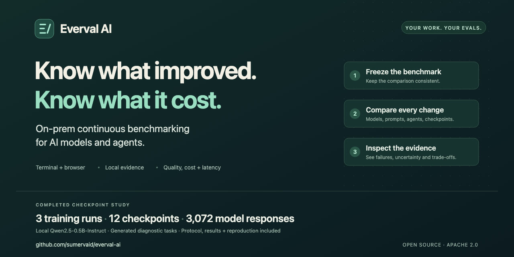
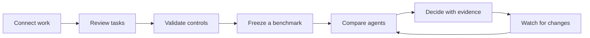

# Everval AI — On-prem continuous benchmarking for AI models and agents



Decide whether a model, prompt, or agent change is ready to ship. Everval turns your work into repeatable benchmarks, compares quality, cost, and latency, and keeps checking as your system changes.

For ML platform and evaluation engineers who need evidence on their own infrastructure: a terminal workbench, a shared CLI/API, and an optional review browser. Evaluate repository tasks, documents, structured data, and workflow simulations.

[Try it](#try-it-without-a-key) · [One complete workflow](docs/worked-example.md) · [Deploy on-premises](docs/on-premises.md) · [Measured checkpoint study](docs/benchmarks/checkpoint-study-2026-10-22/results.md)

## Try it without a key

Use Linux or macOS with a supported Node.js release (`^22.22.2 || ^24.15.0 || >=26.0.0`), an existing Python 3.12+ interpreter, and [uv](https://docs.astral.sh/uv/getting-started/installation/).

```sh
npm install --global everval-ai@0.3.1
everval setup
everval demo
```

**Choose the right installation:** npm 0.3.1 provides the packaged evaluation workbench. For the latest source features, including checkpoint monitoring, use the [source quickstart](docs/quickstart.md#install-from-source). With npm, omit `uv run` from source-based guides.

Watch a passing reference, a deliberate regression, and a restored candidate run across three examples. Inspect failures, compare the same frozen tasks, and keep the evidence locally. **The installed demo makes zero model calls and needs no Docker or network connection.** Dependency installation may use the network.

These are installation controls, not a model leaderboard. [Open the demo in tmux](docs/demo.md) or [connect your own repository](docs/guided-run.md).


*The actual terminal workbench. These results are original installation controls.*

## What you can do

| Your question | Everval's workflow |
| --- | --- |
| **Did our coding agent improve?** | Reconstruct tasks from repository history, validate fail-before/pass-after behavior, freeze a cohort, and compare systems. [Repository guide →](docs/github.md) |
| **Which model works best on each of our benchmarks?** | Scan a model-by-benchmark matrix, switch quality/cost/latency, and inspect the exact evidence. [Rankings →](docs/rankings.md) |
| **Is the cheaper model good enough?** | Compare success, cost per passing attempt, and latency on the same workload. Retain errors and unknown accounting. [Economics →](docs/cost-latency.md) |
| **What broke after a change?** | Link runs to revisions, inspect failure evidence, and regrade stored outputs without another model call. [Investigate →](docs/diagnostics.md) |
| **Can we keep checking automatically?** | Schedule bounded screening, escalate to full evaluation, and inspect recurring budget projections. [Autopilot →](docs/autopilot.md) |
| **Which configuration should we ship?** | Compare saved candidates, validate the selected candidate against a reserved holdout, and review a proposal. [Research lab →](docs/research-loop.md) |
| **How is a model changing during training?** | Follow declared checkpoints, inspect paired uncertainty and qualification gaps, investigate regressions, and validate evaluation mixes. [Post-training →](docs/post-training.md) |
| **Can this evaluate more than code?** | Use reviewed document, structured-data, and workflow tasks with explicit success criteria. [Task packs →](examples/community/README.md) |

**Current source addition:** [Checkpoint monitoring](docs/post-training.md) is available from the source checkout; the published npm 0.3.1 package predates this workflow. [Read the completed checkpoint study](docs/benchmarks/checkpoint-study-2026-10-22/results.md): three actual local QLoRA training runs, twelve checkpoints, and 3,072 model responses, with a frozen protocol, withheld validation, plots, and [reproduction instructions](scripts/posttraining/SETUP.md).

The terminal is the primary interface: fourteen views, a command palette, tmux sessions, and a durable local worker. The CLI and API use the same core. An optional browser gives reviewers blinded assignments and role-based access. [See the product tour →](docs/product-tour.md)

## From real work to a decision



An engineering owner curates the work. An evaluation engineer validates the tasks. A platform owner runs comparisons within a budget. A decision owner reviews the evidence. [Choose your team's workflow →](docs/enterprise-workflows.md)

Repository tasks must fail before the original fix, pass afterward, and preserve selected baseline behavior. Agents receive the starting point and issue statement; hidden checks and reference solutions stay with the evaluator. Infrastructure failures and empty test runs cannot establish validity. [Read the validation contract →](docs/benchmarks.md)

## Start your own workspace

After the demo, start a separate workspace with the original starter collections:

```sh
everval init --starters
everval tmux
```

From a source checkout, prefix these commands with `uv run`. Install [tmux](https://github.com/tmux/tmux/wiki) for the session launcher, or run `everval tui` directly. Press **Ctrl+L** for rankings, **Ctrl+N** to connect a repository, **F9** for a guided run, and **Ctrl+P** for commands. In the current source checkout, **Ctrl+T** opens training checkpoints. **Ctrl+B, D** detaches tmux while queued work continues.

Python and JavaScript/TypeScript repository execution require Docker and a prepared runtime. GitHub onboarding uses Git and the [GitHub CLI](https://cli.github.com/). Node.js is needed for the npm launcher or to build the optional browser interface from source. [Setup and first experiment →](docs/quickstart.md)

## Evidence you can inspect

The [0.3.1 acceptance record](docs/evidence/2026-10-15/README.md) includes:

- **114/114 single-turn OpenAI acceptance trials passed** across 19 original starter tasks, three models, and two repetitions.
- **135 repository and pack checks**, plus **21 Docker/GitHub checks** with no skips.
- Terminal, browser, access controls, worker recovery, spending limits, and backup/restore exercises.
- **$0.482999 estimated provider cost across 179 acceptance calls**, with no unsettled usage.

These single-turn acceptance trials exercised API compatibility and grading on small original tasks; models did not use tools or attempt autonomous repository repairs. The repository and Docker checks exercised installation controls. This evidence does not rank models or establish performance on customer repositories. Costs use recorded tokens and configured rates, not invoice reconciliation. Earlier attempts, excluded trials, overlapping checks, and deployment limits remain in the record.

[Results and artifacts](docs/evidence/2026-10-15/README.md) · [Reproduce acceptance](docs/release-acceptance.md) · [Verification scope](docs/verification.md)

The separate [public repository pilot](docs/benchmarks/public-repositories-2026-10-15/results.md) has finished all 16 scheduled attempts. Of 12 selected test tasks, seven passed admission and five were excluded. Review resolved 6/12 selected tasks and baseline 4/12 (6/7 and 4/7 admitted), while all four comparable graded pairs tied. The difference came from ungraded baseline API interruptions, so no repair-quality improvement is demonstrated. Four unknown requests remain fully reserved after an explicit [accounting amendment](docs/benchmarks/public-repositories-2026-10-15/recovery.md). Known cumulative provider spending is $3.367754; the budget commitment is $3.859489. Inspect the [final metadata](docs/benchmarks/public-repositories-2026-10-15/final-summary.json), [original partial export](docs/benchmarks/public-repositories-2026-10-15/partial-summary.json), [protocol](docs/benchmarks/public-repositories-2026-10-15/methodology.md), and [reproduction recipe](scripts/benchmarks/README.md).

The separate [checkpoint study](docs/benchmarks/checkpoint-study-2026-10-22/results.md) trained Qwen2.5-0.5B-Instruct locally. In both withheld validation runs, exact JSON-contract success reached 64/64 for routing (from 0/64) and extraction (from 6/64). Arithmetic remained 0/64, making retention inconclusive. A suite selected before validation used 37.7% less recorded provider-call time in a counterfactual replay, with 1.56 percentage-point mean absolute change-estimation error. No reference regressions occurred, so detection recall is undefined. These are generated diagnostics with shared templates; they do not establish customer performance or general capability gains.


*Actual local inference on generated tasks. Each line is one training seed; the validation runs reuse the same withheld task cohort. [Methods, uncertainty and all baseline results →](docs/benchmarks/checkpoint-study-2026-10-22/results.md)*

## Your workspace, your evidence

Workspaces live locally; the default is `~/.local/share/everval`. Set `EVERVAL_DATA_DIR` to choose another disk. There is no telemetry or automatic result upload. Hosted inference is an explicit choice requiring configured prices, credentials, and a budget.

Imported code runs in supported isolated runtimes. Hidden graders, traces, credentials, and repository mirrors stay outside Git. [Storage, network, and operating boundaries →](docs/operations.md)

The supported deployment is one on-premises workspace and worker, with optional authenticated browser roles. Follow the [enterprise installation guide](docs/on-premises.md) for service templates, internal inference, access, backups and upgrades. SSO, tenant isolation, distributed execution, and compliance certification are outside this release. [Current scope](docs/PLAN.md) · [Security](SECURITY.md)

## Make it useful for your team—and others

Start with a [runnable example](examples/community/README.md), contribute a well-tested [task pack](docs/community-packs.md), or improve the path you just used. A useful contribution includes the problem, a small reproduction, and evidence of what changed.

[Documentation](docs/index.md) · [Use cases](docs/use-cases.md) · [Contribution guide](CONTRIBUTING.md) · [Roadmap](ROADMAP.md) · [Support](SUPPORT.md) · [Changelog](CHANGELOG.md) · [Cite](CITATION.cff)

Original project material is licensed under [Apache-2.0](LICENSE). Imported work retains its own permissions; bundled web dependencies retain their [notices](web/public/assets/third-party-notices.txt). Developed by Sumer S. Vaid and contributors.
