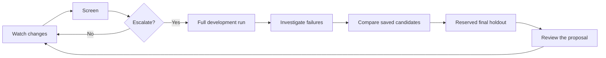
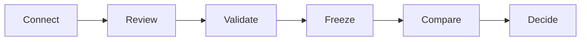
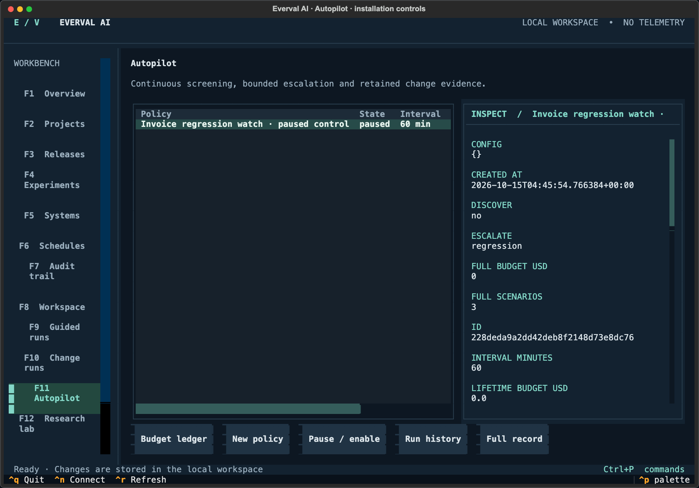

# Everval AI

**Continuous evaluation for agents doing real work.**

Everval AI turns an organization's real work into validated benchmarks and repeatable decisions about the agents it deploys. It brings task curation, controlled execution, cost and latency analysis, human review, and ongoing evaluation into one local workspace, with a tmux terminal interface and a shared CLI/API. The same engine evaluates code, documents, structured data, and workflows.

Source is maintained in this **private repository**. Workspaces, repository mirrors, hidden graders, model traces, and credentials stay outside Git.

The [0.3.1 verification record](docs/verification.md) separates installation controls, live-provider evidence, and deployment limits. Follow the [release acceptance procedure](docs/release-acceptance.md) or inspect the [dated evidence record](docs/evidence/2026-10-15/README.md).

## Try it without a model key

After `uv sync --frozen`, run:

```sh
uv run everval demo
```

The local walkthrough shows a behavioral regression, failure evidence and a passing candidate across code contracts, grounded document answers and structured data. It writes an inspectable evidence bundle without network access, Docker or a model key. These are **installation controls**, clearly separated from live agent measurements. [Walkthrough and examples](docs/demo.md).

## Keep improving after the first evaluation



**[Autopilot](docs/autopilot.md)** checks configured changes or intervals, reserves a cumulative budget and runs a small screening workload before optional full evaluation. **[Research lab](docs/research-loop.md)** retains grading reproductions, reduced outputs and grader-quality signals. Configuration studies compare explicit model, prompt and tool-budget candidates, then validate a selected candidate once against a reserved holdout. Deployment remains a reviewed decision.

**[Community packs](docs/community-packs.md)** carry versioned tasks, provenance, licenses and runtime contracts. Imports are staged for independent behavior review and control validation. **[Budget projections](docs/budget-planning.md)** separate observed costs, reservations and assumptions before recurring work starts.

## Workflow at a glance



An **engineering owner** connects a GitHub or local repository and reviews tasks from real changes. An **evaluation engineer** validates the tasks and freezes a benchmark. A **platform owner** compares systems; a **decision owner** reviews quality, cost, and latency evidence, applies a policy, and schedules follow-up runs.

[Start a guided run](docs/guided-run.md) · [Follow the terminal workflow](docs/terminal.md) · [See the validation contract](docs/benchmarks.md)

## Built for the full evaluation lifecycle

Everval builds on established practices in software testing and model evaluation: historical task reconstruction, hidden checks, regression testing, frozen comparisons, and expert review. It connects these foundations into a workflow that teams can operate, inspect, and improve over time.

The product extends benchmark execution with reviewed task creation, versioned evidence, live agent adapters, cumulative spending controls, authenticated decisions, and a path from production failures back into validated tests. Each decision stays connected to the workload, configuration, outcomes, and costs that support it.

| Everval capability | What it lets you do |
| --- | --- |
| **Local terminal operations** | Work in a tmux TUI, CLI, or API; keep workspace records locally and let durable queued work continue after the terminal closes. |
| **Benchmark history** | Inspect a persistent candidate and rejection ledger, review issue statements, repeat validation, and freeze versioned development/holdout releases with release diffs. |
| **Tasks beyond code** | Author or import document, structured-data, and workflow-simulation collections into the same evaluation engine. These tasks are curated separately from repository mining. |
| **[Cost, latency, and quality](docs/cost-latency.md)** | Compare compatible frozen cohorts, inspect uncertainty and individual attempts, and retain cost, latency, errors, and missing accounting alongside task success. |
| **Explicit decision policies** | Set quality, completion, error, cost, latency, and regression gates; version policies and retain their decisions with the supporting evidence. |
| **Existing agents** | Connect a versioned live agent adapter or import recorded submissions; retain usage, revisions, and bounded traces. |
| **Failure investigation** | Group failures, inspect file differences and stage timings, and regrade recorded outputs without another model call. |
| **Ongoing evaluation** | Watch configured changes, screen before escalating, retain automatic pure-grader investigations, cap recurring spending, and inspect benchmark health. |
| **Controlled improvement** | Compare frozen configuration candidates, reserve an unused holdout, and retain a reviewable proposal without deploying it. |
| **Portable benchmark packs** | Inspect versioned, licensed data-only packs; review expected behavior and validate controls before admission. |
| **Team decisions** | Assign blinded comparisons with frozen rubrics, enforce personal identities and API roles, and retain review decisions. |
| **Production feedback** | Redact and stage real examples, review expected behavior, then publish control-validated task collections. |

These capabilities are implemented in Everval. Read the [methodology and design](docs/METHODOLOGY.md) for the principles connecting them. Everval supports Python and JavaScript/TypeScript repository validation, offline private dependencies, and one local workspace with optional authenticated browser roles. See [delivery status and deployment boundaries](docs/PLAN.md).



*The terminal workbench, displaying original installation controls.*

## Start in the terminal

Install Python 3.12+, [uv](https://docs.astral.sh/uv/), and optionally [tmux](https://github.com/tmux/tmux/wiki). GitHub onboarding uses Git and the [GitHub CLI](https://cli.github.com/). Coding evaluation needs Docker and a compatible local runtime image; see [runtime setup](docs/sandbox.md).

```sh
git clone https://github.com/sumervaid/everval-ai.git
cd everval-ai
uv sync --frozen
uv run everval init --starters
uv run everval tmux
```

Without tmux, run `uv run everval tui`. Node.js is required only to build the optional web interface.

The workbench provides twelve views: **Overview · Projects · Releases · Experiments · Systems · Schedules · Audit · Workspace · Guided runs · Change runs · Autopilot · Research lab**. Use **F1–F12** to navigate, **Ctrl+P** for commands, **Ctrl+N** to connect a repository, and **Ctrl+R** to refresh. A separate worker retains queued work when the terminal closes. In tmux, **Ctrl+B, D** detaches the session.

[Terminal walkthrough](docs/terminal.md) · [First experiment](docs/quickstart.md) · [GitHub onboarding](docs/github.md)

## From a repository to a benchmark

1. **Connect.** Paste a GitHub URL or `owner/repository`, or choose a local Git repository. GitHub imports use a private bare mirror; imported code is never checked out or executed on the host.
2. **Discover.** Inspect merged PR candidates, lineage evidence, missing context, and rejection reasons. Paginate through older work without losing the candidate ledger.
3. **Review.** Write an independent issue statement that describes the desired behavior without disclosing the fix. Review identity is a local label.
4. **Prepare.** Inspect dependency declarations. Prepare a pinned Python/pytest or JavaScript/TypeScript runtime. Import inspected private dependency archives when required, or select a compatible local image.
5. **Validate.** Repeat clean before/after runs. A repair must fail before the original fix, pass afterward, and preserve selected baseline behavior. Infrastructure failures, zero tests, inconsistent outcomes, and unclear lineage cannot establish validity.
6. **Release.** Freeze accepted tasks into versioned development and holdout collections. Choose the partition explicitly; old releases retain their original evidence.
7. **Evaluate.** Select a model or harness, declare prices and budget, and inspect every attempt. Compare compatible cohorts, apply quality gates, add human reviews, and export results.

Python supports constrained literal function cases and prepared full-repository pytest profiles. JavaScript/TypeScript supports prepared node:test, Jest, and Vitest profiles with npm lockfiles. Private packages are imported as inspected offline wheels or npm archives; repository install hooks and native source builds are disabled. See the [benchmark contract](docs/benchmarks.md), [Python environments](docs/environments.md), and [JavaScript/TypeScript guide](docs/javascript-typescript.md).

## Built for different responsibilities

| Responsibility | Workflow |
| --- | --- |
| Engineering owner | Connect repositories, review candidate quality, inspect reconstruction and regression evidence. |
| Evaluation engineer | Freeze releases, separate development from holdout, configure harnesses, compare results. |
| Platform or model owner | Set provider credentials, prices, limits, and run schedules; inspect cost and latency. |
| Quality reviewer | Examine trial evidence and append judgments without replacing automated outcomes. |
| Decision owner | Read cohort coverage, uncertainty, failures, and policy decisions before accepting a system. |

Operate one local workspace. Optional team mode enforces **administrator, operator, reviewer, and viewer** roles with individual, expiring, revocable tokens. Assigned reviewers receive blinded evidence; viewers receive summaries. The terminal and filesystem remain trusted operator surfaces. SSO, tenant isolation, distributed workers, and compliance certification are outside this release. See [team access and review](docs/team-review.md).

## Cost and latency in practice

Compare **pass rate, cost per passing attempt, median duration, and p95 duration** on the same frozen workload. Spending on unsuccessful attempts stays in cost per pass. Missing accounting remains unknown.

Live duration covers the complete attempt, with separate submission, provider, tool, and grading timing coverage. Workspace, repository, and recurring-schedule caps limit cumulative admissions. The economics view shows the observed quality/cost/latency frontier. Use quality, spending, and duration gates together to identify systems that meet the workload's requirements. The experiment budget controls combined run admission; a cost gate evaluates each system's recorded spend.

[See the metric definitions and a worked decision example](docs/cost-latency.md).

## Installation controls

The four original starter collections contain 19 scenarios. Their reference and incomplete controls verify installation; their results are **not model performance measurements**. No paid model calls are needed for the test suite.

The document, data, and workflow starter collections are version 1.1.0. Their nine structured tasks publish the required output types, casing, citations, ordering, and state transitions in the task itself. Existing frozen experiments retain their original contracts.

## Choose a guide

| Task | Guide |
| --- | --- |
| Connect and curate a repository | [GitHub](docs/github.md), [benchmark validation](docs/benchmarks.md) |
| Prepare repository dependencies | [Python](docs/environments.md), [JavaScript/TypeScript and private packages](docs/javascript-typescript.md), [sandbox](docs/sandbox.md) |
| Configure a model or tool harness | [Providers](docs/providers.md) |
| Evaluate an existing agent | [Live adapters](docs/agent-adapters.md), [recorded submissions](docs/submissions.md) |
| Diagnose a failed attempt | [Failure investigation](docs/diagnostics.md) |
| Evaluate changes and recurring work | [Change-linked runs and digests](docs/change-evaluation.md), [benchmark health](docs/guided-run.md) |
| Assign reviews and learn from production | [Team review](docs/team-review.md), [production cases](docs/production-cases.md) |
| Author document, data, or workflow tasks | [Scenarios](docs/scenarios.md) |
| Run continuously and improve configurations | [Autopilot](docs/autopilot.md), [research lab](docs/research-loop.md), [budget planning](docs/budget-planning.md) |
| Try or contribute a portable task pack | [Free demo](docs/demo.md), [community packs](docs/community-packs.md) |
| Interpret evidence and set a gate | [Results](docs/results.md), [cost and latency](docs/cost-latency.md), [quality policies](docs/policies.md) |
| Operate and recover a local workspace | [Operations](docs/operations.md) |
| Understand implementation and scope | [Methodology](docs/METHODOLOGY.md), [architecture](docs/ARCHITECTURE.md), [interfaces](docs/INTERFACES.md), [delivery status](docs/PLAN.md) |
| Verify an installed release | [Release acceptance](docs/release-acceptance.md), [verification record](docs/verification.md), [dated evidence](docs/evidence/2026-10-15/README.md) |
| Develop or contribute | [Contributing](CONTRIBUTING.md) |

## Storage and network

Default data location: `~/.local/share/everval`. Set `EVERVAL_DATA_DIR` to a local disk; `CVALS_DATA_DIR` remains a compatibility alias. The `cvals` executable also remains available.

There is no telemetry or automatic result upload. GitHub onboarding reads the chosen repository. Environment preparation can download supported public wheels or pinned npm dependencies. Private packages enter through inspected offline imports; registry credentials do not enter benchmark containers. A configured hosted model receives public task material; hidden checks and reference solutions are excluded. Remote inference requires explicit opt-in, declared prices, and a budget. Local storage and local inference are separate choices.

Keep credentials in environment variables. Set them before starting the worker. Treat full experiment exports and private grading bundles as sensitive workspace data.

## Development

Install Node.js for the web checks, then run:

```sh
make setup
make check
make test
```

`make setup` also builds the optional web interface; `uv run everval serve` serves it on loopback. Dependencies are locked in `uv.lock` and `web/package-lock.json`. Live Docker and GitHub checks require explicit test flags; ordinary tests do not call paid providers.

## License

Original project material is licensed under [Apache-2.0](LICENSE). Imported repositories and datasets retain their own permissions. Bundled web dependencies retain their [third-party notices](web/public/assets/third-party-notices.txt). Everval AI is developed by Sumer S. Vaid and contributors.
