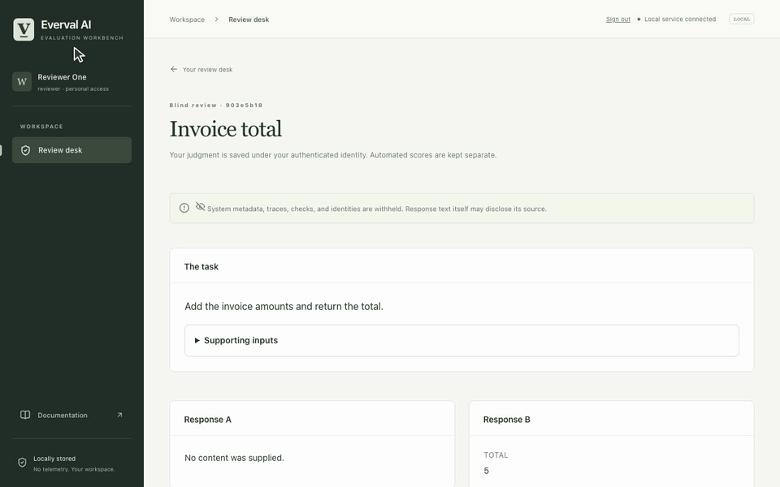
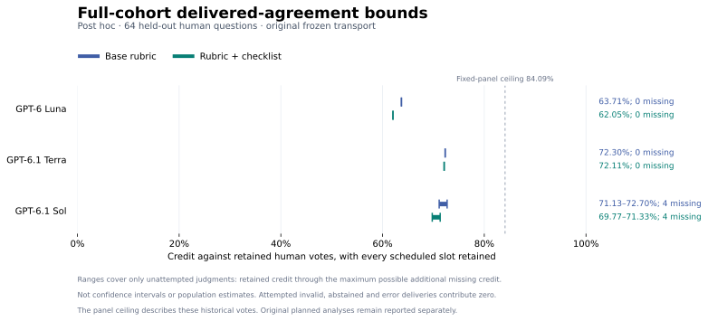

# Everval AI — On-prem continuous benchmarking for AI models and agents

[](https://github.com/sumervaid/everval-ai/actions/workflows/validation.yml)

[Quickstart](#try-it-without-a-key) · [Daily updates](UPDATES.md) · [All demos](docs/demos.md) · [Research finding](#inspect-the-evidence) · [On-prem deployment](docs/on-premises.md)

**~10% lower estimated judging cost in a 64-question study.**

Everval measured **9.8% lower estimated cost** for GPT-6.1 Terra's standard rubric versus its checklist rubric, with **72.30% versus 72.11% observed agreement with human votes**. The quality difference was not statistically established. [Read the study](docs/benchmarks/judge-study-2026-10-27/results.md).

Turn your own work into repeatable evaluations. Compare models, prompts and agents; track quality, cost and latency; keep checking as your system changes.

[](docs/demos.md)

*One continuous 46-second workflow. [Watch the full-resolution video](docs/assets/demos/recordings/everval-tour.mp4) · [Try it locally](#try-it-without-a-key).*

| Terminal workbench · 16s | Anonymous review · 27s |
| --- | --- |
| [](docs/demos/terminal-workbench.md) | [](docs/demos/blind-reviewer.md) |
| Navigate the workbench and inspect saved evidence. | Review answers before model identities are revealed. |

*These looping recordings show the actual interfaces using original demo data and a scripted reviewer account. They are separate from the research study above. [Explore all workflows](docs/demos.md) · [Browse still images](docs/demo-stills.md).*

## Try it without a key

Start from source to use the features shown in the demos. You need Linux or macOS, Git, Python 3.12+, and [uv](https://docs.astral.sh/uv/getting-started/installation/). Run these commands in one shell:

```sh
git clone https://github.com/sumervaid/everval-ai.git
cd everval-ai
uv sync --frozen

mkdir -p "$HOME/.local/share/everval/demos"
everval_demo_dir="$(mktemp -d "$HOME/.local/share/everval/demos/walkthrough.XXXXXX")"
uv run everval demo --workspace "$everval_demo_dir"
EVERVAL_DATA_DIR="$everval_demo_dir" uv run everval tui --no-worker
```

The walkthrough compares a passing baseline, a deliberate regression, and a restored candidate across three original examples. Expect **3/3 → 0/3 → 3/3**. Open **Experiments** to inspect the failures and retained evidence; press **Ctrl+P** for commands.

The installed demo works offline without a model key or Docker. Dependency installation may use the network. These controls verify the installation; they do not measure model quality. For a persistent tmux session, install tmux and replace the last command with `EVERVAL_DATA_DIR="$everval_demo_dir" uv run everval tmux`.

For the optional browser, install a [supported Node.js release](docs/npm.md#first-session), build the assets, and open the same workspace:

```sh
npm ci --prefix web
npm run build --prefix web
uv run python scripts/build_web.py
EVERVAL_DATA_DIR="$everval_demo_dir" uv run everval serve --no-worker
```

Follow the [first-session guide](docs/quickstart.md) to create your own workspace, connect a repository, and prepare a real evaluation.

### Packaged alternative

[npm 0.3.1](docs/npm.md) includes the packaged workbench and browser. It predates chat, double-blind studies, and checkpoint monitoring; use source for those features. It requires supported Node.js, Python 3.12+, and uv.

```sh
npm install --global everval-ai@0.3.1
everval setup
everval demo
```

## What you can do

| Workflow | What Everval records |
| --- | --- |
| [Repository benchmarks](docs/guided-run.md) | Reviewed tasks, fail-before/pass-after controls, hidden checks, and frozen benchmark releases. |
| [Documents, data, and workflows](docs/scenarios.md) | Explicit task contracts, reference outputs, grading checks, and reusable collections. |
| [Rankings and economics](docs/rankings.md) | Quality, cost, latency, coverage, and the evidence behind each comparison. |
| [Recurring benchmarks](docs/chat.md) | Plain-language setup, schedules, spending limits, and local HTML/CSV/JSON/Markdown reports. |
| [Failure investigation](docs/research-loop.md) | Saved failures, regrading, candidate comparisons, and reserved holdout decisions. |
| [Calibrated LLM judges](docs/judge-calibration.md) | Human-vote agreement, paired rubric comparisons, order effects, repeatability and evaluator-only references. |
| [Double-blind review](docs/double-blind.md) | Randomized response pairs, frozen rubrics, locked judgments, and explicit identity release. |
| [Checkpoint monitoring](docs/post-training.md) | Training trajectories, paired comparisons, regression investigations, and evaluation qualification. |

For example, with the named systems and collection configured in your workspace:

> Compare Support baseline and Support candidate on Support tickets every two weeks. Save HTML and CSV reports. Budget $2 per run and $20 total.

Everval asks for missing details and retains the conversation, runs, and reports. Keep a worker running for scheduled work. [Try the chat walkthrough](docs/chat.md), or follow [one shopping-cart bug from discovery to decision](docs/worked-example.md).

## Deploy on your infrastructure

Operate one local workspace with a dedicated worker. The [on-premises guide](docs/on-premises.md) covers service templates, internal inference, authenticated browser roles, disconnected installation, backups, and upgrades.

Workspaces default to `~/.local/share/everval`; set `EVERVAL_DATA_DIR` to choose another location. Telemetry and automatic result uploads are off. Hosted inference requires explicit configuration, credentials, prices, and a budget. Repository execution requires a supported prepared Docker runtime.

SSO, tenant isolation, and distributed execution are outside this release. Double-blind review trusts workspace operators and does not conceal prompts from hosted providers. See [operating boundaries](docs/operations.md), [current scope](docs/PLAN.md), and [security](SECURITY.md).

## Inspect the evidence

Read the [daily updates](UPDATES.md) for dated changes, findings, verification and release status.

The headline comes from a complete 64-question GPT-6.1 Terra comparison: the standard rubric cost **$0.624685** versus **$0.692560** for the checklist across **256 judgments per arm**, a **9.8% reduction in estimated cost**. Agreement with historical human votes was **72.30% versus 72.11%**. The original checklist-minus-standard change was −0.20 percentage points, with a multiplicity-adjusted interval of −2.15 to +1.76 points. These are conservative usage-based estimates for the tested configurations.

[](docs/benchmarks/judge-study-2026-10-27/results.md)

*The chart uses original frozen scores. Its ranges cover unattempted judgments; they are not confidence intervals. [Read the study](docs/benchmarks/judge-study-2026-10-27/results.md) for the planned comparisons, human-vote provenance, judgments checked against archived test reports, and the separate audit of ten transport-parser failures.*

**Fresh repository study:** on 50 admitted tasks, the constrained one-shot setup produced 110 explicit empty patches and 24 rejected patches across 150 attempts. Only 16 submissions reached test execution. [See the audited repair results and failure breakdown](docs/benchmarks/judge-study-2026-10-27/fresh-results.md).

- [Calibrated-judge and distribution acceptance](docs/evidence/2026-10-27/README.md): live product judge calls, actual Inspect compatibility, and installed Python/npm checks.
- [Release acceptance](docs/evidence/2026-10-15/README.md): installed-package, interface, accounting, and bounded API checks.
- [Public repository pilot](docs/benchmarks/public-repositories-2026-10-15/results.md): completed attempts, exclusions, and unresolved accounting; no repair-quality improvement demonstrated.
- [Checkpoint study](docs/benchmarks/checkpoint-study-2026-10-22/results.md): three local training runs, twelve checkpoints, and 3,072 responses on generated diagnostics.

Read [four measurement decisions](docs/measurement-design.md) for the admission, comparison, grading and blinding tradeoffs, or [export a judge campaign to Inspect](docs/inspect.md).

Each record includes methods and limitations. Installation controls and generated tasks do not establish representative customer performance. [Verification scope](docs/verification.md) · [Study reproduction](scripts/posttraining/SETUP.md).

## Contribute

Start with a [runnable task pack](examples/community/README.md), a reproducible issue, or a focused improvement. Read [Contributing](CONTRIBUTING.md), [Roadmap](ROADMAP.md), and [Support](SUPPORT.md).

Licensed under [Apache-2.0](LICENSE). Imported material retains its permissions and [dependency notices](web/public/assets/third-party-notices.txt). Developed by Sumer S. Vaid and contributors.
