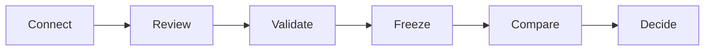
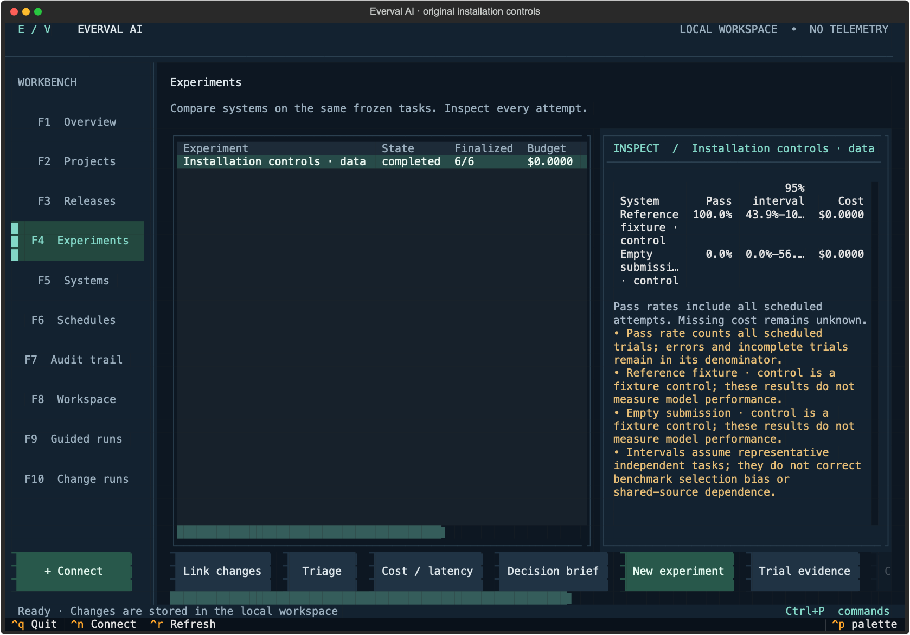

# Everval AI

**Turn real work into repeatable evidence.**

Everval AI is a local evaluation workbench with a keyboard-first terminal interface, a styled tmux workspace, and a shared CLI/API. Connect a GitHub repository, curate engineering tasks from merged pull requests, validate each task, and compare systems against a frozen benchmark. The same evaluation engine supports document, data, and workflow tasks.

Source is maintained in this **private repository**. Workspaces, repository mirrors, hidden graders, model traces, and credentials stay outside Git.

## Workflow at a glance



An **engineering owner** connects a GitHub or local repository and reviews tasks from real changes. An **evaluation engineer** validates the tasks and freezes a benchmark. A **platform owner** compares systems; a **decision owner** reviews quality, cost, and latency evidence, applies a policy, and schedules follow-up runs.

[Follow the terminal workflow](docs/terminal.md) · [See the validation contract](docs/benchmarks.md)

## How Everval builds on Vals Smith

[Vals Smith's published methodology](https://www.vals.ai/vals-smith) turns merged pull requests into reproducible tasks, checks that hidden tests fail before the historical fix and pass afterward, and evaluates models without revealing the fix. Passing also requires preserving existing behavior. That is the shared foundation.

Everval is an independent implementation of this approach. It extends the repository-benchmark workflow into a local workbench for curating tasks, comparing systems, making decisions, and retaining the evidence behind them.

| Extension in Everval | What it lets you do |
| --- | --- |
| **Local terminal operations** | Work in a tmux TUI, CLI, or API; keep workspace records locally and let durable queued work continue after the terminal closes. |
| **Benchmark history** | Inspect a persistent candidate and rejection ledger, review issue statements, repeat validation, and freeze versioned development/holdout releases with release diffs. |
| **Tasks beyond code** | Author or import document, structured-data, and workflow-simulation collections into the same evaluation engine. These tasks are curated separately from repository mining. |
| **Comparison with context** | Compare compatible frozen cohorts, inspect uncertainty and individual attempts, and retain cost, latency, errors, and missing accounting alongside task success. |
| **Explicit decision policies** | Set quality, completion, error, cost, latency, and regression gates; version policies and retain their decisions with the supporting evidence. |
| **Ongoing evaluation** | Schedule frozen runs, append human reviews, verify the local audit chain, and export evidence for review. |

The table describes capabilities implemented in Everval; feature availability beyond Vals' public description is unverified. Everval currently supports Python repository validation and one trusted local workspace. See [delivery status and deployment boundaries](docs/PLAN.md).



## Start in the terminal

Install Python 3.12+, [uv](https://docs.astral.sh/uv/), and optionally [tmux](https://github.com/tmux/tmux/wiki). GitHub onboarding uses Git and the [GitHub CLI](https://cli.github.com/). Coding evaluation needs Docker and a local Python image; see [runtime setup](docs/sandbox.md).

```sh
git clone https://github.com/sumervaid/everval-ai.git
cd everval-ai
uv sync --frozen
uv run everval init --starters
uv run everval tmux
```

Without tmux, run `uv run everval tui`. Node.js is required only to build the optional web interface.

The workbench provides eight views: **Overview · Projects · Releases · Experiments · Systems · Schedules · Audit · Workspace**. Use **F1–F8** to navigate, **Ctrl+P** for commands, **Ctrl+N** to connect a repository, and **Ctrl+R** to refresh. A separate worker retains queued work when the terminal closes. In tmux, **Ctrl+B, D** detaches the session.

[Terminal walkthrough](docs/terminal.md) · [First experiment](docs/quickstart.md) · [GitHub onboarding](docs/github.md)

## From a repository to a benchmark

1. **Connect.** Paste a GitHub URL or `owner/repository`, or choose a local Git repository. GitHub imports use a private bare mirror; imported code is never checked out or executed on the host.
2. **Discover.** Inspect merged PR candidates, lineage evidence, missing context, and rejection reasons. Paginate through older work without losing the candidate ledger.
3. **Review.** Write an independent issue statement that describes the desired behavior without disclosing the fix. Review identity is a local label.
4. **Prepare.** Inspect dependency declarations. For supported Python projects, prepare a pinned environment from public wheels, or select an already-local image.
5. **Validate.** Repeat clean before/after runs. A repair must fail before the original fix, pass afterward, and preserve selected baseline behavior. Infrastructure failures, zero tests, inconsistent outcomes, and unclear lineage cannot establish validity.
6. **Release.** Freeze accepted tasks into versioned development and holdout collections. Choose the partition explicitly; old releases retain their original evidence.
7. **Evaluate.** Select a model or harness, declare prices and budget, and inspect every attempt. Compare compatible cohorts, apply quality gates, add human reviews, and export results.

Python has two validation paths: constrained literal function cases and a prepared full-repository pytest profile. Arbitrary builds, private package registries, native source builds, and other language runners are not supported by this release. See the [benchmark contract](docs/benchmarks.md) and [environment guide](docs/environments.md).

## Built for different responsibilities

| Responsibility | Workflow |
| --- | --- |
| Engineering owner | Connect repositories, review candidate quality, inspect reconstruction and regression evidence. |
| Evaluation engineer | Freeze releases, separate development from holdout, configure harnesses, compare results. |
| Platform or model owner | Set provider credentials, prices, limits, and run schedules; inspect cost and latency. |
| Quality reviewer | Examine trial evidence and append judgments without replacing automated outcomes. |
| Decision owner | Read cohort coverage, uncertainty, failures, and policy decisions before accepting a system. |

One trusted local workspace is the supported deployment. These are workflow responsibilities, not authenticated application roles. SSO, RBAC, tenant isolation, distributed workers, and compliance certification are not provided.

## Installation controls

The four original starter collections contain 19 scenarios. Their reference and incomplete controls verify installation; their results are **not model performance measurements**. No paid model calls are needed for the test suite.

## Choose a guide

| Task | Guide |
| --- | --- |
| Connect and curate a repository | [GitHub](docs/github.md), [benchmark validation](docs/benchmarks.md) |
| Prepare Python dependencies | [Environments](docs/environments.md), [sandbox](docs/sandbox.md) |
| Configure a model or tool harness | [Providers](docs/providers.md) |
| Evaluate an existing agent | [Recorded submissions](docs/submissions.md) |
| Author document, data, or workflow tasks | [Scenarios](docs/scenarios.md) |
| Interpret evidence and set a gate | [Results](docs/results.md), [quality policies](docs/policies.md) |
| Operate and recover a local workspace | [Operations](docs/operations.md) |
| Understand implementation and scope | [Architecture](docs/ARCHITECTURE.md), [interfaces](docs/INTERFACES.md), [delivery status](docs/PLAN.md) |
| Develop or contribute | [Contributing](CONTRIBUTING.md) |

## Storage and network

Default data location: `~/.local/share/everval`. Set `EVERVAL_DATA_DIR` to a local disk; `CVALS_DATA_DIR` remains a compatibility alias. The `cvals` executable also remains available.

There is no telemetry or automatic result upload. GitHub onboarding reads the chosen repository. Environment preparation downloads supported dependencies from the public Python package index. A configured hosted model receives public task material; hidden checks and reference solutions are excluded. Remote inference requires explicit opt-in, declared prices, and a budget. Local storage and local inference are separate choices.

Keep credentials in environment variables. Set them before starting the worker. Treat full experiment exports and private grading bundles as sensitive workspace data.

## Development

Install Node.js for the web checks, then run:

```sh
make setup
make check
make test
```

`make setup` also builds the optional web interface; `uv run everval serve` serves it on loopback. Dependencies are locked in `uv.lock` and `web/package-lock.json`. Live Docker and GitHub checks require explicit test flags; ordinary tests do not call paid providers.

## License

Original project material is licensed under [Apache-2.0](LICENSE). Imported repositories and datasets retain their own permissions. Bundled web dependencies retain their [third-party notices](web/public/assets/third-party-notices.txt). Everval AI is an independent implementation and is not affiliated with Vals AI.
