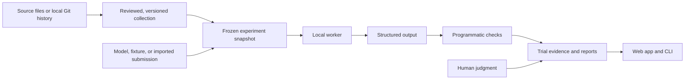

# Architecture

Custom Vals is a local evaluation application with a React workbench, a Python CLI, and an HTTP API. They share a typed task model, a SQLite workspace, and a single-worker evaluation engine.

The central unit is a **scenario**: public inputs and an instruction, paired with private evaluation checks. A repository is one possible source of scenarios. Documents, structured records, and simulated business states use the same execution and reporting contracts.

## Flow



Source preview does not create a valid benchmark automatically. Collection validation tests a reference output and declared negative controls. Historical extraction creates drafts whose instructions and checks still require review.

## Components

| Module                          | Responsibility                                                                                               |
| ------------------------------- | ------------------------------------------------------------------------------------------------------------ |
| `models.py`                     | Bounded Pydantic manifests, canonical JSON, and SHA-256 fingerprints.                                        |
| `config.py`                     | Environment configuration, data-directory admission, and storage paths.                                      |
| `store.py`                      | Collection versions, frozen experiments, trial state, events, and worker leases.                             |
| `engine.py`                     | One active experiment, budget reservation, submission, grading, and finalization.                            |
| `providers.py`                  | Structured-output HTTP calls, deterministic fixtures, and imported submissions.                              |
| `evaluators.py`                 | Exact values, containment, numeric tolerance, JSON Schema, citations, prohibited content, and Python checks. |
| `domains/` and `ingestion.py`   | Source previews, scenario validation, and conservative local Git extraction.                                 |
| `sandbox.py`                    | Disposable, bounded Linux verification for submitted Python files.                                           |
| `reports.py` and `exporting.py` | Aggregates, uncertainty, paired comparisons, and portable exports.                                           |
| `reviews.py`                    | Append-only human judgments linked to finalized evidence.                                                    |
| `schedules.py`                  | Recurring runs of a frozen experiment, with admission checks and occurrence records.                         |
| `api.py` and `cli.py`           | Local interfaces to the shared engine and stores.                                                            |
| `web/`                          | Guided authoring, comparison, evidence inspection, and service setup.                                        |

The frontend uses same-origin HTTP requests. The production build is copied into the Python package by `scripts/build_web.py` and served by the application. During development, Vite proxies API requests to the local Python service. The UI polls active experiments; the API also provides an event stream.

## Data and reproducibility

`CVALS_DATA_DIR` contains `workspace.sqlite3` and an `artifacts/` directory. The database stores collections, system definitions, frozen experiment snapshots, outputs, checks, attempt records, events, schedules, and reviews. It uses WAL mode and full synchronous writes. Database schema version 1 is explicit; an unknown schema version is rejected.

Saving changed collection content requires a new version. Creating an experiment copies the current collection and selected systems into its snapshot and records collection and snapshot hashes. Later edits or deletions of library records do not rewrite that snapshot. A rerun uses the saved snapshot rather than silently picking up current configurations.

Fingerprints detect mismatched content; they are not digital signatures or independent attestations. Host administrators retain access to the database. The current release does not implement a separate content-addressed object store, authenticated team tenancy, or tamper-proof external audit log.

The default data directory is local. For a path under macOS `/Volumes/`, startup requires the named volume to be mounted. Storage admission requires at least 100 MiB free. Machine-specific paths belong in ignored local configuration, not portable project files.

## Public and private task views

Provider requests and exported task inputs use an allowlist:

```text
id, name, domain, instruction, inputs
```

They exclude expected values, checks, reference outputs, and evaluator provenance. Collection review and evidence exports are trusted workspace operations and can contain that private material.

The HTTP adapter sends one bounded, non-streaming chat-completions request and requires a JSON-object response. It does not run tool loops, edit a repository, operate a browser, or execute an external agent harness. Existing agents run in their own environment and return [submission bundles](submissions.md), bound to an exact collection hash.

The workflow fixtures describe inputs and expected final states. They do not connect to production applications or independently observe tool actions. Citation checks verify source identifiers and literal quotations; they do not establish semantic entailment. Human review can supplement these checks without overwriting their outcomes.

## Python verification

Python submissions are text-file maps. The verifier combines the base task files with the submitted files and runs them in a fresh Linux container. The service never falls back to executing imported Python code on the host.

Execution requires a locally loaded image; the verifier resolves and records its immutable image ID. It uses a non-root user, no network or host mounts, a read-only root filesystem, dropped capabilities, and CPU, memory, process, time, input, and output limits. Staging copies files without executing repository code. Cleanup addresses only project-owned temporary resources; recovery additionally checks workspace ownership and age.

The preferred mode invokes declared functions with JSON arguments. Expected values stay in the host evaluator, and bounded returned values determine the outcome. A candidate cannot supply its own passing score. Arbitrary unittest compatibility mode shares an interpreter between tests and submitted code and carries weaker resistance to grader manipulation. The [sandbox guide](sandbox.md) defines both modes and their limits.

The historical compiler accepts a restricted subset of Python changes and literal function assertions. It reads Git metadata and blobs without checkout, hooks, dependency installation, or test execution. Unsupported setup, fixtures, assertions, source layouts, and history are rejected with reasons. Extraction acceptance is separate from validation.

## Execution, recovery, and budgets

A durable singleton lease permits one active worker. The lease expires after 30 seconds and is renewed during execution. A stale worker cannot finalize another worker’s trial. All scheduled trials exist before execution begins, so missing attempts remain part of the record.

An expired lease marks an active attempt as interrupted and retains its evidence. Pending work can resume. An ambiguous provider attempt is not automatically retried. Cancellation finalizes queued work and prevents later submissions; an already active request may finish before its bounded timeout, and recorded usage is retained.

Before each HTTP call, the engine reserves a conservative estimate using bounded input, maximum output, and saved token prices. Reported usage supplies the calculated cost when available. Unknown billing remains unknown; uncertainty blocks further paid requests. These calculations do not reconcile a provider invoice or guarantee a provider’s external charging behavior.

Remote endpoints require HTTPS, explicit opt-in, positive pricing, and a positive experiment budget. Requests reject redirects and nonpublic remote destinations; loopback endpoints support local inference. Keys are resolved from named service environment variables and never stored as key values in system manifests. See [provider configuration](providers.md).

## Reports and human review

Pass rate uses all scheduled trials, including errors and incomplete work. The report also gives completion coverage, check scores, costs, and latency. Unknown costs remain null; cost per pass is undefined if no trials pass.

Single-attempt task results use 95% Wilson intervals. Repeated results are grouped by scenario and use bounded task-level intervals. Paired differences compare shared tasks and use unadjusted task-level intervals. These methods assume representative, independent tasks; they do not remove selection bias, shared-source dependence, contamination, or multiple-comparison concerns.

Imported submissions preserve the external harness’s reported duration and usage separately from local evaluation time. Regrading identical outputs is not a new independent experiment. Fixture controls are labeled and excluded from the workspace’s headline system pass rate.

Human reviews record a reviewer label, dimension, score, rationale, timestamp, and evidence hash. A later judgment for the same reviewer, trial, and dimension supersedes the displayed latest judgment while preserving earlier records. Labels are self-reported, not verified identities. Human scores do not change automated pass rates.

## Recurring evaluation

Schedules refer to an experiment’s frozen snapshot. The worker checks due schedules while running and records each occurrence transactionally. It avoids queuing another occurrence while a related run remains outstanding and does not replay a backlog of missed intervals.

Every occurrence has the original per-run budget. There is no aggregate lifetime spending ceiling for a schedule. Admission failures and uncertain billing disable a schedule with an explicit error. Imported-submission replays cannot be scheduled as fresh evidence. Changing the task cohort requires a new experiment.

## Service boundary and deployment

The default server binds to loopback. Optional bearer authentication protects API routes; the health endpoint and static app remain public. The browser stores a token only for the current session. Trusted-host checks, bounded request bodies, same-origin mutation checks, and response security headers constrain the local service.

The deployment is intended for one trusted workspace owner. A workspace token is not a multi-user permission model. SSO, roles, tenant isolation, distributed workers, interactive tool-agent execution, benchmark holdout management, and universal repository support are future work.

For access from another device, use an authenticated SSH tunnel to the loopback service. The [operations guide](operations.md) covers configuration, backups, recovery, and deployment details.
