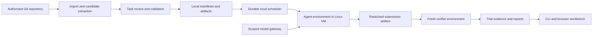

# Proposed architecture

Status: design decisions for implementation; components are not built yet.

## Components and flow

The coordinator holds private evaluator data. Solver inputs are independently assembled from an allowlist; the solver never receives the full task-store directory.

| Layer | Initial choice | Reason |
| --- | --- | --- |
| Shared core | Python 3.12, uv, Pydantic | Typed task and experiment contracts shared by import, CLI, API, and worker. |
| CLI | Typer | A usable vertical slice before a web service is necessary. |
| API | FastAPI, server-sent events | One local service for commands, review, and streamed run events. |
| UI | React, TypeScript, Vite | Task review, run diagnosis, and comparisons after the CLI works. |
| State | SQLite WAL with migrations | Durable local jobs without an extra database service. |
| Artifacts | Content-addressed local filesystem | Immutable bundles and evidence with explicit ownership and retention. |
| Execution | Harbor adapter, gated by capability tests | Reuse task/runtime integrations while owning validation and experiment semantics. |
| Isolation | Dedicated Linux VM on the iMac | No imported code executes directly on the personal macOS host. |

Pin versions after the executor capability spike. Hardware architecture is part of every result; ARM64 and emulated x86 runs are not interchangeable performance measurements.

## Records

| Record | Required information |
| --- | --- |
| RepositorySnapshot | Origin, permission scope, source license/attribution, base commit, tree hash, acquisition time. |
| Candidate | Historical change IDs, reconstruction method, test split, generated-text lineage, rejection/review history. |
| TaskBundle | Task version, issue/context, agent-view hash, private evaluator hash, environment digest, supported platform, resource and network policy. |
| ValidationReport | Collected test IDs, expected fail/pass sets, structured evidence for each clean cycle, regression outcomes, flaky/invalid classification. |
| Experiment | Frozen cohort, systems, repetitions, randomization, budget/exclusion/retry rules, analysis method, cost assumptions. |
| Trial and Attempt | Immutable system configuration, lease, lifecycle events, submitted patch, artifacts, token/spend records, terminal reason. |
| ScoreReport | Included trials, exclusions, coverage, denominators, estimates/uncertainty, analysis version, links to evidence. |

Mutable review decisions and job states are kept separate from immutable content. Changing task tests or setup creates a new task version; it never silently rewrites an old benchmark.

## Storage and local development

Configure separate source, private data, artifact, cache, and VM-disk roots. Keep data outside the public Git checkout. The local machine inventory records exact paths in the ignored `.local/IMAC.md`.

The current maintainer machine is an 8 GB ARM64 iMac with a nearly full internal disk and substantial attached-disk capacity. Keep this small source checkout in the home directory; place datasets, container images, VM disks, caches, and trial artifacts on the attached volume.

The workspace doctor must verify volume identity and mount state before opening data roots. If the volume is unavailable, stop clearly; never fall back to a same-named directory on the internal disk. Start with one worker and small fixtures. Resource admission reserves space for the host, checks available memory/disk, and refuses tasks above configured limits. Only project-owned caches and containers are eligible for cleanup.

Use loopback binding by default. The maintainer can reach the browser over an SSH tunnel through Tailscale. Network exposure and team authentication become explicit configuration choices.

## Execution boundary

1. Import reads source/metadata without invoking repository hooks, builds, or install commands on the host.
2. An isolated builder performs permitted dependency downloads with bounded access. It never receives model or GitHub credentials. Pin the resulting image and dependency manifests.
3. Assemble the solver image from the historical source tree. Create a fresh Git repository only if the harness requires Git; exclude future objects, remotes, gold patches, hidden tests, and previous-trial caches.
4. The solver runs with bounded CPU/RAM/disk/time/processes, no host home mount, and no container-engine socket. Evaluation network policy permits only the scoped model gateway and explicitly required test services.
5. Collect an allowlisted patch or artifact under strict size/path limits. Reject path traversal, unsafe symlinks, grader overwrites, and attempts to modify trusted evaluation machinery.
6. Apply the submission to a fresh verified base inside the verifier environment. Install evaluator tests from the trusted store. Parse structured outcomes; do not trust an agent-written score file.
7. Keep logs/artifacts local, terminate task processes, and reconcile owned containers on completion or restart.

A fresh verifier separates solver state, but candidate code still executes during tests. Grader isolation needs adversarial verification; it is not proved by putting tests in a second container. Use trusted result collection and additional process/filesystem boundaries as needed. Any runtime that cannot enforce the requested policy is rejected for that experiment.

[Harbor documents separate verification](https://docs.harborframework.com/tasks/separate-verifier) as an explicit option. Our adapter must select it and control artifact transfer. Package defaults are not an isolation guarantee.

## Credentials and model access

The host coordinator owns GitHub credentials and provider keys. The solver receives only a scoped gateway credential tied to its trial, allowed model, expiry, and budget. The gateway records actual usage when available, reserves spend before calls, limits concurrent calls/output, and revokes access on termination.

Local inference, hosted inference, and offline replay are distinct modes. Hosted inference can transmit submitted source/context to the selected provider. A strict offline mode disallows external egress after staged dependency acquisition. The initial machine is not assumed to support large local models alongside worker environments.

## Scheduler and accounting

Use transactional states: queued, leased, preparing, running, grading, and a terminal success/failure/cancel/error state. Separate logical trials from retry attempts. Leases expire and can be recovered; attempt IDs, artifact hashes, and idempotent finalization prevent duplicate final results.

Persist intent before launching a process. On restart, reconcile live owned processes/containers and expired leases before claiming more work. Retries preserve the original task, image, runner, harness, and analysis revisions. Container cleanup must not touch unrelated iMac projects.

Budget reservation includes pending calls and bounded provider accounting lag. Distinguish estimated enforcement from final billed usage. Cancellation stops future calls, terminates compute, revokes credentials, and records partial consumption.

## Reporting and browser workflow

The UI progresses through repository import, candidate review, experiment design, run monitoring, comparison, and replay. Each aggregate links to its task cohort, trial attempts, test evidence, and accounting.

Use paired differences, uncertainty intervals, repeat reliability, and explicit ties. Show task-family coverage, candidate-selection bias, infrastructure errors, and missing metrics. Constraints for system recommendations are user-defined and saved with the report.

The first release includes local exports. Publication is a separate action with dataset permissions and private-data exclusions. GitHub integration reads repository metadata and can later report approved aggregate checks without uploading private evidence.

## Reuse and future scaling

The core, schemas, validation pipeline, scheduler semantics, and decision reports are our own implementation. Harbor is the preferred backend after capability validation. SWE-bench compatibility follows; broader generators are optional plugins.

Vals' Valkyrie is already open-source under AGPL-3.0. No Valkyrie implementation is incorporated into this Apache-2.0 project. Compatibility can be independently implemented against documented interfaces if useful.

PostgreSQL and multiple workers are future options when SQLite contention or workload measurements justify them. Preserve the same task contracts and artifacts. Remote compute remains disabled in the maintainer's iMac-only configuration.
