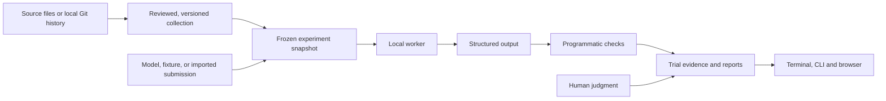

# Architecture

Everval AI is a terminal-first local evaluation application with a Textual/tmux workbench, a Python CLI, an HTTP API and an optional React review browser. They share typed task models, a SQLite workspace and one dedicated worker.

[Documentation](index.md) · [Supported scope](PLAN.md) · [Verification](verification.md)

The central unit is a **scenario**: public inputs and an instruction, paired with private evaluation checks. A repository is one possible source of scenarios. Documents, structured records, and simulated business states use the same execution and reporting contracts.

## Flow



Source preview does not create a valid benchmark automatically. Collection validation tests a reference output and declared negative controls. Historical extraction creates drafts whose instructions and checks still require review.

## Components

| Module                          | Responsibility                                                                                               |
| ------------------------------- | ------------------------------------------------------------------------------------------------------------ |
| `models.py`                     | Bounded Pydantic manifests, canonical JSON, and SHA-256 fingerprints.                                        |
| `config.py`                     | Environment configuration, data-directory admission, and storage paths.                                      |
| `store.py`                      | Collection versions, frozen experiments, trial state, events, and worker leases.                             |
| `engine.py`                     | One active experiment, budget reservation, submission, grading, and finalization.                            |
| `providers.py`                  | Structured-output HTTP calls, deterministic fixtures, and imported submissions.                              |
| `evaluators.py`                 | Exact values, containment, numeric tolerance, JSON Schema, citations, prohibited content, and Python checks. |
| `domains/` and `ingestion.py`   | Source previews, scenario validation, and conservative local Git extraction.                                 |
| `sandbox.py` and `node_runtime.py` | Bounded container verification for Python and prepared Node tasks. |
| `reports.py` and `exporting.py` | Aggregates, uncertainty, paired comparisons, and portable exports.                                           |
| `reviews.py`                    | Append-only human judgments linked to finalized evidence.                                                    |
| `schedules.py`                  | Recurring runs of a frozen experiment, with admission checks and occurrence records.                         |
| `api.py`, `cli.py` and `workbench.py` | Shared application services for the API, CLI and terminal. |
| `tui/` and `runtime.py` | Textual views, tmux launch and dedicated worker lifecycle. |
| `identity.py` and `review_queues.py` | HTTP roles, personal tokens, frozen assignments and authenticated judgments. |
| `autopilot.py` and `optimization.py` | Budgeted recurring screening and explicit candidate studies with reserved holdouts. |
| `research.py` and `pure_checks.py` | Retained diagnostic experiments and bounded pure-grader work. |
| `web/`                          | Guided authoring, comparison, evidence inspection, and service setup.                                        |

The frontend uses same-origin HTTP requests. The production build is copied into the Python package by `scripts/build_web.py` and served by the application. During development, Vite proxies API requests to the local Python service. The UI polls active experiments; the API also provides an event stream.

## Data and reproducibility

`EVERVAL_DATA_DIR` (with `CVALS_DATA_DIR` as a compatibility fallback) contains `workspace.sqlite3` and an `artifacts/` directory. The database stores collections, system definitions, frozen experiment snapshots, outputs, checks, attempt records, events, schedules, and reviews. It uses WAL mode and full synchronous writes. Database schema version 1 is explicit; an unknown schema version is rejected.

Saving changed collection content requires a new version. Creating an experiment copies the current collection and selected systems into its snapshot and records collection and snapshot hashes. Later edits or deletions of library records do not rewrite that snapshot. A rerun uses the saved snapshot rather than silently picking up current configurations.

Fingerprints detect mismatched content; they are not digital signatures or independent attestations. Host administrators retain access to the database. Imported dependency artifacts are addressed by their content hashes. The workspace is not a general content-addressed object store, a tenant-isolated service or an externally anchored audit log. Optional team authentication controls HTTP access within the single workspace.

The default data directory is local. For a path under macOS `/Volumes/`, startup requires the named volume to be mounted. Storage admission requires at least 100 MiB free. Machine-specific paths belong in ignored local configuration, not portable project files.

## Public and private task views

Provider requests and exported task inputs use an allowlist:

```text
id, name, domain, instruction, inputs
```

They exclude expected values, checks, reference outputs, and evaluator provenance. Collection review and evidence exports are trusted workspace operations and can contain that private material.

The `single-turn` harness sends one bounded, non-streaming chat-completions request and requires a JSON-object response. The `tools` harness runs a bounded loop over public files with isolated Python or Node execution; it has no host shell or browser tool. An [external-agent adapter](agent-adapters.md) invokes a separately operated service under a frozen revision and declared aggregate limits. Existing outputs can also enter as [submission bundles](submissions.md), bound to an exact collection hash. These are distinct execution modes; replaying a bundle creates no new agent attempt.

The workflow fixtures describe inputs and expected final states. They do not connect to production applications or independently observe tool actions. Citation checks verify source identifiers and literal quotations; they do not establish semantic entailment. Human review can supplement these checks without overwriting their outcomes.

## Repository verification

Python submissions are text-file maps. The verifier combines the base task files with the submitted files and runs them in a fresh Linux container. The service never falls back to executing imported Python code on the host.

Execution requires a locally loaded image; the verifier resolves and records its immutable image ID. It uses a non-root user, no network or host mounts, a read-only root filesystem, dropped capabilities, and CPU, memory, process, time, input, and output limits. Staging copies files without executing repository code. Cleanup addresses only project-owned temporary resources; recovery additionally checks workspace ownership and age.

The preferred mode invokes declared functions with JSON arguments. Expected values stay in the host evaluator, and bounded returned values determine the outcome. A candidate cannot supply its own passing score. Arbitrary unittest compatibility mode shares an interpreter between tests and submitted code and carries weaker resistance to grader manipulation. The [sandbox guide](sandbox.md) defines both modes and their limits.

The lightweight historical compiler accepts a restricted subset of Python changes and literal function assertions. Prepared repository profiles also support pytest, Node's test runner, Jest and Vitest. Discovery reads Git metadata and blobs without executing hooks or repository source. Preparation and validation execute only inside controlled containers. Unsupported setup, source layouts and history are rejected with reasons; extraction acceptance is separate from validation.

Prepared repository admission requires repeated fail-before/pass-after controls and separate baseline regression evidence. Python and Node test runners share a process boundary with submitted source, so they provide weaker resistance to deliberate grader manipulation than host-compared function cases. See [benchmark admission](benchmarks.md) and [JavaScript/TypeScript runtimes](javascript-typescript.md).

## Execution, recovery, and budgets

A durable singleton lease permits one active worker. The lease expires after 30 seconds and is renewed during execution. A stale worker cannot finalize another worker’s trial. All scheduled trials exist before execution begins, so missing attempts remain part of the record.

An expired lease marks an active attempt as interrupted and retains its evidence. Pending work can resume. An ambiguous provider attempt is not automatically retried. Cancellation finalizes queued work and prevents later submissions; an already active request may finish before its bounded timeout, and recorded usage is retained.

Before an HTTP-backed attempt, the engine reserves a conservative estimate using bounded input, maximum output and frozen token prices. Tool loops and external adapters reserve their declared aggregate ceilings before the first request. Reported usage supplies the calculated cost when available. Unknown billing remains unknown; uncertainty blocks further paid requests. These calculations do not reconcile a provider invoice or guarantee a provider’s external charging behavior.

Remote endpoints require HTTPS, explicit opt-in, positive pricing, and a positive experiment budget. Requests reject redirects and nonpublic remote destinations; loopback endpoints support local inference. Keys are resolved from named service environment variables and never stored as key values in system manifests. See [provider configuration](providers.md).

## Reports and human review

Pass rate uses all scheduled trials, including errors and incomplete work. The report also gives completion coverage, check scores, costs, and latency. Unknown costs remain null; cost per pass is undefined if no trials pass.

Single-attempt task results use 95% Wilson intervals. Repeated results are grouped by scenario and use bounded task-level intervals. Paired differences compare shared tasks and use unadjusted task-level intervals. These methods assume representative, independent tasks; they do not remove selection bias, shared-source dependence, contamination, or multiple-comparison concerns.

Imported submissions preserve the external harness’s reported duration and usage separately from local evaluation time. Regrading identical outputs is not a new independent experiment. Fixture controls are labeled and excluded from the workspace’s headline system pass rate.

Legacy local reviews record a self-reported reviewer label, dimension, score, rationale, timestamp and evidence hash. New judgments retain earlier records. Assigned browser review queues instead bind judgments to authenticated identities and freeze public tasks, submitted outputs, rubrics and the response-to-system mapping. Reviewer endpoints withhold evaluator-only material; optional blinding also withholds system identities. Human judgments remain separate from automated pass rates. See [team review](team-review.md).

## Recurring evaluation

Schedules refer to an experiment’s frozen snapshot. The worker checks due schedules while running and records each occurrence transactionally. It avoids queuing another occurrence while a related run remains outstanding and does not replay a backlog of missed intervals.

Every occurrence has the original per-run budget and reserves that amount against the schedule's cumulative lifetime cap before admission. The default lifetime cap funds one occurrence. Workspace and project daily, monthly and lifetime caps can further restrict admissions. Unsettled reservations count toward spending controls; admission failures and uncertain billing disable a schedule with an explicit error. Imported-submission replays cannot be scheduled as fresh evidence. Changing the task cohort requires a new experiment.

## Service boundary and deployment

The default server binds to loopback. An optional shared bearer token protects a trusted local workspace. Explicitly enabled team mode takes precedence and adds salted, hashed, expiring personal tokens with administrator, operator, reviewer and viewer capabilities. Revocation and role changes apply to subsequent requests; event streams recheck access. The health endpoint and static app remain public. The browser stores its active token only for the current session. Trusted-host checks, bounded request bodies, same-origin mutation checks and response security headers constrain the service.

The supported deployment is one local workspace and one dedicated worker. Terminal, CLI and direct filesystem access remain trusted administrative surfaces. SSO, tenant isolation, distributed execution and universal repository support are not implemented. A built-in bounded tool harness, authenticated browser roles and development/holdout releases are implemented within these limits.

For access from another device, use an authenticated SSH tunnel to the loopback service. The [operations guide](operations.md) covers configuration, backups, recovery, and deployment details.

## Terminal and repository services

The Textual interface calls `Workbench`, a synchronous application service used from background UI workers. A workspace-specific tmux session hosts the terminal and activity log. `Jobs` persists discovery, validation, and environment preparation independently of terminal lifetime; `runtime` manages the dedicated process and exclusive lock.

`Projects` reconstructs bounded GitHub/local histories. `Environments` prepares Python wheel and locked Node dependency runtimes without executing repository installation scripts. Inspected private archives can supply dependencies without copying registry credentials. `Benchmarks` binds repeated validation to exact task, image and grader fingerprints and creates immutable development/holdout releases. Admission is rechecked before executing a derived task.

`agent_runner` implements a bounded public-file tool loop. It has no host-shell tool and never receives evaluator-only fields. The final source snapshot is evaluated independently. `comparison` checks cohort compatibility, and `policies` retains versioned decision constraints and evidence-bound outcomes.

See [the validation contract](benchmarks.md), [environment boundary](environments.md), and [decision policies](policies.md) for operational guarantees and limits.

## Continuous improvement and holdouts

Autopilot observes configured source or system changes and admits bounded screening and full development runs through the normal durable experiment queue. Policies start paused. Atomic budget reservations include pending work; unknown accounting stops further automatic admissions. Bounded investigations reuse recorded outputs with supported pure graders and make no new provider calls.

Optimization compares explicitly saved configurations on a development cohort. It reserves an unused final holdout and its budget before beginning. Admission rejects previously used holdout task IDs or exact public content and development/holdout overlap. A passing study produces an evidence-linked proposal for review. It does not generate arbitrary prompts or deploy a selected configuration. Activity outside the workspace can still expose holdout material.

Research evidence distinguishes grading intermittency from model variation. Negative controls and lexical duplicate signals are diagnostic checks, not proof of complete graders or semantic equivalence. See [research](research-loop.md), [Autopilot](autopilot.md) and [budget planning](budget-planning.md) for supported bounds.
