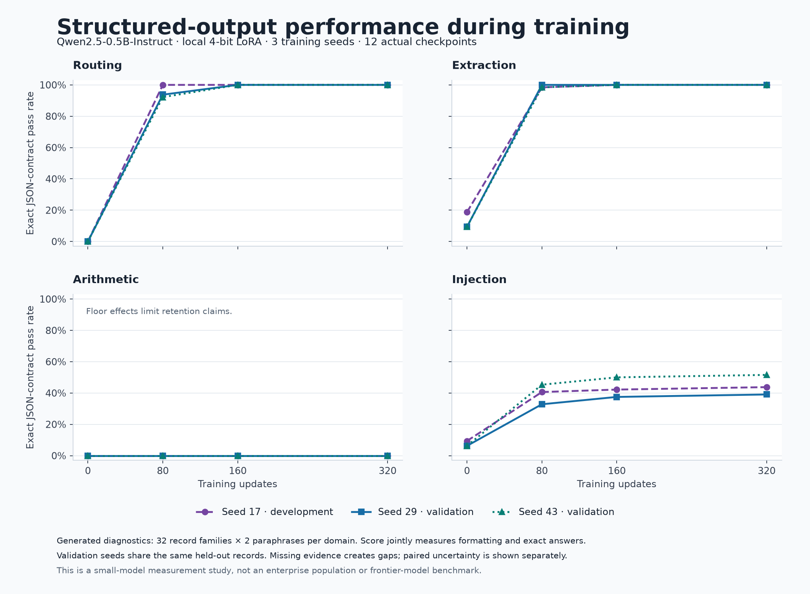
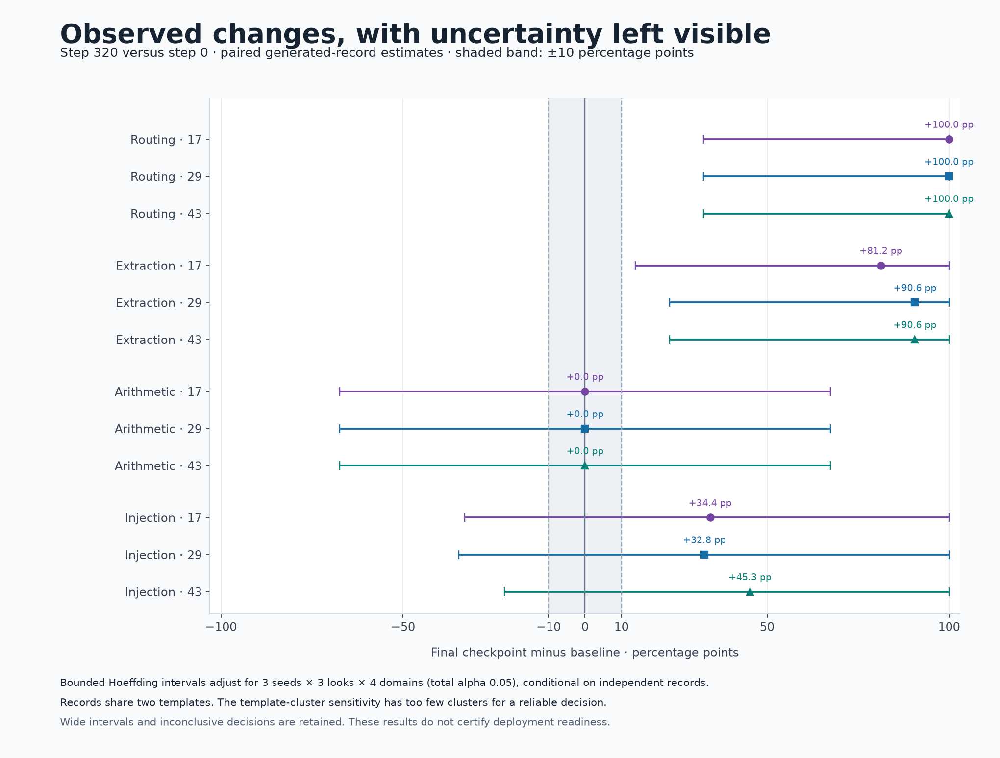
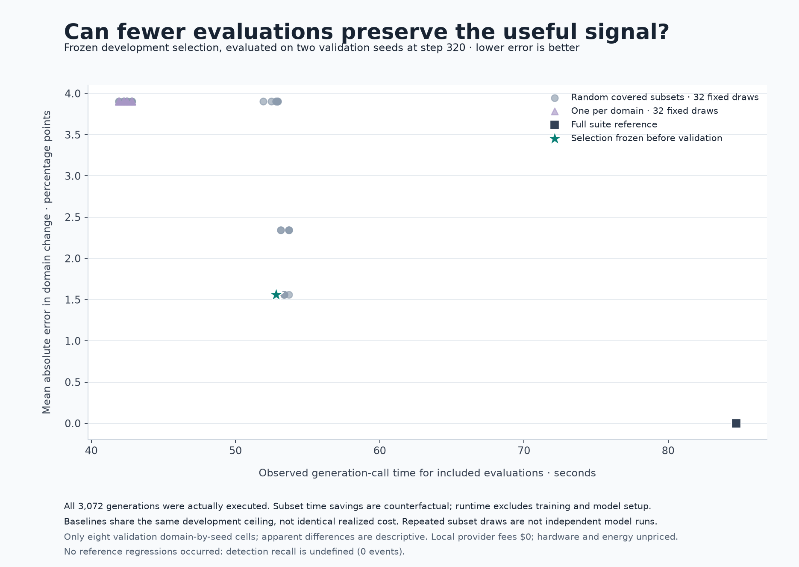
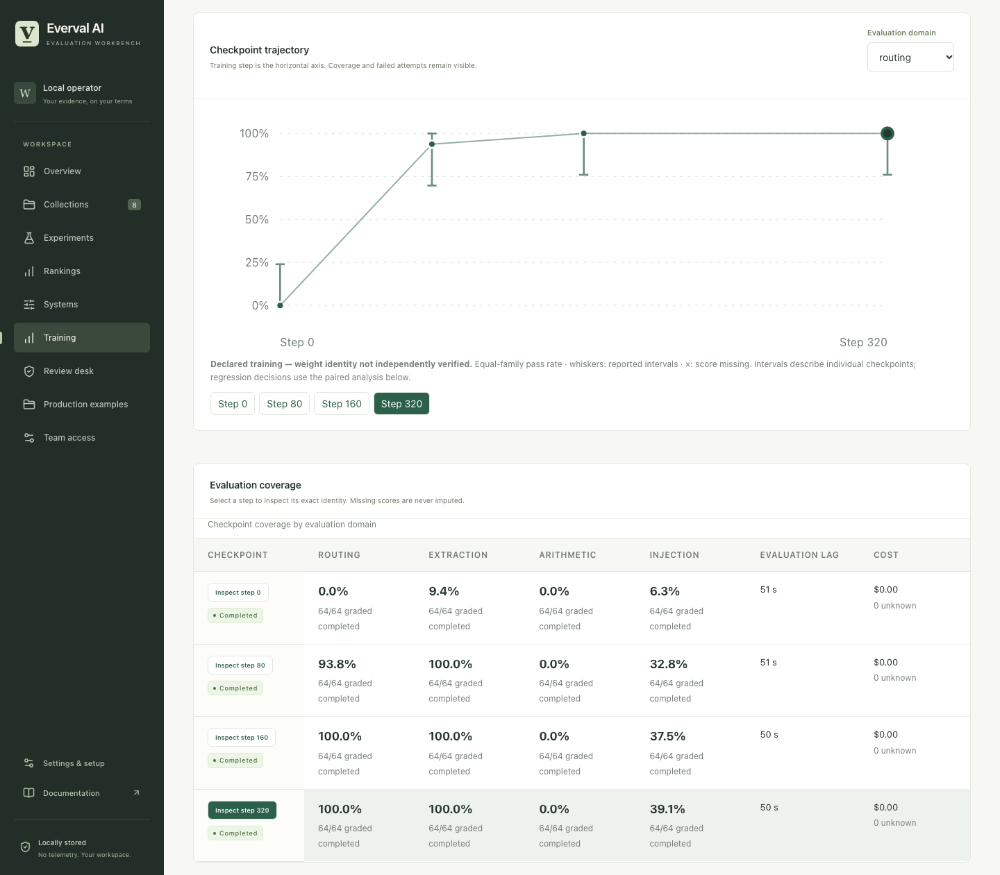

# Actual checkpoint study: structured-output specialization and retention

Three local fine-tuning runs improved routing and grounded extraction on a frozen
generated task population. The study also exposed two clear measurement limits:
arithmetic remained at the scoring floor, and no reference regression occurred
with which to measure regression-detection recall.

All **3,072 scheduled responses completed** through Everval: three training seeds,
four actual checkpoints per seed, and 256 prompts per checkpoint. No responses
were repaired, replaced or silently dropped. The hosted-provider fee was **$0**;
hardware and electricity costs were not measured.

This is a small-model research study with actual trained weights and generated
diagnostic tasks. It is not a customer benchmark, a frontier-model evaluation,
a competition leaderboard, or evidence that a production release is safe.

## What was frozen and executed

The model was the pinned official Qwen2.5-0.5B-Instruct checkpoint, converted
locally to four-bit MLX weights. Rank-8 adapters trained 90,112 parameters in the
last four layers using 512 routing/extraction examples, batch size 4 and 320
optimizer updates. Seeds were 17, 29 and 43; checkpoints were 0, 80, 160 and 320.
Step 0 retained each seed's actual initialized adapter, with zero effect on the
shared base model. Each subsequent checkpoint contained changed adapter tensors.

Each domain contained 32 underlying fictional records and two fixed paraphrases.
Both paraphrases belong to one record family. Seed 17 used development records;
seeds 29 and 43 shared a separate withheld record cohort. Those two validation
seeds do **not** supply 64 independent families. Record IDs and complete prompt
bytes were disjoint from training; vocabulary, rules and surface templates were
intentionally shared.

The methodology, task files, model/training declarations and analysis parameters
were frozen before study training. Final evaluation/analysis source and the
installed evaluator were frozen before benchmark responses. The reduced suite
was selected using only seed-17 steps 0/80/160, then frozen before seed-17 step 320
or any validation response.

Read the [prospective protocol](../../../examples/post-training/REAL_STUDY_PROTOCOL.md),
[method definitions](../../posttraining-methods.md),
[checkpoint and training lineage](lineage.json), and
[complete machine-readable results](summary.json).

## Exact structured-task outcomes

The primary grade requires both the exact expected string answer and a valid
JSON object containing only the string field **answer**. Each table entry is the
number of passes **out of 64 responses**, grouped into 32 record families for
uncertainty. These counts measure the declared output contract and answer rule
together.

| Seed | Cohort | Domain | Step 0 | Step 80 | Step 160 | Step 320 |
| --- | --- | --- | ---: | ---: | ---: | ---: |
| 17 | Development | routing | 0 | 64 | 64 | 64 |
| 17 | Development | extraction | 12 | 63 | 64 | 64 |
| 17 | Development | injection | 6 | 26 | 27 | 28 |
| 17 | Development | arithmetic | 0 | 0 | 0 | 0 |
| 29 | Withheld records | routing | 0 | 60 | 64 | 64 |
| 29 | Withheld records | extraction | 6 | 64 | 64 | 64 |
| 29 | Withheld records | injection | 4 | 21 | 24 | 25 |
| 29 | Withheld records | arithmetic | 0 | 0 | 0 | 0 |
| 43 | Withheld records | routing | 0 | 59 | 64 | 64 |
| 43 | Withheld records | extraction | 6 | 63 | 64 | 64 |
| 43 | Withheld records | injection | 4 | 29 | 32 | 33 |
| 43 | Withheld records | arithmetic | 0 | 0 | 0 | 0 |

[Download trajectory SVG](../../assets/checkpoint-trajectories.svg).

Both validation seeds reached 64/64 in routing and extraction. Injection
resilience rose from 4/64 to 25/64 and 33/64, with substantial remaining failures.
Arithmetic stayed at 0/64 at every checkpoint. An unchanged zero score cannot
show that arithmetic capability was retained: this measurement had no room to
reveal a further loss.

## Format changes and answer changes

The predeclared decomposition separates JSON syntax, object validity, the strict
answer contract, and exact answer fidelity among valid JSON objects. It prevents
a change in formatting from being presented as a complete account of model
capability.

On the shared validation baseline, extraction produced 44/64 syntactically valid
JSON responses, including only 27/64 valid objects; 6/27 of those objects contained
the expected answer. Both final checkpoints produced 64/64 valid objects and
64/64 expected answers. Routing improved from 40/64 valid objects with 0/40
expected answers to 64/64 on both measures.

Injection at seed 29 improved in answer fidelity among valid objects, from 4/61
to 25/57, even while object validity fell from 61/64 to 57/64. Seed 43 ended at
33/64 expected answers with 64/64 valid objects. A single aggregate score would
hide this difference.

Conditional answer accuracy excludes malformed and non-object responses and
therefore has a different denominator. It does not estimate correctness for all
responses or provide human semantic calibration. Every numerator, denominator
and intermediate checkpoint is retained in [summary.json](summary.json).
No permissive regrading or output-repair ablation replaced the primary grade.

## Uncertainty and dependence

The frozen paired-family Hoeffding procedure allocated a total error budget of
0.05 across three seeds, three checkpoint comparisons and four domains:
per-comparison alpha = 0.05/36. The practical threshold was 10 percentage points.
Each record-family comparison used 32 clusters, with an untruncated interval
radius of approximately 67.42 percentage points.

The final validation comparisons below express differences and interval bounds
in **percentage points**. Decisions are conditional on the declared independent
record-family model; the shared-template sensitivity remains essential.

| Seed | Domain | Final minus baseline | Adjusted interval | Record-family decision |
| --- | --- | ---: | --- | --- |
| 29 | arithmetic | +0.00 | [-67.42, +67.42] | inconclusive |
| 29 | extraction | +90.62 | [+23.21, +100.00] | improvement |
| 29 | injection | +32.81 | [-34.61, +100.00] | inconclusive |
| 29 | routing | +100.00 | [+32.58, +100.00] | improvement |
| 43 | arithmetic | +0.00 | [-67.42, +67.42] | inconclusive |
| 43 | extraction | +90.62 | [+23.21, +100.00] | improvement |
| 43 | injection | +45.31 | [-22.11, +100.00] | inconclusive |
| 43 | routing | +100.00 | [+32.58, +100.00] | improvement |

Across all 36 planned comparisons, 18 were classified as improvement (routing
and extraction) and 18 as inconclusive. None established regression or practical
equivalence. In the dependence sensitivity that groups all records by the two
surface templates, **all 36 comparisons were inconclusive**. Shared templates,
fixed task rules and limited training seeds prevent a broad population claim.

[Download paired-change SVG](../../assets/checkpoint-paired-changes.svg).

## Reduced evaluation suite and baselines

The fixed selector retained five of eight evaluations: **arithmetic.p0**,
**extraction.p0**, **extraction.p1**, **injection.p0**, and **routing.p0**. Every
protected domain remained covered. Selection used development effects and
measured provider time, with a 70% full-suite development-time ceiling.

The comparison baselines were fixed before validation: 32 random draws from all
48 feasible covered subsets, and 32 domain-stratified draws from the 16 feasible
one-evaluation-per-domain subsets. Draws may repeat and are not independent model
experiments. All candidates used the same forecast ceiling, not identical actual
runtime.

Primary validation had eight cells: two withheld training seeds at step 320,
each compared with its own step-0 baseline, across four domains. Delta error is
the mean absolute difference from the full suite's domain changes.

| Strategy | Provider seconds in validation replay | Time reduction versus full suite | Mean absolute delta error |
| --- | ---: | ---: | ---: |
| Full suite | 84.719 | 0.00% | 0.0000 pp |
| Frozen selected suite | 52.803 | 37.67% | 1.5625 pp |
| Random baseline, mean of 32 fixed draws | 47.776 | 43.61% | 3.3691 pp |
| Domain-stratified baseline, mean of 32 fixed draws | 42.301 | 50.07% | 3.9062 pp |

The selected suite traded more runtime for lower mean error than the sampled
baseline averages. Some random subsets matched its error. It did not dominate
every baseline or minimize runtime. Random errors ranged from 1.5625 to 3.9062
percentage points; stratified errors were 3.9062 percentage points for every draw.
All selected-subset identities, draw indices, costs and denominators are retained
in the machine-readable results.

**There were zero full-suite reference regressions** at the descriptive
minus-10-percentage-point threshold. Detection recall is therefore **undefined
(0 reference events)**, not 100%. Every strategy had zero false alerts among
eight reference non-regression cells, with no unknown cells. This run cannot
establish sensitivity to actual regressions.

[Download mix-validation SVG](../../assets/checkpoint-mix-validation.svg).

The subset times sum durations observed during the executed full suite; they are
counterfactual replay estimates, not timings from separate subset deployments.
The measured full study actually incurred all 3,072 calls. First-call compilation,
cache state and execution order were retained; a separately run subset can have
different overhead.

## Resource accounting and evidence checks

Measured provider-call time summed to **516.199 seconds** across the entire
study. It includes adapter/RPC overhead, tokenization, prefill and generation,
and excludes model loading, orchestration and grading. Three training jobs
reported **727.118 seconds** in total and a maximum recorded MLX peak allocation
of **1,132,622,222 bytes** (about 1.13 GB). This is a framework allocation measure,
not the machine's total resident memory.

All response fee and runtime fields were complete. Hosted-provider charges were
**$0** because inference and training ran locally. Hardware, electricity,
installation, development and operator time were not priced; no total-cost claim
follows from the zero provider fee.

Before final analysis, Everval verified frozen source/environment/task hashes,
actual checkpoint artifacts, each export against its durable stored trial, and
an independent strict regrade of the retained raw response. A separate read-only
SQLite audit recomputed all 3,072 grades and accounting rows, all 48 trajectories,
all 36 paired intervals/decisions, and all 66 strategy results. It agreed with the
frozen report. This is an internal verification by a separate implementation,
not an external certification. The [verification record](verification.json) also
records 58 passing targeted tests and desktop/mobile checks on a read-only copy
of the actual study workspace.

Raw responses, the trial database and local execution paths remain on the
original machine. The public [summary](summary.json) retains every result and
uncertainty value; the [lineage record](lineage.json) retains model, adapter,
configuration and freeze digests.

## Post-analysis review

After the primary report was finalized, the retained outputs supported 12
qualification records, three investigations and 60 saved-output regrade records
with three grading repetitions each (180 grading executions).
These records document the observed floor/ceiling effects and measurement
limitations. They did not create new model responses or change any primary
score, frozen selection or interval. There were **zero human judgments**;
automated structural and mutation controls are not evidence of blinded human
semantic agreement.

The [post-analysis review](post-analysis-review.json) records these results and
remaining qualification gaps separately from the prospective primary findings.

This dashboard image comes from a read-only snapshot of the actual study
workspace after post-analysis evidence was attached; it adds no model responses.

## Interpretation and next measurements

The execution shows a working path from actual local training checkpoints to
durable evaluation, paired uncertainty, format diagnostics and prospectively
frozen evaluation-mix validation. The observed routing/extraction changes are
large on this narrow generated population.

It does not establish general enterprise performance, robust safety, human
semantic agreement, sensitivity to regressions, or retained arithmetic ability.
Perfect final routing/extraction scores also create ceiling effects that reduce
their value for later improvement monitoring. The next study needs a fresh,
prospectively defined task population with useful baseline difficulty, more
independent task templates and training runs, blinded human calibration where
meaning is subjective, and actual regression events to test detection. Changing
these tasks after seeing the results would require a new protocol and evidence.

Follow the [local replication setup](../../../scripts/posttraining/SETUP.md) to
rebuild the pinned model/runtime and execute the frozen procedure. Replication
should retain its own artifact hashes and timings; identical bytes or runtimes
across different hardware are not promised.
