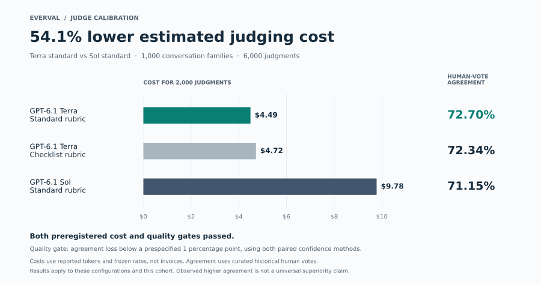

# Judge cost and quality confirmation

**Completed: 1,000 conversation families, 2,957 retained human votes, all 6,000 planned judgments.**

Everval qualified GPT-6.1 Terra's standard rubric against GPT-6.1 Sol with **54.1% lower estimated judging cost** and **72.70% versus 71.15% agreement with retained human votes**. The candidate passed the preregistered cost test and one-percentage-point quality-loss limit. The preceding standard-versus-checklist comparison also passed, with **4.87% lower estimated cost**.

[Read the result](results.md) · [Analysis output](results.json) · [Reproducible family measurements](family-metrics.json) · [Final accounting](budget-status.json)

| Configuration | Reasoning | Output-token ceiling | Human-vote agreement | Estimated cost, 2,000 judgments |
| --- | --- | ---: | ---: | ---: |
| GPT-6.1 Terra, standard rubric | None | 768 | 72.70% | $4.489838 |
| GPT-6.1 Terra, checklist | None | 768 | 72.34% | $4.719575 |
| GPT-6.1 Sol, standard rubric | Low | 1,536 | 71.15% | $9.778616 |

Each judge saw both answer orders. Human votes and generator identity metadata stayed with the evaluator. Both bootstrap and Student t confidence methods had to pass; the rubric comparison came first. Full methods and limitations remain in the unchanged [preregistered protocol](protocol.md).

The new run cost **$18.988029**, compared with the original **$24.23** planning estimate. Cumulative accounting is **$34.130958 of the $50 limit**, including the earlier study and its retained unknown-charge reserve. All 6,000 new requests settled without unresolved reservations. Costs are token-based estimates, not reconciled invoices.

[Statistical audit](independent-statistical-audit.json) · [Data and accounting audit](independent-data-audit.json) · [Operational diagnostics](operations.json) · [Frozen identities](freeze.json) · [Cohort and provenance](cohort.json) · [Power sensitivity](power.json) · [Original forecast](forecast.json)

Preflight passed **78 tests** plus [independent checks](independent-prelaunch-audit.json), including [Student t values against SciPy](student-t-independent-audit.json). Pre-run simulations are retained [before](analysis-validation-v1.json) and [after](analysis-validation-v2.json) the prespecified rare-disagreement guard.

NVIDIA's reference contains curated historical human preferences, and provider training exposure is unknown. This study qualifies the tested configuration on the specified cohort; it does not establish universal model superiority, representative customer performance or customer ROI.
