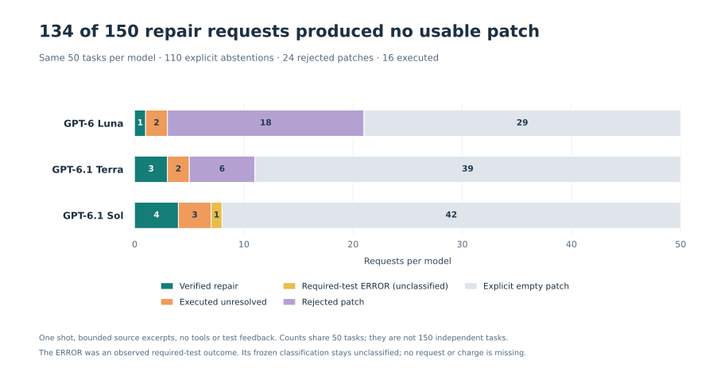

# A delivery bottleneck in one-shot repository repair

**134 of 150 repair requests produced no usable submission: 110 explicit empty patches and 24 rejected patches.** Only 16 submissions reached execution. All 150 provider responses completed with valid patch JSON; there was no final-message parsing or output-token truncation loss. [Output attribution](fresh-output-attribution.json).



Each model received the **same 50 admitted tasks**. There are 150 requests, not 150 independent tasks. The finding describes a constrained one-shot deployment; it does not rank tool-using coding agents or establish a general model-quality improvement.

## What reached the grader

These five outcome columns partition each model's 50 planned tasks. An explicit empty patch is an abstention under the request contract. Empty output alone does not establish why the model abstained or prove that retrieval was insufficient.

| Model | Verified repair | Executed unresolved | Required-test ERROR, unclassified | Rejected patch | Explicit empty patch | Estimated cost |
| --- | ---: | ---: | ---: | ---: | ---: | ---: |
| GPT-6 Luna | 1 | 2 | 0 | 18 | 29 | $0.051683 |
| GPT-6.1 Terra | 3 | 2 | 0 | 6 | 39 | $0.493653 |
| GPT-6.1 Sol | 4 | 3 | 1 | 0 | 42 | $1.009465 |

The 24 rejected patches comprise 16 that could not be parsed and eight with no recognized file changes. They failed validation before tests ran. An independent [Git syntax check](fresh-patch-syntax-audit.json) also rejected all 24; this check applied no patches and changed no scores. They are separate from the seven submissions that executed with fully classified unresolved outcomes. [Independent attribution](fresh-output-attribution.json), [operations and exact costs](fresh-operations.json).

The execution error is also retained separately. Sol's submission for one task produced **14 required passes and one required ERROR**, with suite exit 1 and completed cleanup. The frozen analyzer requires PASSED or FAILED outcomes for every required test, so this ERROR remains unclassified in its primary analysis. It is an observed execution outcome, not a missing request, lost run or uncertain charge.

## What the scores support

Luna verified **1/50 repairs (2%)**, Terra **3/50 (6%)**, and Sol **4/50 (8%)**. Sol's one unclassified outcome gives full-cohort identification bounds of **8–10%**; these bounds are not a confidence interval and do not count a fifth repair as observed.

The complete Luna–Terra comparison differs by **4 percentage points**, with an exact paired McNemar p-value of 0.625 and a three-comparison adjusted p-value of **1.0**. No difference is established. The frozen analysis withholds p-values for the two Sol contrasts because of the unclassified outcome. [Exact unchanged analysis](fresh-results.json), [independent final audit](fresh-independent-audit.json).

The prospective power calculation targeted 80% power over three planned contrasts. With 50 independent task pairs and assumed discordance of 0.2 or 0.4, the minimum detectable differences were **19.1 or 28.8 percentage points**. Power for a 10-point difference was only **12.2% or 6.1%**. Repeated controls and additional models do not enlarge the independent task count. These are sensitivity calculations; they do not correct repository clustering. [Retained power record](fresh-power.json).

## The deployment that was tested

The cohort contains **35 SymPy, 12 pytest, two Django and one Flask task** from a pinned SWE-bench Verified revision. Each admitted task passed three separate base/reference cycles: required failures before the fix, required passes after it, regression checks, consistent collected identities and the prescribed suite exits. An independent audit replayed all **300 control logs** and checked the complete selection prefix before any generation. [Admission audit](fresh-admission-audit.json), [full methods](../../fresh-repair-methods.md).

Each request contained the complete public issue, limited to 4,500 bytes, and at most 11,000 bytes of deterministic source excerpts from the starting repository. The model had one request, a 2,048-output-token ceiling, no tools, no test feedback and no retries. Original fixes and hidden checks stayed outside the solver request. The bounded context can omit relevant code.

The selected public tasks, concentration in two repositories, native environment substitutions and possible public-data familiarity limit generalization. The final cohort has **four repository clusters**; the older five-cluster wording in the retained planning record is not the observed composition. Three successful admission cycles cannot guarantee that a test will never be flaky.

This experiment makes a practical measurement distinction: **track usable-submission rate alongside test success**. A single pass-rate number would hide the 134 requests that never delivered a testable patch. Whether different source access, patch delivery or an interaction loop improves that bottleneck requires a separate experiment; this study does not establish the cause or the remedy.

## Self-preference follow-up

Twenty task families were selected by a fixed hash-order rule before any repair generation. Only **six families** supplied a nonempty pair of generated patches. The original 360-slot judging grid therefore retained **276 unavailable slots** and **84 completed judgments**. All 84 judgments were valid; no replacement tasks were selected. This attrition is part of the result.

For each generator's patch, the paired comparison asks whether its own model identifier favors it more than the judge that generated neither patch. Both judges see the same pair and order; ties receive half credit. Observed orders are averaged within pairs, then pairs within tasks. The following points condition on available matched data and use different task subsets:

| Judge | Matched task families | Own-judge preference | Neutral-judge preference | Difference |
| --- | ---: | ---: | ---: | ---: |
| GPT-6 Luna | 6 | 66.67% | 27.08% | +39.58 points |
| GPT-6.1 Terra | 6 | 66.67% | 47.92% | +18.75 points |
| GPT-6.1 Sol | 4 | 62.50% | 87.50% | −25.00 points |

These small conditional samples cannot establish systematic self-bias or rank judges. Every bootstrap interval was withheld under the frozen minimum of 20 observed task families. The unchanged aggregate retains 12 explicitly conditional Hoeffding sensitivity ranges for small complete execution strata; their interpretation depends on the stated independent-family assumptions and does not resolve the coverage and selection limits. Patch quality and style remain confounded with generator identity, and equal API identifiers do not attest equal serving weights.

The conservative usage-based cost was **$0.244387**; all 84 calls reported usage. [Exact aggregate and coverage](self-preference-results.json), [independent replay](self-preference-audit.json).

## Accounting and reproduction

All **150 requests settled and all 150 submissions received grading records**. Conservative reported-usage cost was **$1.55480025**, within the separate **$12 ceiling**. The estimate uses 2.5 times the frozen standard input rates and standard output rates; it is not an invoice reconciliation. Modal spending was zero.

Across the human-reference study, product probe, fresh repairs and self-preference follow-up, the conservative accounted total is **$15.142929 of the $50 ceiling**. This includes **$0.01312325** held for three earlier unknown-billing requests. There were 3,342 provider requests in total and no Modal spending. No further model calls are planned. [Consolidated budget](study-budget.json).

A controller restart occurred after 102 settled requests. Recovery revalidated those records and admitted only the remaining 48 untouched requests, without retries. Request wall times include local persistence and accounting while grading could overlap. They do not isolate provider latency. [Operational evidence](fresh-operations.json).

The frozen analysis and request sources are preserved at [commit f306e54](https://github.com/sumervaid/everval-ai/tree/f306e5448772d0ba3636f4abfa4e21732a506422). The public aggregate is byte-for-byte identical to the retained frozen analysis. Raw requests, patches and execution logs remain in the private study workspace. [Publication hashes and figure provenance](fresh-publication.json) identify the exact public inputs and renderer.

Recreate the figure from the public aggregates:

```sh
uv run --no-project --python 3.12 --with matplotlib==3.11.2 \
  python scripts/judge_study/publish_fresh.py \
  --directory docs/benchmarks/judge-study-2026-10-27
```

The [human-reference judge study](results.md) is a separate experiment. These fresh repair outcomes must not be substituted for human agreement or archived-patch judge discrimination.
