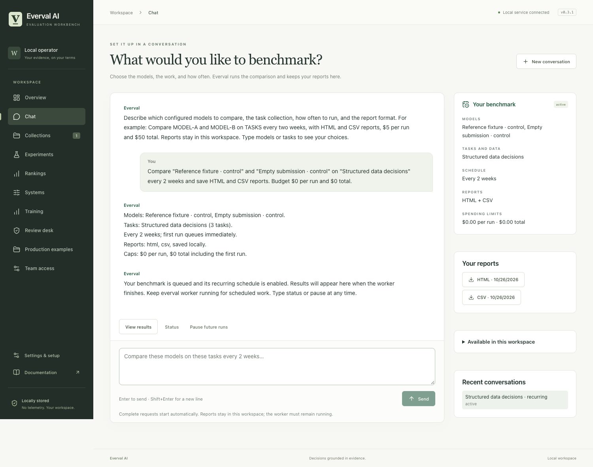

# Set up a benchmark by chatting

[Documentation](index.md) · [Connect models](providers.md) · [Choose tasks](scenarios.md)

Tell Everval what to compare and how often. It saves the benchmark, queues the first run, repeats it on schedule, and writes your reports locally.

This is a current-source feature. The published npm 0.3.1 package predates it; use the [source installation](quickstart.md#install-from-source).



*An actual local run with built-in installation controls. [Verification and scope](evidence/2026-10-26-chat/README.md).*

## Describe what you want

```sh
uv run everval chat
```

Or press **Ctrl+J** in the terminal workbench, or choose **Chat** in the browser.

With these models and task set already saved in your workspace, type:

> Compare Support baseline and Support candidate on Support tickets every two weeks. Save HTML and CSV reports. Budget $2 per run and $20 total.

Everval shows the models, task set, frequency, reports, and spending limits it understood. A complete instruction starts automatically. Answer missing details in the same conversation:

> Every two weeks, with HTML and CSV reports.

> $2 per run and $20 total.

There is no separate configuration file to write. Chat uses the existing evaluation engine and spending controls. Setup itself makes no model calls.

## Try it without a model key

Use a separate workspace for this installation walkthrough. Run these commands in the same shell:

```sh
mkdir -p "$HOME/.local/share/everval/demos"
everval_chat_dir="$(mktemp -d "$HOME/.local/share/everval/demos/chat.XXXXXX")"
export EVERVAL_DATA_DIR="$everval_chat_dir"
uv run everval init --starters
uv run everval chat
```

Type:

> Compare fixture-reference and fixture-incomplete on starter-data every two weeks and save HTML and CSV reports.

These built-in controls need no paid budget, API key, Docker, or inference service. They check the workflow, not model quality. The first run queues immediately; later runs use a two-week interval.

Type **status** to inspect the benchmark, then **pause** when finished. Pausing stops future admissions; already queued work remains visible in Experiments. Closing a conversation preserves its transcript and schedule.

## Connect your work once

Save models through **Systems** or the [provider guide](providers.md). Save task sets with inputs and explicit grading checks through **Collections**, a [reviewed task pack](community-packs.md), or the [repository workflow](guided-run.md).

Then use their names in chat. Type **models** or **tasks** to see the choices; exact IDs resolve duplicate names. A task set already contains the data and grading rules. Expected answers and private checks stay separate from model-visible tasks.

If you supply a raw file path or URL, chat asks you to import it and define checks first. It does not read arbitrary paths, guess correct answers, or execute conversation text.

## Results and controls

| Say or do | Result |
| --- | --- |
| **status** | Inspect current execution and scheduling state. |
| **pause** | Stop future scheduled admissions. |
| **resume** | Enable future runs within the remaining budget. |
| **models** / **tasks** | List the configured choices. |
| Open **View results** | Inspect the initial experiment and its evidence. |
| Open a report | Download HTML, CSV, JSON, or Markdown. |
| Start a new conversation | Define a different frozen comparison. |

HTML gives a readable comparison, CSV gives trial rows, JSON preserves detailed evidence, and Markdown gives a portable summary. Reports are generated from saved results without another model call. Failed report writes are retained and retried by the worker.

Automatic email, Slack, external destinations, and PDF generation are not implemented in this workflow. Requests for unsupported delivery remain unresolved until you choose a supported format and local delivery.

For independent human review with locked judgments and controlled identity reveal, use [Double-blind studies](double-blind.md). Requests for double-blind or confidential execution stay blocked in chat across follow-ups; they do not silently become ordinary runs. Say **use standard unblinded evaluation** only if you want to remove that requirement. Existing active runs cannot be retroactively protected.

## What runs in the background

Everval freezes the tasks, model configurations, and per-run budget. The initial experiment, recurring schedule, and activation record commit together; retrying activation does not create a duplicate initial run. Later runs use that frozen comparison and retain failures, incomplete attempts, and unknown costs.

The total cap includes the first run and all later runs from the conversation. Pending and uncertain usage stay reserved. Workspace and project caps still apply. Provider accounting excludes hardware, hosting, and development costs.

Keep the host awake and its worker running. Terminal chat starts the local worker unless you pass `--no-worker`. Browser chat uses the server worker or your dedicated deployment worker:

```sh
uv run everval worker
```

For a persistent service, follow the [on-premises guide](on-premises.md). After an offline period, missed intervals coalesce into one due run, rather than a burst of catch-up runs.

“Every two weeks” means an elapsed interval of fourteen days. Fixed intervals from five minutes to 365 days are supported. Calendar times such as “every other Monday at 9 a.m.,” automatic ingestion of new data, and editing active frozen benchmarks require separate workflows. Chat explains unsupported requests instead of substituting another behavior.

## Resume or automate

```sh
uv run everval chat --list
uv run everval chat --session CONVERSATION_ID
uv run everval chat --session CONVERSATION_ID --message "status" --json
uv run everval chat --session CONVERSATION_ID --message "pause"
```

For automation, `--message` returns the reply and conversation ID. Use `--no-worker` when another service owns execution. Include `draft only` to prepare without starting.

The API provides `/api/conversations`, `/catalog`, `/{id}/messages`, and report downloads under the existing workspace permissions. Parsing runs locally with supported setup instructions; it is not a general-purpose assistant or a shell.
