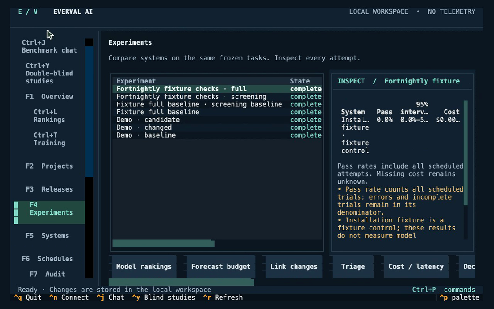
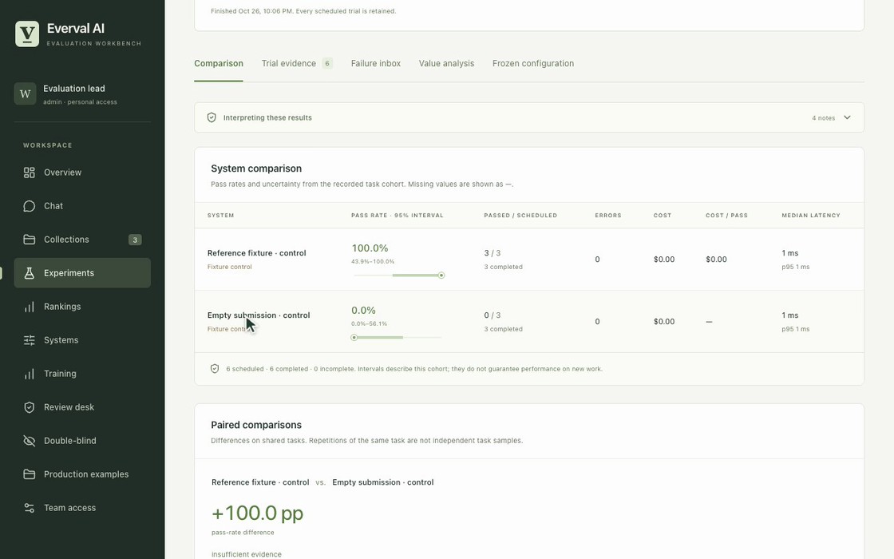
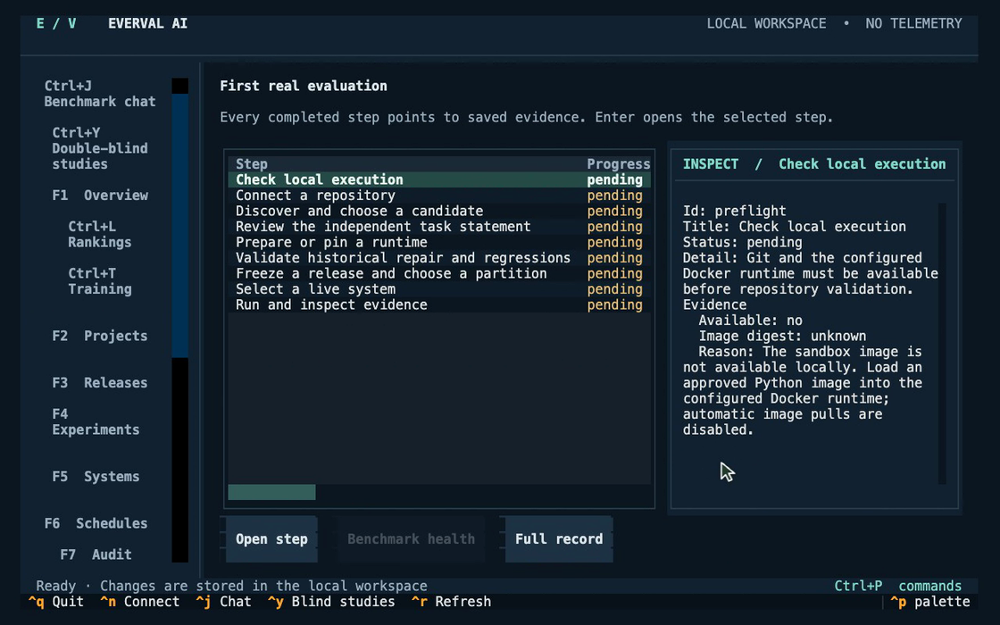
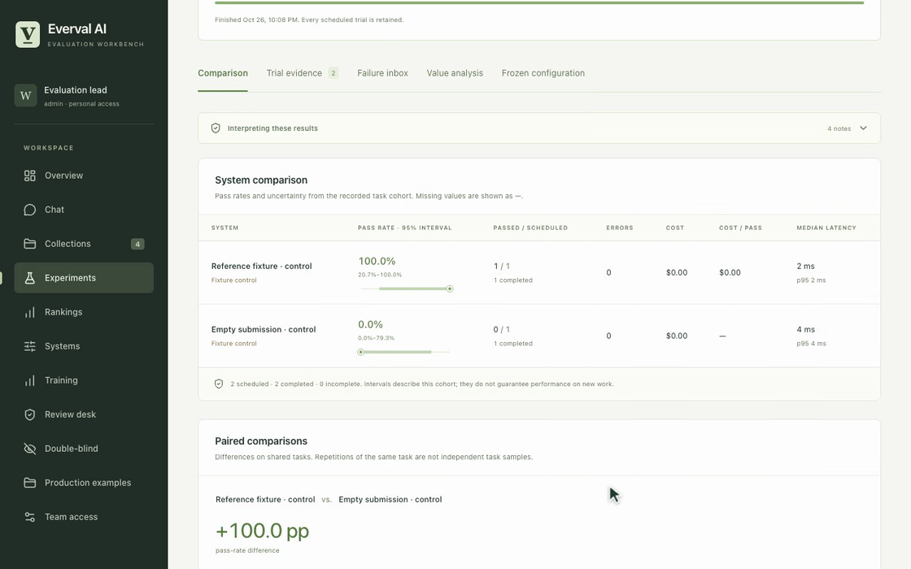
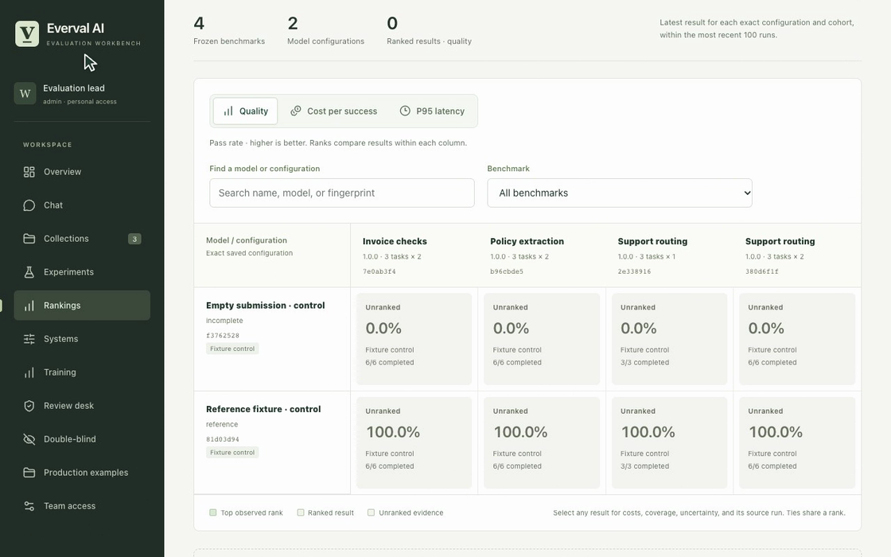
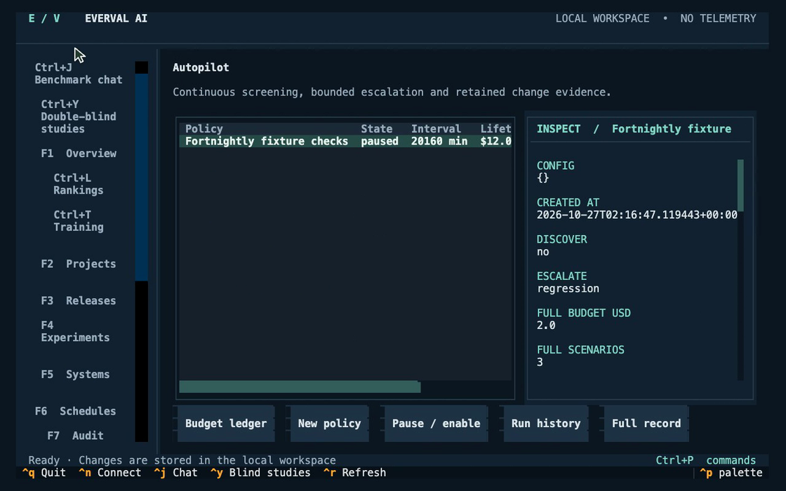
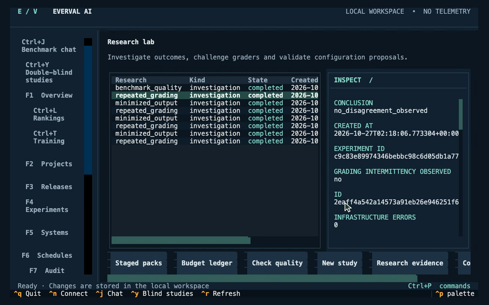
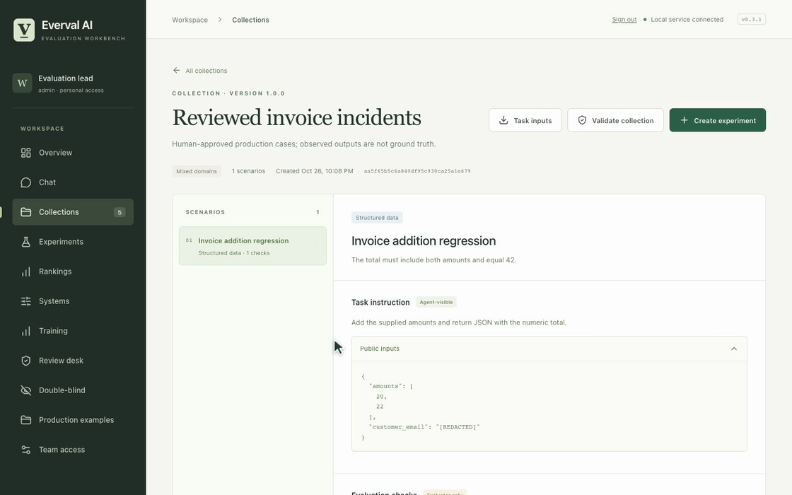
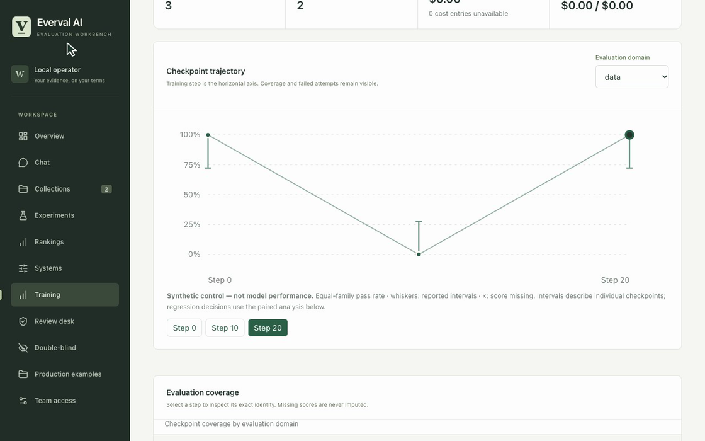
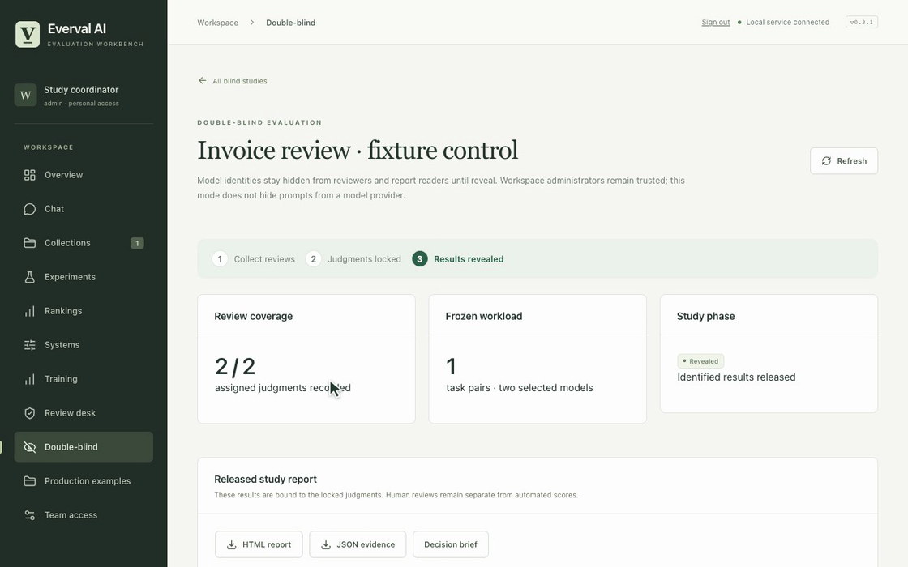

# Everval without animation

[Continuous recordings](demos.md) · [Project](../README.md)

Still previews from the continuous recordings. Results use original controls and synthetic data.

## Terminal workbench

A real terminal process responds to typed command-palette searches, navigation and selection changes.

[Watch the recording](demos.md#terminal-workbench) · [Workflow guide](terminal.md)

## Benchmark chat

Type a recurring benchmark request, start the real fixture run, inspect its reports and pause future runs.

[Watch the recording](demos.md#chat-and-reports) · [Workflow guide](chat.md)

## Repository onboarding

Type through connection and discovery for an original local Git repository. Review and isolated validation remain pending; this is not a completed repository benchmark.

[Watch the recording](demos.md#repository-onboarding) · [Workflow guide](guided-run.md)

## Tasks and comparisons

Type a task contract, keep evaluator checks separate, validate controls and inspect both comparison outcomes.

[Watch the recording](demos.md#tasks-and-comparisons) · [Workflow guide](scenarios.md)

## Rankings, cost and latency

Move through the benchmark matrix, switch metrics, filter configurations and inspect the underlying evidence. Free controls do not establish real model cost or latency.

[Watch the recording](demos.md#rankings) · [Workflow guide](rankings.md)

## Continuous checks and budgets

Use the terminal to inspect a bounded policy, spending commitments and its retained observations. The recorded policy is left paused.

[Watch the recording](demos.md#autopilot-budget) · [Workflow guide](autopilot.md)

## Failure investigation

Navigate failed attempts and saved evidence through the actual terminal, then inspect investigation and grader-quality records.

[Watch the recording](demos.md#failure-research) · [Workflow guide](research-loop.md)

## Production cases and team review

An approver inspects an incident previously staged by another identity, types expected behavior, validates the control and publishes a collection.

[Watch the recording](demos.md#production-cases) · [Workflow guide](production-cases.md)

## Checkpoint monitoring

Move through checkpoint trajectories, domain selection, coverage, investigations and qualification records. These are explicitly synthetic controls.

[Watch the recording](demos.md#checkpoint-monitoring) · [Workflow guide](post-training.md)

## Double-blind review

The coordinator begins with completed reviews, locks the judgments, types a release reason, reveals identities and opens the report. This is trusted-custodian review.

[Watch the recording](demos.md#double-blind) · [Workflow guide](double-blind.md)
