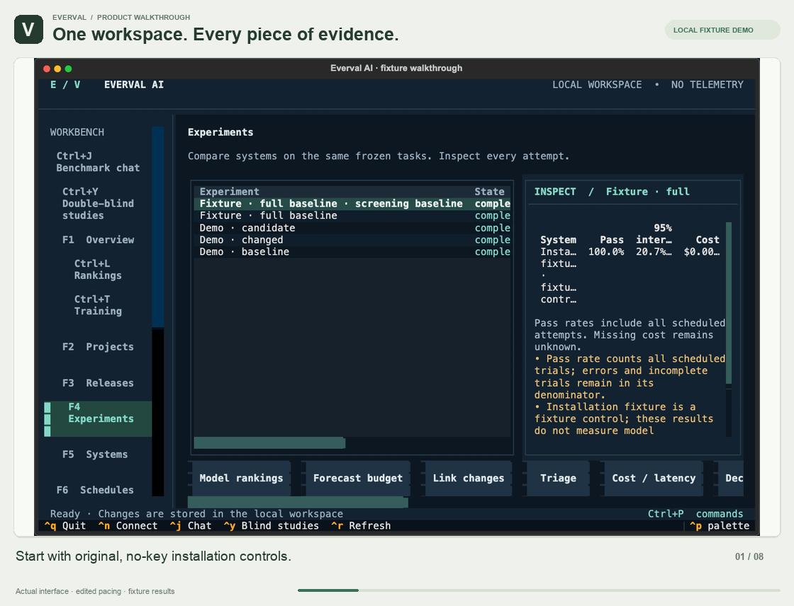
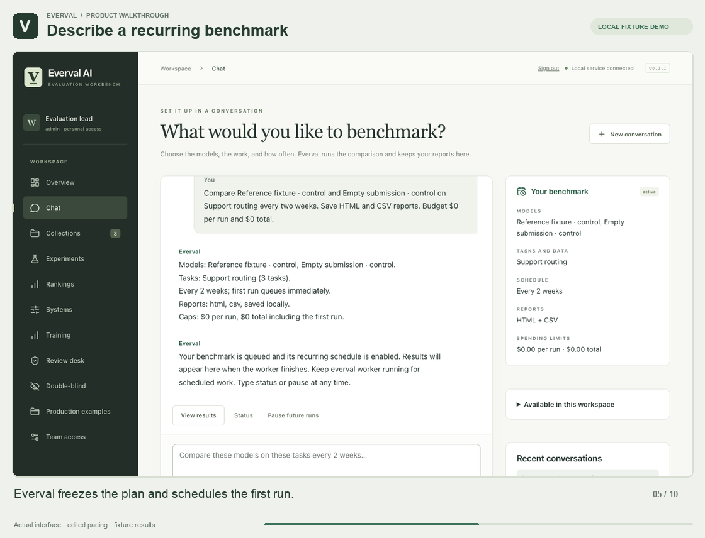
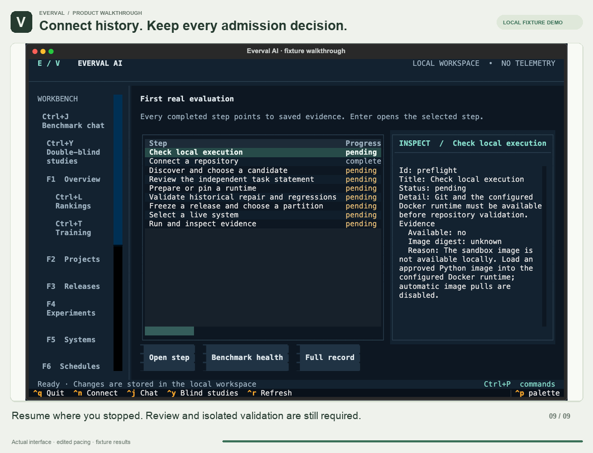
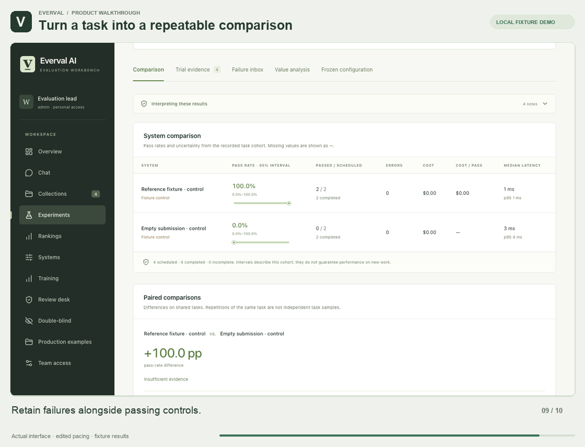
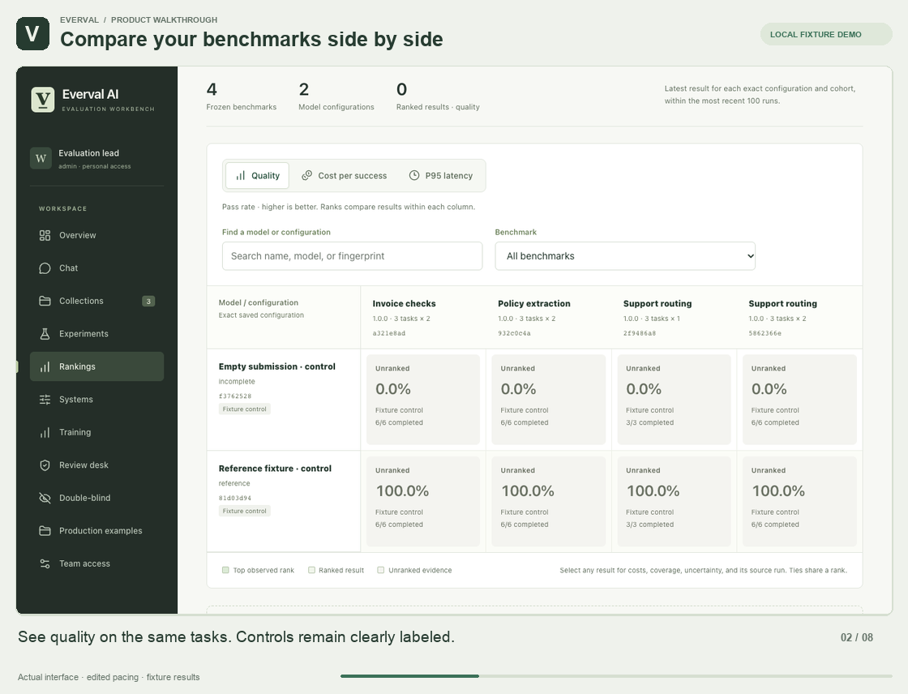
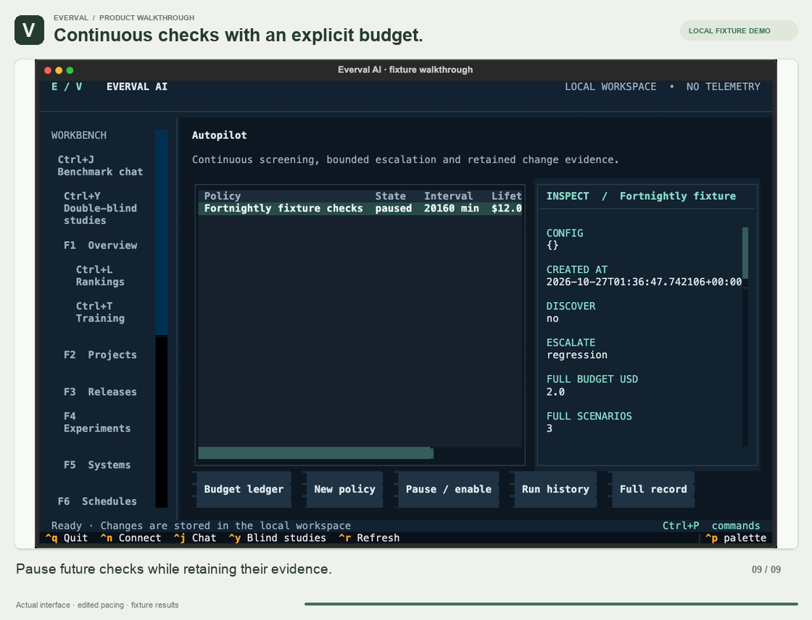
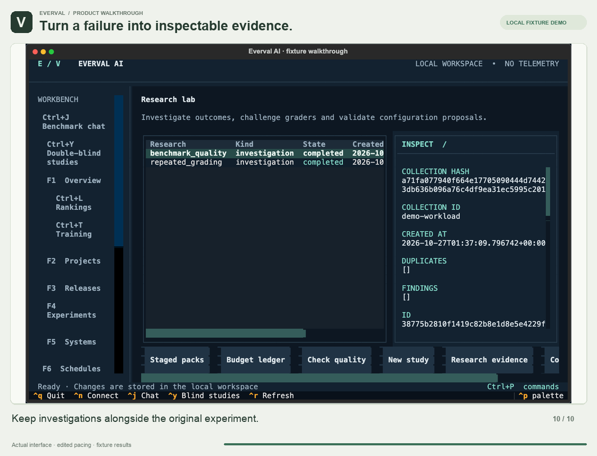
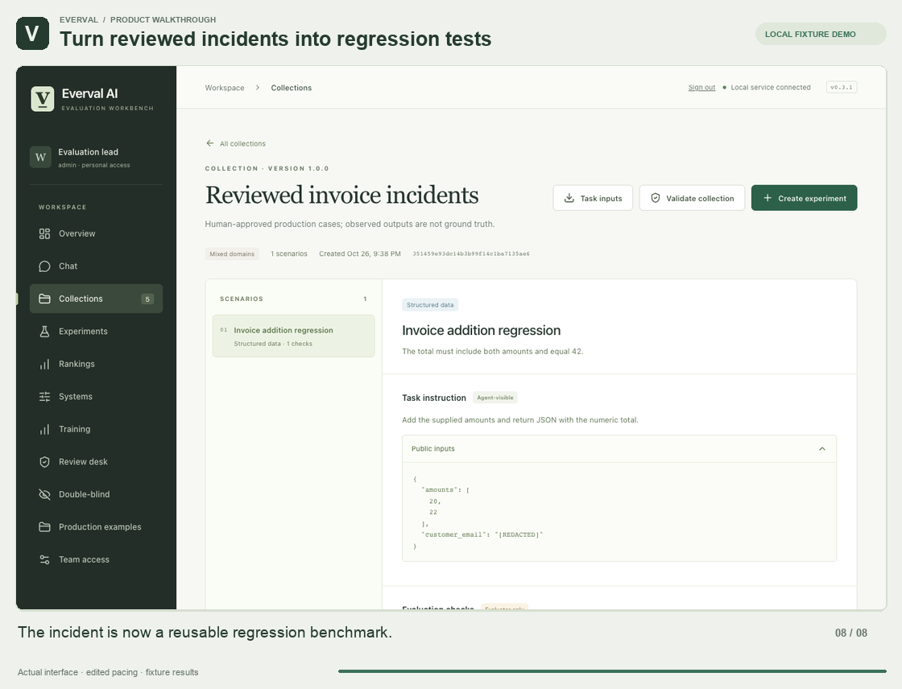
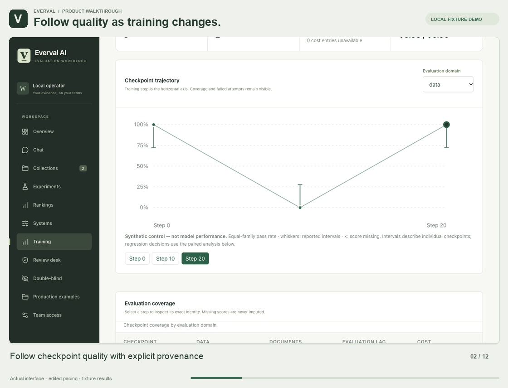
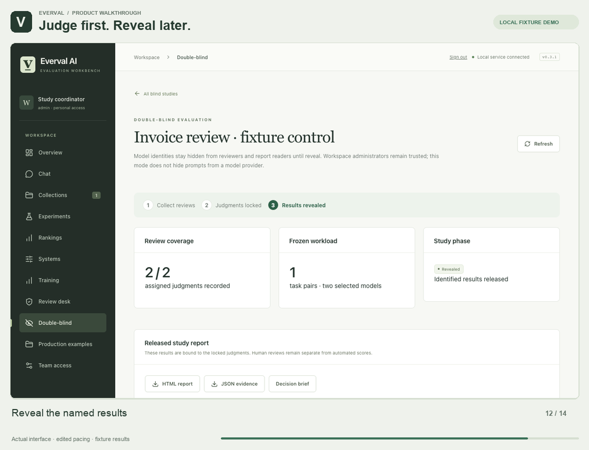

# Everval without animation

[Animated gallery](demos.md) · [Project](../README.md) · [Install from source](quickstart.md#install-from-source)

Still frames from the same workflows. These are original installation controls and synthetic demonstrations, not model-quality evidence.

## Terminal workbench

Move through completed runs, systems, the command palette, audit records and saved schedules.

[Workflow guide](terminal.md) · [Watch the clip](demos.md#terminal-workbench)

## Benchmark chat

Describe models, tasks, an interval and reports. Start a comparison, inspect local reports and pause future runs.

[Workflow guide](chat.md) · [Watch the clip](demos.md#chat-and-reports)

## Repository onboarding

Connect an original Git repository, discover work, inspect admission decisions and open the resumable guide. This clip stops before isolated validation; it does not show a validated repository benchmark.

[Workflow guide](guided-run.md) · [Watch the clip](demos.md#repository-onboarding)

## Tasks and comparisons

Create a task with public instructions and separate evaluator checks, validate original controls and compare attempts.

[Workflow guide](scenarios.md) · [Watch the clip](demos.md#tasks-and-comparisons)

## Rankings, cost and latency

Switch quality, cost per success and latency across frozen benchmarks, then inspect evidence. These free controls do not demonstrate real provider pricing or model latency.

[Workflow guide](rankings.md) · [Watch the clip](demos.md#rankings)

## Continuous checks and budgets

Configure screening and full-run budgets, inspect cumulative commitments, review triggers and pause a policy. The recorded policy is left paused.

[Workflow guide](autopilot.md) · [Watch the clip](demos.md#autopilot-budget)

## Failure investigation and research

Inspect a failed attempt, regrade saved output, retain an investigation and inspect structural grader-quality signals without additional inference.

[Workflow guide](research-loop.md) · [Watch the clip](demos.md#failure-research)

## Production cases and team review

Stage an original example incident, inspect redaction, obtain approval from a separate identity and publish a reviewed collection.

[Workflow guide](production-cases.md) · [Watch the clip](demos.md#production-cases)

## Checkpoint monitoring

Explore trajectories, coverage, paired decisions, investigations, qualification gaps and held-out evaluation mixes. All checkpoint and mix observations here are synthetic installation controls.

[Workflow guide](post-training.md) · [Watch the clip](demos.md#checkpoint-monitoring)

## Double-blind review

Freeze a pair and rubric, collect anonymous judgments, lock evidence, reveal identities and export a report. This is trusted-custodian review, not hardware-backed confidentiality.

[Workflow guide](double-blind.md) · [Watch the clip](demos.md#double-blind)

