# Product demos

[Project](../README.md) · [Quickstart](quickstart.md#install-from-source) · [Documentation](index.md)

## A complete benchmark workflow

Type a request, run the comparison, inspect results and open the benchmark matrix. This is one continuous session using original installation controls.

**46 seconds.** [Open animation](assets/demos/recordings/everval-tour.gif) · [Full-resolution video](assets/demos/recordings/everval-tour.mp4) · [Still image](assets/demos/recordings/everval-tour.png)

## Explore each workflow

**Click a preview to watch its animation on GitHub.** Each viewing page loads one continuous recording.

| | |
| --- | --- |
| [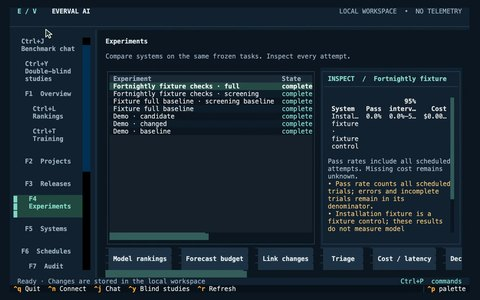](demos/terminal-workbench.md) **[Terminal workbench · Watch 16s](demos/terminal-workbench.md)** Search the command palette, switch views and inspect saved experiment evidence. | [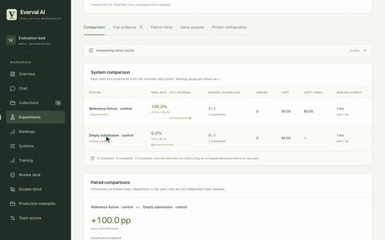](demos/chat-and-reports.md) **[Benchmark chat · Watch 32s](demos/chat-and-reports.md)** Type a recurring request, start a fixture run, open reports and pause future runs. |
| [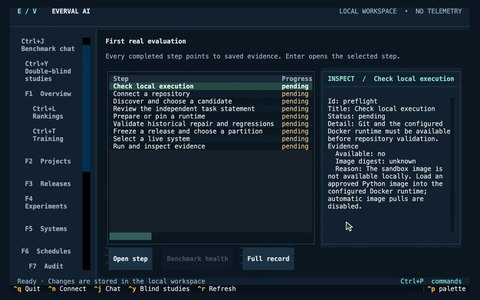](demos/repository-onboarding.md) **[Connect a repository · Watch 23s](demos/repository-onboarding.md)** Connect an original local Git repository and discover candidate work. | [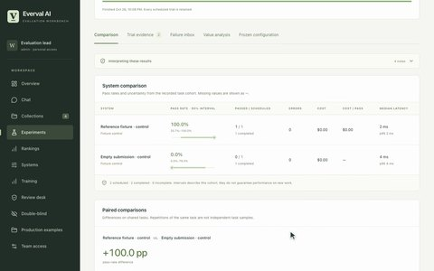](demos/tasks-and-comparisons.md) **[Tasks and comparisons · Watch 47s](demos/tasks-and-comparisons.md)** Write a task contract, validate its controls and inspect both comparison outcomes. |
| [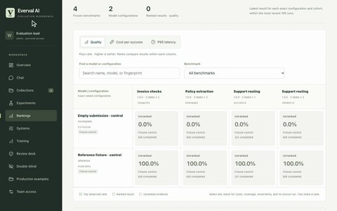](demos/rankings.md) **[Rankings, cost and latency · Watch 30s](demos/rankings.md)** Switch metrics, filter configurations and open the evidence behind the matrix. | [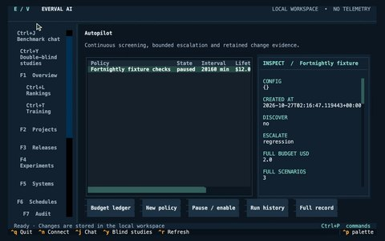](demos/autopilot-budget.md) **[Continuous checks and budgets · Watch 16s](demos/autopilot-budget.md)** Inspect a bounded policy, spending commitments and retained observations. |
| [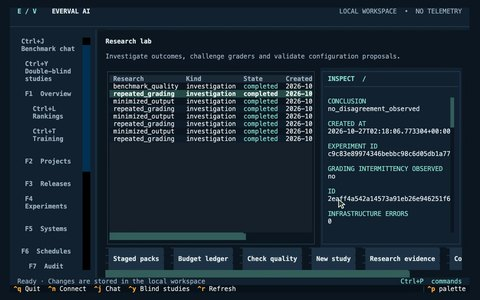](demos/failure-research.md) **[Investigate failures · Watch 27s](demos/failure-research.md)** Open failed attempts, inspect evidence and review grader-quality records. | [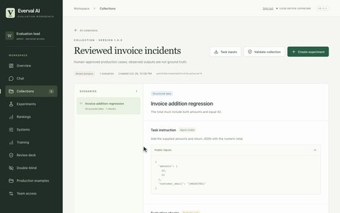](demos/production-cases.md) **[Production cases and team review · Watch 34s](demos/production-cases.md)** Review a staged incident, enter expected behavior and publish a validated collection. |
| [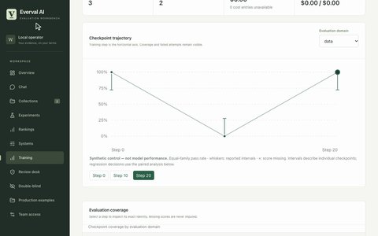](demos/checkpoint-monitoring.md) **[Checkpoint monitoring · Watch 39s](demos/checkpoint-monitoring.md)** Inspect checkpoint trajectories, domain coverage and investigation records. | [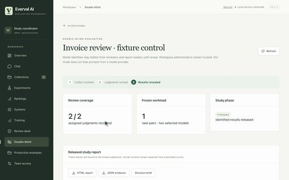](demos/double-blind.md) **[Double-blind coordinator · Watch 35s](demos/double-blind.md)** Lock completed judgments, enter a release reason and reveal the report. |
| [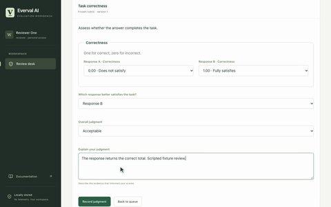](demos/blind-reviewer.md) **[Anonymous reviewer · Watch 27s](demos/blind-reviewer.md)** Read responses without model names, score them and submit a judgment. | [Install current source](quickstart.md#install-from-source) Try the workflows with your own tasks. |

The recordings show the actual browser and terminal, with pointer movement, typing, scrolling and live navigation. They use original controls or explicitly synthetic data and make no model API calls. Featured workflows require the current source checkout; npm 0.3.1 predates several of them.

[Still-image gallery](demo-stills.md) · [Capture recipes](../scripts/demos/README.md) · [Verification](evidence/2026-10-26-motion/README.md).
