# See Everval in motion

[Project](../README.md) · [Install from source](quickstart.md#install-from-source) · [Still images](demo-stills.md)

Continuous recordings of the actual browser and terminal. Watch pointer movement, typed text, scrolling, live navigation and results. Each recording follows one session without internal cuts. Full-resolution MP4s accompany the GIFs.

All runs use original installation controls or explicitly synthetic data. The recordings demonstrate product workflows; they do not measure model quality or latency. Current-source features include functionality added after npm 0.3.1.

## One request, one complete session

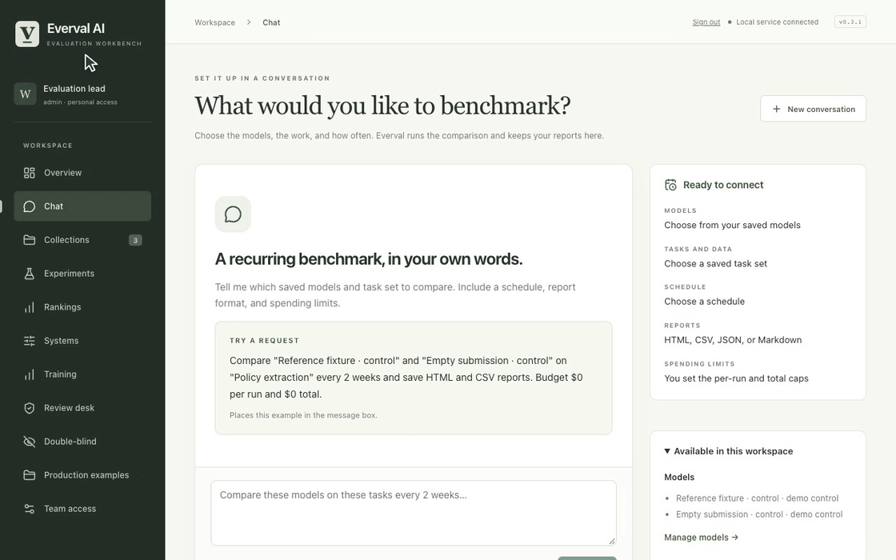

[Full-resolution MP4](assets/demos/continuous/everval-tour.mp4) · [Still image](assets/demos/continuous/everval-tour.png)

## Explore the workflows

[Terminal workbench](#terminal-workbench) · [Benchmark chat](#chat-and-reports) · [Repository onboarding](#repository-onboarding) · [Tasks and comparisons](#tasks-and-comparisons) · [Rankings, cost and latency](#rankings) · [Continuous checks and budgets](#autopilot-budget) · [Failure investigation](#failure-research) · [Production cases and team review](#production-cases) · [Checkpoint monitoring](#checkpoint-monitoring) · [Double-blind review](#double-blind)

## Terminal workbench

A real terminal process responds to typed command-palette searches, navigation and selection changes.

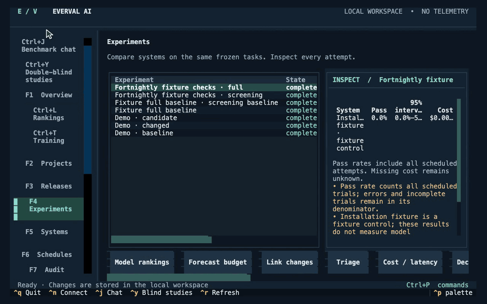

[Full-resolution MP4](assets/demos/continuous/terminal-workbench.mp4) · [Still image](assets/demos/continuous/terminal-workbench.png) · [Workflow guide](terminal.md)

## Benchmark chat

Type a recurring benchmark request, start the real fixture run, inspect its reports and pause future runs.

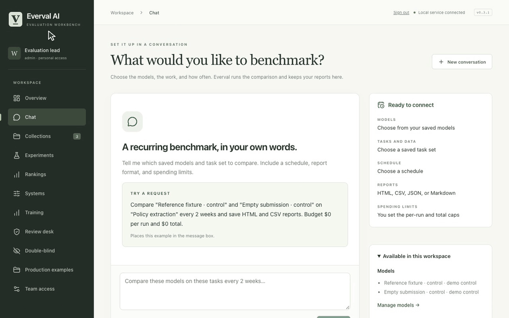

[Full-resolution MP4](assets/demos/continuous/chat-and-reports.mp4) · [Still image](assets/demos/continuous/chat-and-reports.png) · [Workflow guide](chat.md)

## Repository onboarding

Type through connection and discovery for an original local Git repository. Review and isolated validation remain pending; this is not a completed repository benchmark.

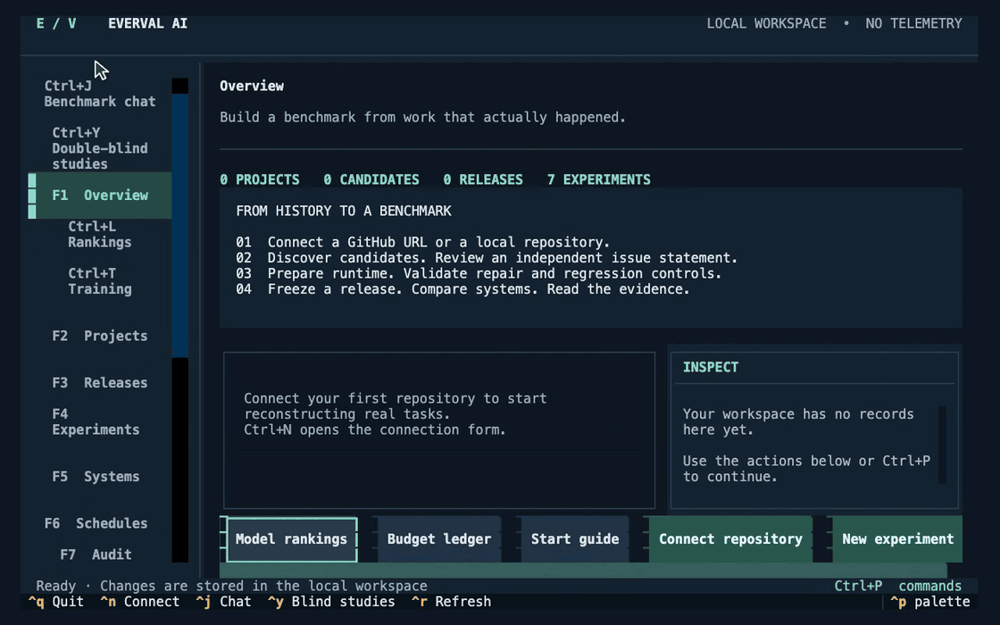

[Full-resolution MP4](assets/demos/continuous/repository-onboarding.mp4) · [Still image](assets/demos/continuous/repository-onboarding.png) · [Workflow guide](guided-run.md)

## Tasks and comparisons

Type a task contract, keep evaluator checks separate, validate controls and inspect both comparison outcomes.

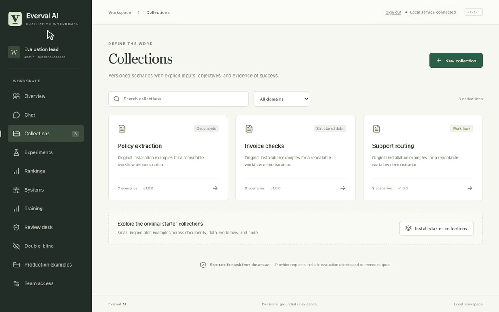

[Full-resolution MP4](assets/demos/continuous/tasks-and-comparisons.mp4) · [Still image](assets/demos/continuous/tasks-and-comparisons.png) · [Workflow guide](scenarios.md)

## Rankings, cost and latency

Move through the benchmark matrix, switch metrics, filter configurations and inspect the underlying evidence. Free controls do not establish real model cost or latency.

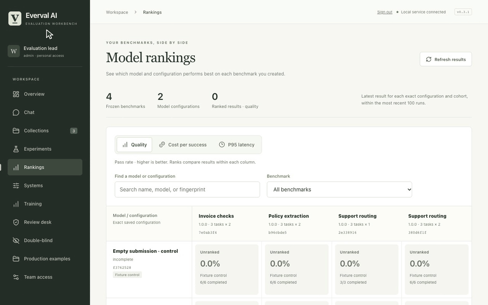

[Full-resolution MP4](assets/demos/continuous/rankings.mp4) · [Still image](assets/demos/continuous/rankings.png) · [Workflow guide](rankings.md)

## Continuous checks and budgets

Use the terminal to inspect a bounded policy, spending commitments and its retained observations. The recorded policy is left paused.

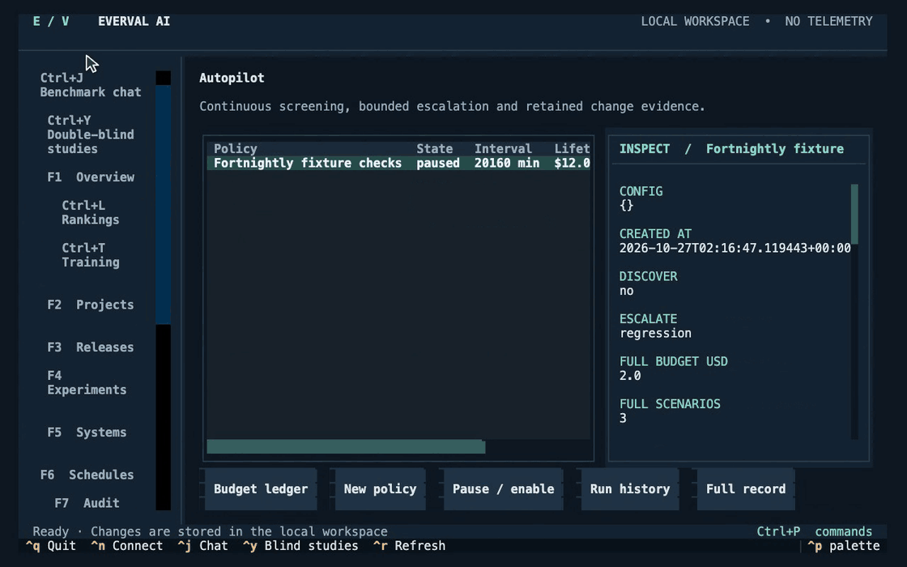

[Full-resolution MP4](assets/demos/continuous/autopilot-budget.mp4) · [Still image](assets/demos/continuous/autopilot-budget.png) · [Workflow guide](autopilot.md)

## Failure investigation

Navigate failed attempts and saved evidence through the actual terminal, then inspect investigation and grader-quality records.

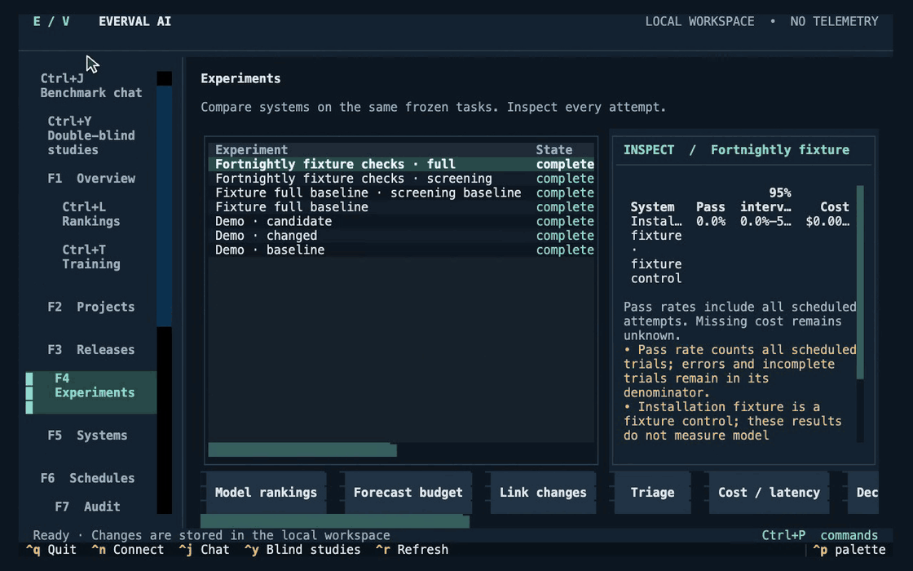

[Full-resolution MP4](assets/demos/continuous/failure-research.mp4) · [Still image](assets/demos/continuous/failure-research.png) · [Workflow guide](research-loop.md)

## Production cases and team review

An approver inspects an incident previously staged by another identity, types expected behavior, validates the control and publishes a collection.

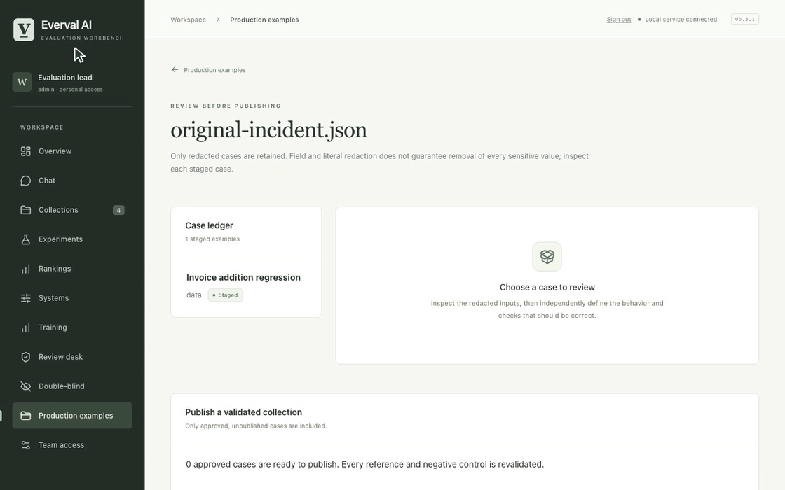

[Full-resolution MP4](assets/demos/continuous/production-cases.mp4) · [Still image](assets/demos/continuous/production-cases.png) · [Workflow guide](production-cases.md)

## Checkpoint monitoring

Move through checkpoint trajectories, domain selection, coverage, investigations and qualification records. These are explicitly synthetic controls.

[Full-resolution MP4](assets/demos/continuous/checkpoint-monitoring.mp4) · [Still image](assets/demos/continuous/checkpoint-monitoring.png) · [Workflow guide](post-training.md)

## Double-blind review

The coordinator begins with completed reviews, locks the judgments, types a release reason, reveals identities and opens the report. This is trusted-custodian review.

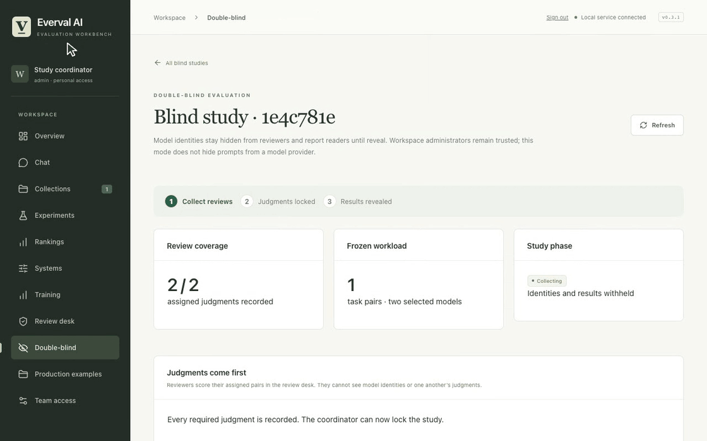

[Full-resolution MP4](assets/demos/continuous/double-blind.mp4) · [Still image](assets/demos/continuous/double-blind.png) · [Workflow guide](double-blind.md)

### The reviewer's session

A separate continuous recording follows an anonymous reviewer through the responses, scores, rationale and submission. It is recorded independently from the coordinator's session; these are scripted demonstration accounts.

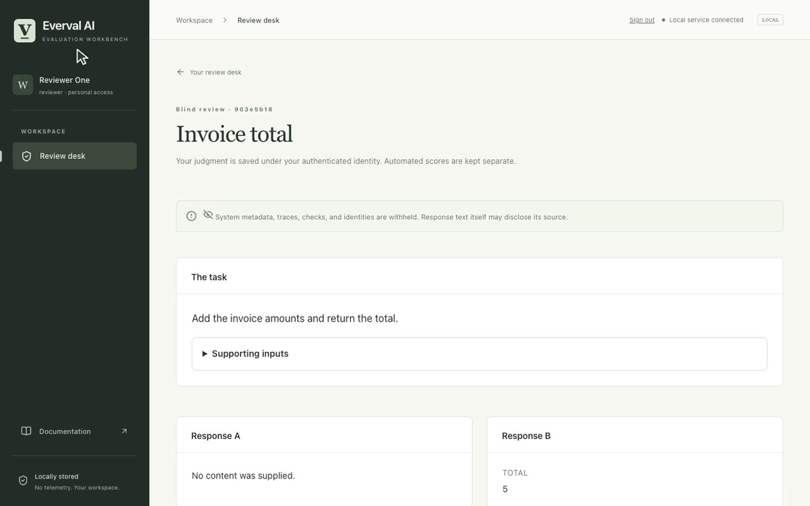

[Full-resolution MP4](assets/demos/continuous/blind-reviewer.mp4) · [Still image](assets/demos/continuous/blind-reviewer.png)

## Capture and verification

The browser captures are recorded at 25 frames per second. Terminal captures stream a real PTY into a local terminal renderer. The published GIFs and MP4s preserve continuous recorded motion; only the beginning and end are trimmed. No model API calls are made, and raw workspaces and credentials stay private.

[Capture recipes](../scripts/demos/README.md) · [Media metadata](assets/demos/continuous/manifest.json) · [Verification](evidence/2026-10-26-motion/README.md).
