# Watch Everval work

[Project](../README.md) · [Install from source](quickstart.md#install-from-source) · [Still-image gallery](demo-stills.md)

Ten short walkthroughs from the actual terminal and browser interfaces, using original installation controls or explicitly synthetic data. Captions and timing are edited for readability; scores and transitions are not customer results or latency measurements.

These recordings show current source. npm 0.3.1 predates chat, checkpoint monitoring and dedicated double-blind studies.

## The thirty-second tour

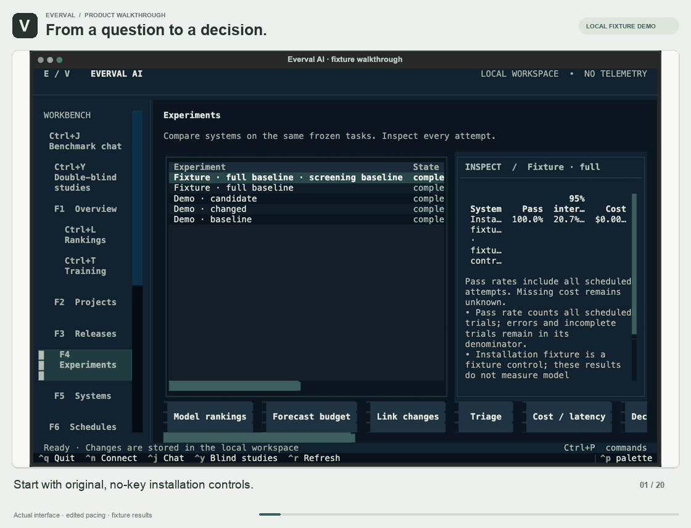

[Still image](assets/demos/everval-tour.png) · [Capture recipes](../scripts/demos/README.md) · [Media metadata](assets/demos/manifest.json)

## Choose a workflow

[Terminal workbench](#terminal-workbench) · [Benchmark chat](#chat-and-reports) · [Repository onboarding](#repository-onboarding) · [Tasks and comparisons](#tasks-and-comparisons) · [Rankings, cost and latency](#rankings) · [Continuous checks and budgets](#autopilot-budget) · [Failure investigation and research](#failure-research) · [Production cases and team review](#production-cases) · [Checkpoint monitoring](#checkpoint-monitoring) · [Double-blind review](#double-blind)

## Terminal workbench

Move through completed runs, systems, the command palette, audit records and saved schedules.

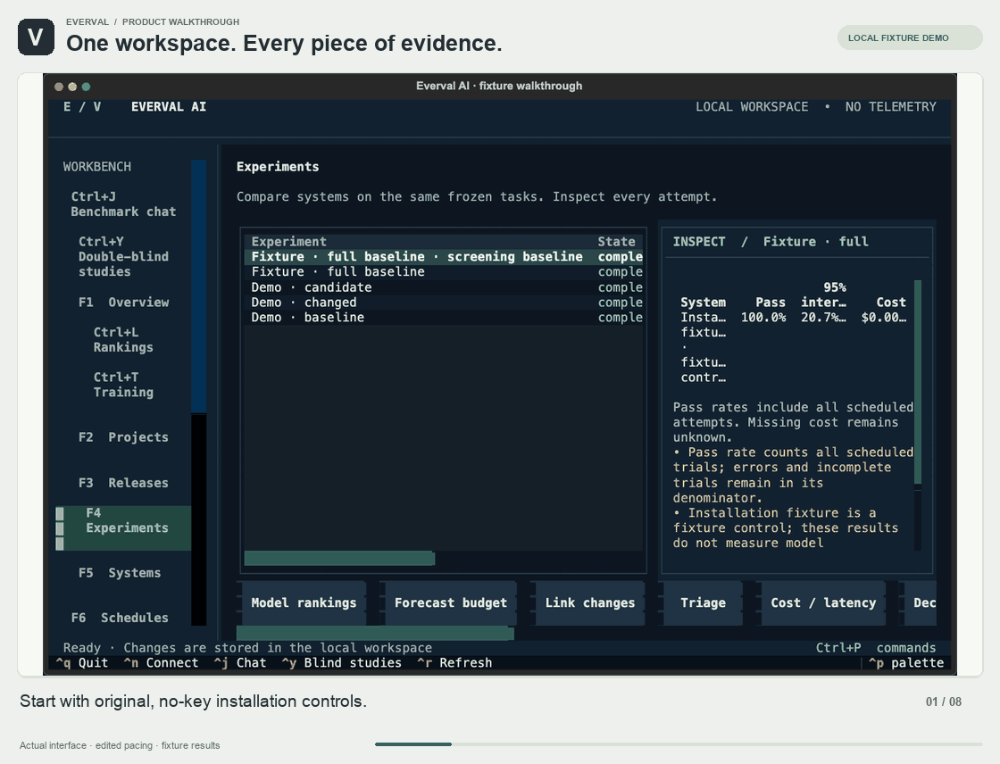

[Still image](assets/demos/terminal-workbench.png) · [Workflow guide](terminal.md)

## Benchmark chat

Describe models, tasks, an interval and reports. Start a comparison, inspect local reports and pause future runs.

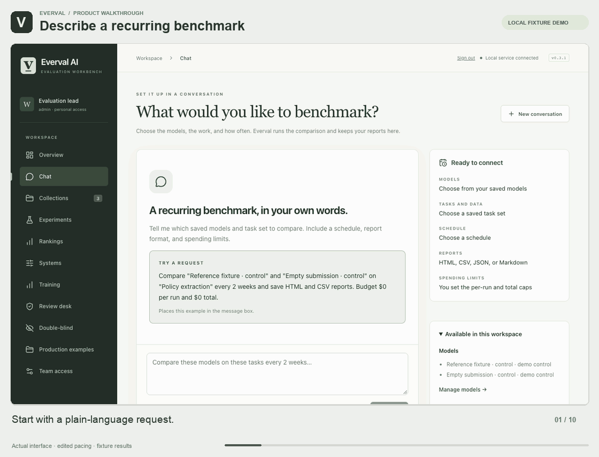

[Still image](assets/demos/chat-and-reports.png) · [Workflow guide](chat.md)

## Repository onboarding

Connect an original Git repository, discover work, inspect admission decisions and open the resumable guide. This clip stops before isolated validation; it does not show a validated repository benchmark.

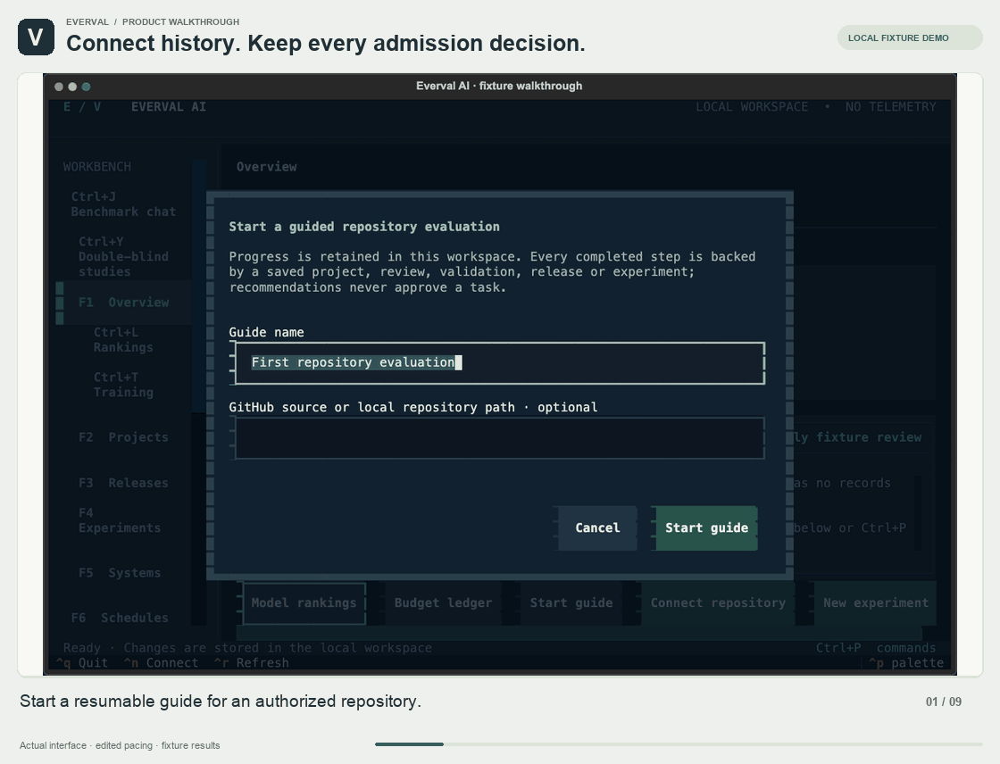

[Still image](assets/demos/repository-onboarding.png) · [Workflow guide](guided-run.md)

## Tasks and comparisons

Create a task with public instructions and separate evaluator checks, validate original controls and compare attempts.

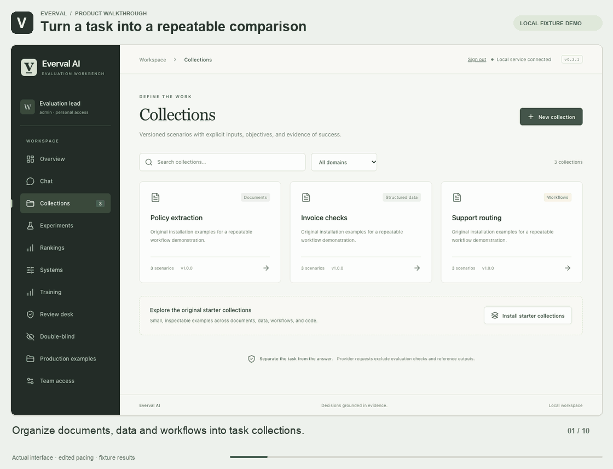

[Still image](assets/demos/tasks-and-comparisons.png) · [Workflow guide](scenarios.md)

## Rankings, cost and latency

Switch quality, cost per success and latency across frozen benchmarks, then inspect evidence. These free controls do not demonstrate real provider pricing or model latency.

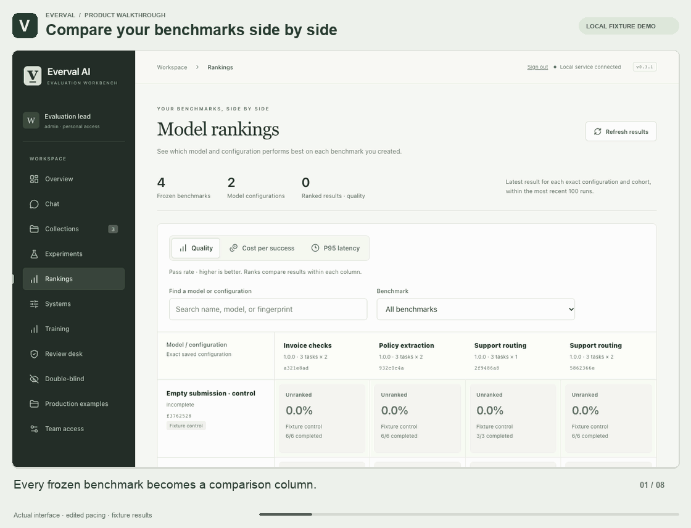

[Still image](assets/demos/rankings.png) · [Workflow guide](rankings.md)

## Continuous checks and budgets

Configure screening and full-run budgets, inspect cumulative commitments, review triggers and pause a policy. The recorded policy is left paused.

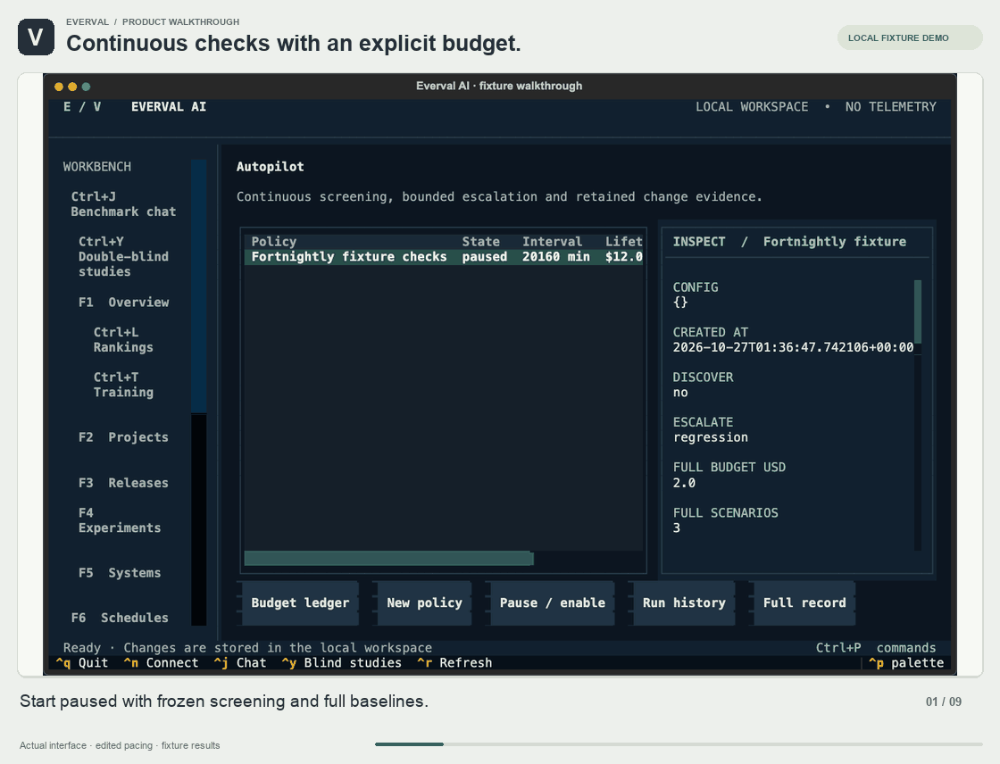

[Still image](assets/demos/autopilot-budget.png) · [Workflow guide](autopilot.md)

## Failure investigation and research

Inspect a failed attempt, regrade saved output, retain an investigation and inspect structural grader-quality signals without additional inference.

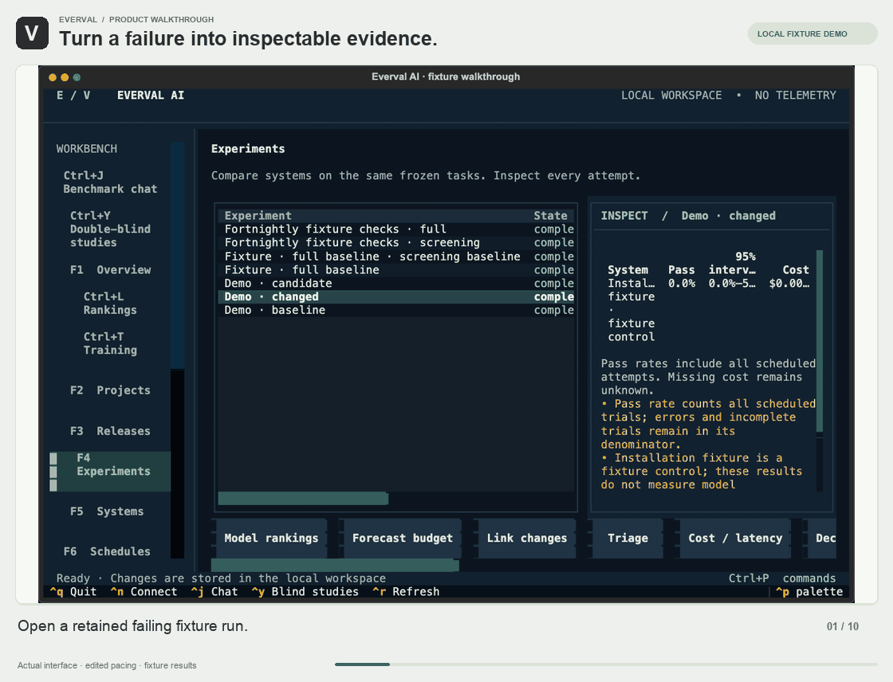

[Still image](assets/demos/failure-research.png) · [Workflow guide](research-loop.md)

## Production cases and team review

Stage an original example incident, inspect redaction, obtain approval from a separate identity and publish a reviewed collection.

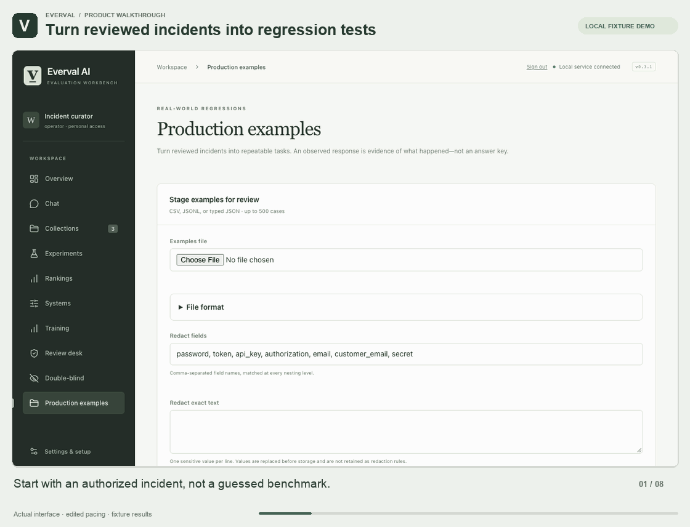

[Still image](assets/demos/production-cases.png) · [Workflow guide](production-cases.md)

## Checkpoint monitoring

Explore trajectories, coverage, paired decisions, investigations, qualification gaps and held-out evaluation mixes. All checkpoint and mix observations here are synthetic installation controls.

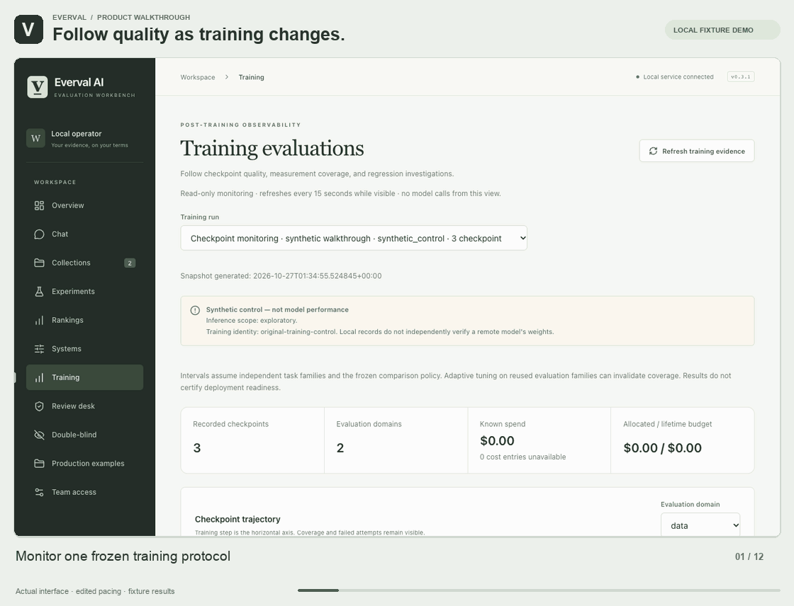

[Still image](assets/demos/checkpoint-monitoring.png) · [Workflow guide](post-training.md)

## Double-blind review

Freeze a pair and rubric, collect anonymous judgments, lock evidence, reveal identities and export a report. This is trusted-custodian review, not hardware-backed confidentiality.

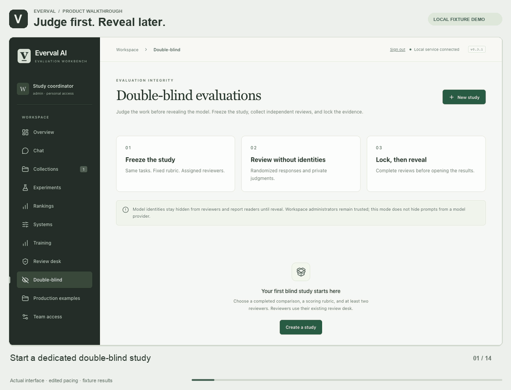

[Still image](assets/demos/double-blind.png) · [Workflow guide](double-blind.md)

## Recording boundaries

No model API calls were made. Raw workspaces, tokens and logs stay private. The OS account label in a terminal audit view is replaced with operator; no score, result or state is altered. Repository validation remains pending. Synthetic training observations do not establish checkpoint gains. [Capture recipes](../scripts/demos/README.md) · [Verification](evidence/2026-10-26-demos/README.md).
