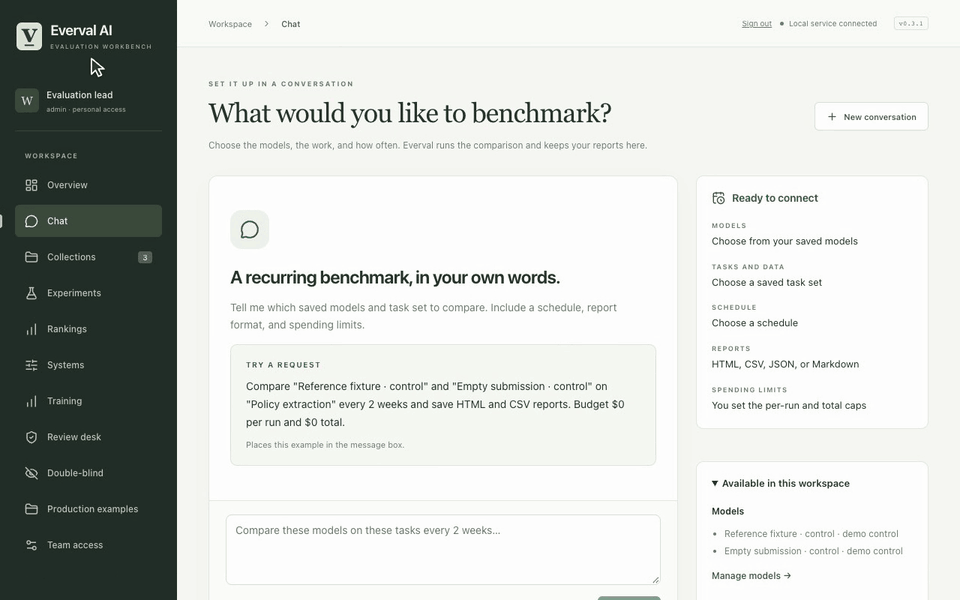

# Benchmark chat

[All demos](../demos.md) · [Project](../../README.md) · [Workflow guide](../chat.md)

Type a recurring request, start a fixture run, open reports and pause future runs.

**32 seconds, one continuous session.** [Open animation](../assets/demos/recordings/chat-and-reports.gif) · [Full-resolution video](../assets/demos/recordings/chat-and-reports.mp4) · [Still image](../assets/demos/recordings/chat-and-reports.png)

The comparison uses free installation controls; it does not measure model quality.

[Install current source](../quickstart.md#install-from-source) · [Capture and verification](../evidence/2026-10-26-motion/README.md)
