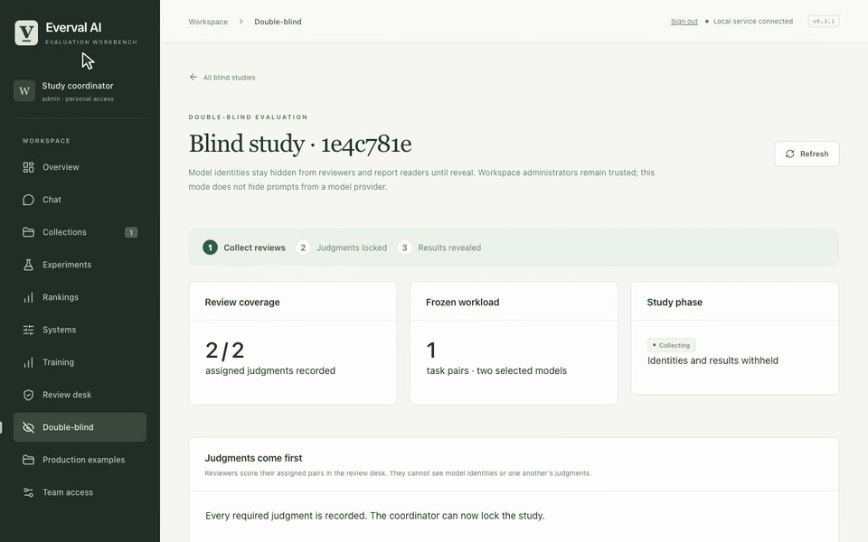

# Double-blind coordinator

[All demos](../demos.md) · [Project](../../README.md) · [Workflow guide](../double-blind.md)

Lock completed judgments, enter a release reason and reveal the report.

**35 seconds, one continuous session.** [Open animation](../assets/demos/recordings/double-blind.gif) · [Full-resolution video](../assets/demos/recordings/double-blind.mp4) · [Still image](../assets/demos/recordings/double-blind.png)

This is trusted-custodian blinding with scripted demonstration accounts.

[Install current source](../quickstart.md#install-from-source) · [Capture and verification](../evidence/2026-10-26-motion/README.md)
