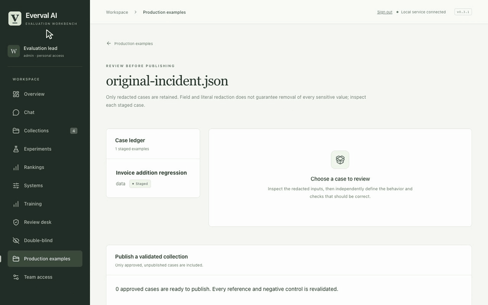

# Production cases and team review

[All demos](../demos.md) · [Project](../../README.md) · [Workflow guide](../production-cases.md)

Review a staged incident, enter expected behavior and publish a validated collection.

**34 seconds, one continuous session.** [Open animation](../assets/demos/recordings/production-cases.gif) · [Full-resolution video](../assets/demos/recordings/production-cases.mp4) · [Still image](../assets/demos/recordings/production-cases.png)

The staged incident is an original fixture. A separate importer identity prepares it before the approver session.

[Install current source](../quickstart.md#install-from-source) · [Capture and verification](../evidence/2026-10-26-motion/README.md)
