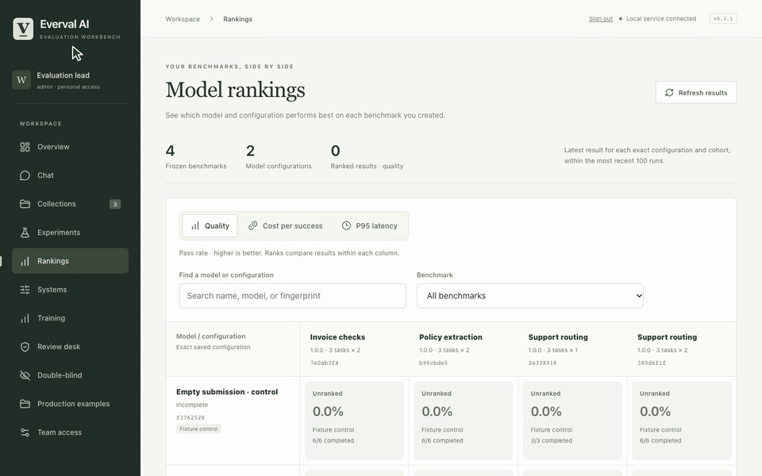

# Rankings, cost and latency

[All demos](../demos.md) · [Project](../../README.md) · [Workflow guide](../rankings.md)

Switch metrics, filter configurations and open the evidence behind the matrix.

**30 seconds, one continuous session.** [Open animation](../assets/demos/recordings/rankings.gif) · [Full-resolution video](../assets/demos/recordings/rankings.mp4) · [Still image](../assets/demos/recordings/rankings.png)

Free controls do not establish real model cost, latency or ranking.

[Install current source](../quickstart.md#install-from-source) · [Capture and verification](../evidence/2026-10-26-motion/README.md)
