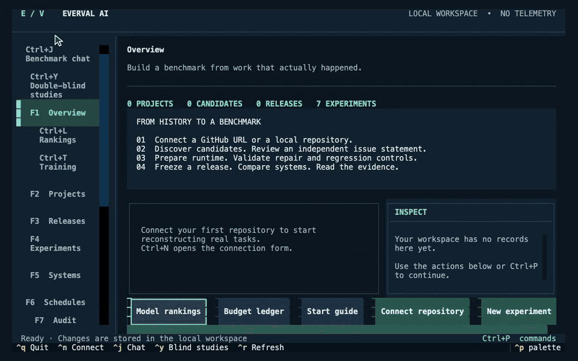

# Connect a repository

[All demos](../demos.md) · [Project](../../README.md) · [Workflow guide](../guided-run.md)

Connect an original local Git repository and discover candidate work.

**23 seconds, one continuous session.** [Open animation](../assets/demos/recordings/repository-onboarding.gif) · [Full-resolution video](../assets/demos/recordings/repository-onboarding.mp4) · [Still image](../assets/demos/recordings/repository-onboarding.png)

Review and isolated validation remain pending. This is onboarding, not a completed real-repository benchmark.

[Install current source](../quickstart.md#install-from-source) · [Capture and verification](../evidence/2026-10-26-motion/README.md)
