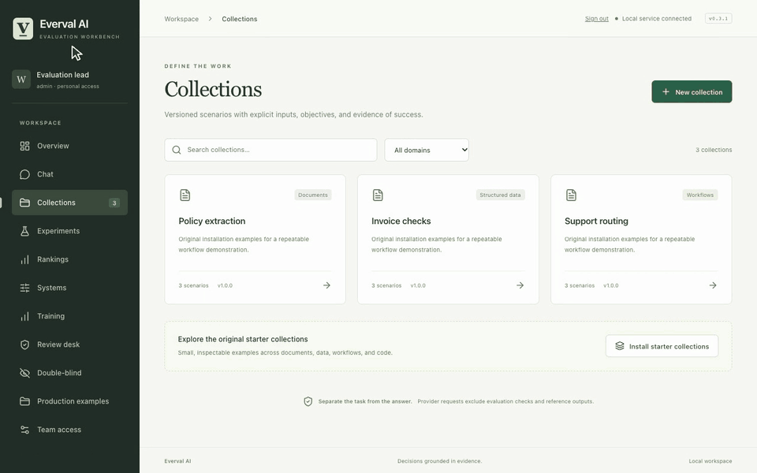

# Tasks and comparisons

[All demos](../demos.md) · [Project](../../README.md) · [Workflow guide](../scenarios.md)

Write a task contract, validate its controls and inspect both comparison outcomes.

**47 seconds, one continuous session.** [Open animation](../assets/demos/recordings/tasks-and-comparisons.gif) · [Full-resolution video](../assets/demos/recordings/tasks-and-comparisons.mp4) · [Still image](../assets/demos/recordings/tasks-and-comparisons.png)

The original controls demonstrate the workflow; their scores are not model results.

[Install current source](../quickstart.md#install-from-source) · [Capture and verification](../evidence/2026-10-26-motion/README.md)
