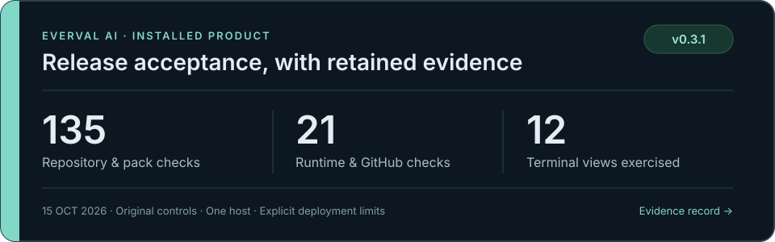

# Everval AI 0.3.1 acceptance evidence

Acceptance completed on 15 October 2026 using an installed release and original controlled workloads on one iMac. Source remains private; raw traces, hidden graders, credentials, and workspaces remain local.

The [machine-readable summary](summary.json) retains counts, identities, and evidence limitations. See [verification](../../verification.md) for detailed and historical checks, or [release acceptance](../../release-acceptance.md) to reproduce the stages.

## Installed product checks

| Area | Observed evidence |
| --- | --- |
| Repository admission and packs | [135/135 checks](repository-checks.json); 73 CLI commands; four original Git histories; six validation cycles; two pack workspaces; three demo domains. |
| Runtime and GitHub cases | 21/21 passed, zero skipped; Docker, private dependencies, Jest/Vitest, and read-only GitHub metadata. |
| Automation and recovery | Seven invariants verified across preserved original runs and bounded readiness rechecks; initial failed phases remain retained. |
| Interfaces and team boundaries | 29 acceptance groups; 40 detailed Textual checks across 12 views, six forms, and two terminal sizes; actual tmux, HTTP, and Chromium journeys. |
| Final interface follow-ups | Two installed choice-control checks; 13 focused browser groups, including completed regrading and retained evidence. |
| Corrected starter controls | 19/19 positive controls passed; 22/22 negative controls rejected before live evaluation. |
| Ordinary Python checks | Full run: 533 passed, 21 opt-in cases skipped. Later affected-suite, guard, and terminal regressions are reported separately in verification. |
| Frontend | 20 tests, type checking, and production build passed. |
| Dependency advisories | Development: 71 third-party packages checked, zero known advisories. Installed runtime: 36 third-party packages audited among [37 recorded distributions](runtime-dependencies.json), zero known advisories. |

These groups overlap and are not a combined unique test count. Fixture submissions deliberately exercise correct and incomplete behavior. Dependency audits are snapshots of known advisories.

## Corrected live cohort

All **114 attempts completed and passed**, with zero execution errors, in 537.167 seconds. Each configuration ran two repetitions of the same 19 original tasks: 10 code contracts and three each in documents, data, and workflow simulation. This single-turn API comparison did not exercise model tools or autonomous repository solving.

| Model | Passed / attempts | Estimated cohort cost | Provider p50 / p95, seconds | Attempt p95, seconds |
| --- | --- | --- | --- | --- |
| gpt-6-luna | 38 / 38 | $0.003671 | 2.522 / 6.348 | 9.165 |
| gpt-6.1-sol | 38 / 38 | $0.052120 | 2.538 / 4.917 | 8.260 |
| gpt-6-astra | 38 / 38 | $0.252400 | 2.527 / 5.231 | 9.179 |
| **Total** | **114 / 114** | **$0.308191** | — | — |

Provider-response latency excludes grading; total attempt duration includes it. The retained task-cluster Hoeffding 95% interval is **68.84%–100%** for each configuration. Repeated attempts share 19 tasks and are not independent task samples. All three configurations passed this small cohort; it does not establish a representative quality ranking.

## Cumulative provider accounting

This table includes **all acceptance calls**, including the earlier 65 calls and the corrected cohort. Recalculation from reported token counts reconciled with the cumulative ledger. All usage is known; zero unresolved usage records and zero outstanding reservations remain.

| Model | Calls | Input tokens | Output tokens | Configured-rate estimate |
| --- | --- | --- | --- | --- |
| gpt-6-luna | 61 | 11,152 | 8,560 | $0.005674 |
| gpt-6.1-sol | 59 | 10,825 | 5,675 | $0.0838125 |
| gpt-6-astra | 59 | 10,825 | 5,164 | $0.3935125 |
| **Total** | **179** | **32,802** | **19,399** | **$0.482999** |

Amounts are USD, calculated from frozen conservative rates; they are not provider invoices. The final **$0.482999** estimate is below the $90 cumulative admission limit and $100 provider ceiling. The approximately $34 planning projection included a $19.9857515 main-cohort reservation; unused reservations were released.

External development-service billing was unavailable and is excluded, along with hosting and other tool charges. Missing usage is never counted as zero.

## Evidence boundaries

The entire earlier 48-trial Autopilot cohort with ambiguous public contracts is excluded from quality claims, including its passing answers; its costs remain above. Fifteen live operating-workflow checks passed with their original harness. Later audit-preflight and plan/model-binding guards were tested locally; the paid workflows were not rerun. The summary discloses the earlier workflow's metadata and audit-checkpoint limitations. The initial three-call compatibility pilot used 0.3.0 and did not retain code/harness digests.

The main cohort's control/snapshot hash difference was reconciled to 85 equal-value numeric-default conversions. The retained proof verifies the executed tasks, frozen models, and repetitions; both original hashes remain preserved. The future-harness normalization fix has local guard coverage and did not trigger another paid run.

These small original tasks, bounded graders, fixed request order, and one host limit generalization. Results do not establish a production SLA, customer return on investment, or independent security certification. Use separately reviewed customer workloads to assess deployment decisions.
