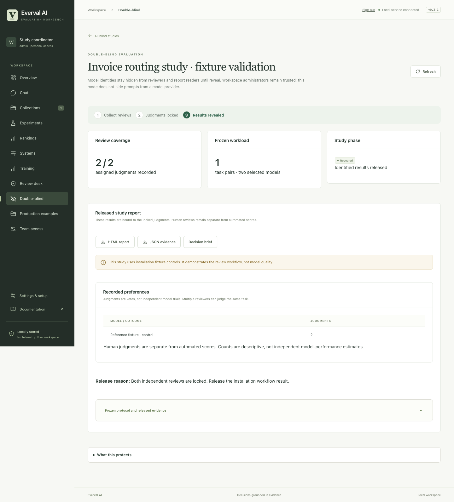

# Double-blind study workflow verification — 2026-10-26

This record verifies the source implementation's study lifecycle and access boundaries. It uses original fixture outputs and scripted reviewer actions, not independent human judgments or live model comparisons. It does not establish model quality or confidential-computing guarantees.

| Check | Result |
| --- | --- |
| Full ordinary Python suite | 1,416 passed; 46 optional integration checks skipped |
| Final study, API, legacy-review, CLI and terminal regressions | 56 passed after final admission/catalog changes; overlaps the full suite |
| Final chat, API and execution regressions | 76 passed after explicit TEE request blocking; overlaps the full suite |
| Browser unit tests | 54 passed across 13 files |
| Python lint, formatting and types | Passed; 205 Python files formatted, 97 source files type-checked |
| TypeScript and production browser build | Passed |
| Documentation links and whitespace | Passed |
| Native Chrome workflow | Create → review → lock → reveal → HTML/JSON download; passed with no JavaScript errors |

The Python skips cover opt-in Docker/Node runtime, authenticated GitHub, and separately pinned public-benchmark tooling. One test-client dependency deprecation warning was retained. These checks were not represented as completed integration coverage.

The adversarial suite exercises legacy report paths, revoked credentials, role changes, frozen assignments, incomplete coverage, stale fingerprints, post-lock mutations, audit rollback, concurrent actions, corrupted state, coordinator ownership, shared-source studies and escaped exports. Unsupported confidential-execution mode requests are rejected.

The actual browser exercise used separate temporary coordinator, reviewer and viewer sessions in an isolated workspace. It verified sealed results before reveal and read-only review controls after lock. Its owned server was stopped. The real workspace and its identities were not changed.

No model API calls were made. Development-service billing is outside Everval's provider ledger. Private QA workspaces, tokens and raw logs remain outside Git. The source feature has not been released in npm 0.3.1.

The screenshot shows two scripted judgments over an original installation control pair. It demonstrates the interface and retained evidence, not reviewer independence or model performance.

[Machine-readable summary](summary.json) · [Workflow and guarantees](../../double-blind.md)
