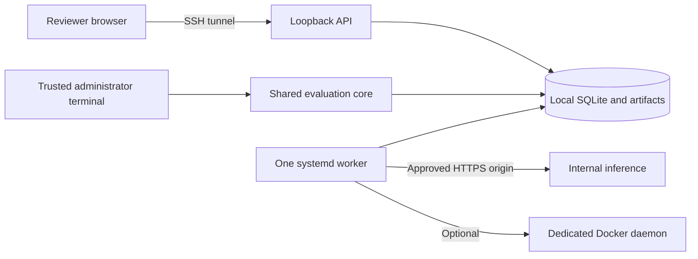

# Run Everval on your own infrastructure

Everval can keep benchmark definitions, repository mirrors, hidden graders, outputs, and reports on a dedicated host you control. An internal model endpoint can also keep inference inside your network. Local storage alone does not make a public model request local.

This guide supplies a **single-host deployment kit**, with one local SQLite workspace, one API, and one worker. The Linux systemd templates require validation on your target distribution; the portable preflight tests do not establish a tested Linux deployment. No service is installed or started automatically.

Operator workstations can also use the [npm distribution](npm.md), with explicit runtime setup and a disconnected wheelhouse. The service deployment below installs Python directly and does not require Node.js on the runtime host.

## The deployment



| Location | Owner and purpose |
| --- | --- |
| `/opt/everval/releases/REVISION` | Root-owned immutable application, environment, and deployment files. |
| `/opt/everval/current` | Root-owned symlink selecting one release. |
| `/var/lib/everval` | Service-owned mode 0700 workspace: database, artifacts, projects, and worker state. Local filesystem only. |
| `/var/cache/everval` | Service-owned mode 0700 cache. |
| `/etc/everval/everval.env` | Root-owned mode 0640, group `everval`; nonsecret policy. |
| `/etc/everval/provider-secrets.env` | Optional root-owned mode 0600 provider credentials, loaded by systemd. |

Use a dedicated Linux host or VM, a supported systemd release, Python 3.12+, and approved Git/SSH tools. Install tmux for administrator sessions. Repository execution also needs the supported Docker runtime; documents, structured data, and workflow checks do not require Docker. Keep at least 1 GiB free for the startup check and provision additional space for your workload.

## 1. Build a release on an approved builder

Use a builder matching the target Linux architecture, Python minor version, and libc. Install approved versions of uv, Node.js, npm, and Python's pip there. Check out a reviewed commit with repository access if required. The runtime host does not need GitHub, npm, PyPI, Node.js, or a build toolchain.

From that source checkout, in one shell:

```sh
set -eu
if [ -n "$(git status --porcelain)" ]; then
  printf '%s\n' 'Build from a clean, reviewed checkout.' >&2
  exit 1
fi
git rev-parse HEAD
uv sync --frozen
npm ci --prefix web
npm run build --prefix web
uv run python scripts/build_web.py

everval_bundle="$(mktemp -d /var/tmp/everval-bundle.XXXXXX)"
export EVERVAL_BUNDLE_DIR="$everval_bundle"
mkdir -p "$everval_bundle/wheelhouse" "$everval_bundle/deploy"
uv export --frozen --no-dev --no-emit-project --format requirements.txt \
  --output-file "$everval_bundle/requirements-runtime.txt"

python3 - <<'PY'
import os
import tomllib
from pathlib import Path
bundle = Path(os.environ["EVERVAL_BUNDLE_DIR"])
project = tomllib.loads(Path("pyproject.toml").read_text())
(bundle / "build.in").write_text("\n".join(project["build-system"]["requires"]) + "\n")
PY

uv pip compile --generate-hashes "$everval_bundle/build.in" \
  --output-file "$everval_bundle/requirements-build.txt"
uv build --wheel --build-constraints "$everval_bundle/requirements-build.txt" \
  --require-hashes --out-dir "$everval_bundle/wheelhouse"
python3 -m pip download --only-binary=:all: --require-hashes --no-deps \
  --dest "$everval_bundle/wheelhouse" \
  --requirement "$everval_bundle/requirements-runtime.txt"
git archive HEAD deploy/onprem | tar -x -C "$everval_bundle"
cp uv.lock web/package-lock.json "$everval_bundle/"
git rev-parse HEAD > "$everval_bundle/REVISION"
uv --version > "$everval_bundle/BUILD_TOOLS.txt"
python3 --version >> "$everval_bundle/BUILD_TOOLS.txt"
node --version >> "$everval_bundle/BUILD_TOOLS.txt"
npm --version >> "$everval_bundle/BUILD_TOOLS.txt"
```

Runtime dependencies come from the unchanged `uv.lock`; frontend dependencies come from `package-lock.json`. The build backend has its own generated, hashed lock retained in the bundle. Review that resolution too. Exporting locked requirements and requiring hashes lets an installer reject different distributions. [uv lockfile export](https://docs.astral.sh/uv/concepts/projects/export/), [uv build controls](https://docs.astral.sh/uv/concepts/projects/build/), [pip download](https://pip.pypa.io/en/stable/cli/pip_download/).

Create the application requirement and bundle checksums, verifying that the wheel contains the browser:

```sh
python3 - <<'PY'
import hashlib
import os
import zipfile
from email.parser import BytesParser
from pathlib import Path

bundle = Path(os.environ["EVERVAL_BUNDLE_DIR"])
wheels = list((bundle / "wheelhouse").glob("everval_ai-*.whl"))
assert len(wheels) == 1, "Expected exactly one application wheel"
wheel = wheels[0]
with zipfile.ZipFile(wheel) as archive:
    assert "cvals/static/index.html" in archive.namelist(), "Browser assets missing"
    metadata_name = next(name for name in archive.namelist() if name.endswith(".dist-info/METADATA"))
    metadata = BytesParser().parsebytes(archive.read(metadata_name))
digest = hashlib.sha256(wheel.read_bytes()).hexdigest()
runtime = (bundle / "requirements-runtime.txt").read_text()
(bundle / "requirements-install.txt").write_text(
    runtime + f"\n{metadata['Name']}=={metadata['Version']} --hash=sha256:{digest}\n"
)
files = sorted(path for path in bundle.rglob("*") if path.is_file())
(bundle / "SHA256SUMS").write_text("".join(
    hashlib.sha256(path.read_bytes()).hexdigest() + "  " + str(path.relative_to(bundle)) + "\n"
    for path in files
))
PY
```

Transfer the bundle through your approved internal artifact channel. Verify its checksum manifest against an independently authenticated release record; a manifest bundled with arbitrary files does not establish their origin. Keep the source commit, dependency locks, checksums, and build-tool versions with the release.

## 2. Install without runtime downloads

On the destination host, enter the transferred bundle directory and verify it. These commands assume the `everval` account and initial release do not already exist:

```sh
set -eu
sha256sum --check SHA256SUMS
everval_revision="$(cat REVISION)"
case "$everval_revision" in
  ''|*[!0-9a-f]*) exit 1 ;;
esac
everval_release="/opt/everval/releases/$everval_revision"

sudo useradd --system --user-group --home-dir /var/lib/everval \
  --shell /usr/sbin/nologin everval
sudo install -d -o root -g root -m 0755 /opt/everval/releases
sudo install -d -o root -g root -m 0755 "$everval_release"
sudo cp -R . "$everval_release/"
sudo uv venv --offline --no-python-downloads --python /usr/bin/python3 \
  "$everval_release/venv"
sudo uv pip install --python "$everval_release/venv/bin/python" \
  --offline --no-index --find-links "$everval_release/wheelhouse" \
  --no-build --require-hashes --strict \
  --requirement "$everval_release/requirements-install.txt"
sudo uv pip check --python "$everval_release/venv/bin/python"
sudo chown -R root:root "$everval_release"
sudo chmod -R go-w "$everval_release"
sudo ln -s "$everval_release" /opt/everval/current

sudo install -d -o everval -g everval -m 0700 /var/lib/everval /var/cache/everval
sudo install -d -o root -g everval -m 0750 /etc/everval
sudo install -o root -g everval -m 0640 deploy/onprem/everval.env.example \
  /etc/everval/everval.env
```

Use the absolute path to your approved uv executable if `sudo` cannot find it. The installed Python must satisfy the package's Python requirement. Missing compatible wheels must be resolved on the builder; do not remove offline or hash checks to make installation continue. Services execute the installed `venv/bin/everval` directly and never run `uv sync`, npm, or package installers.

## 3. Initialize and enable personal authentication

Run these locally before installing or enabling either service. The restrictive umask applies to the database as well as directories:

```sh
sudo -u everval env EVERVAL_DATA_DIR=/var/lib/everval \
  sh -c 'umask 077; exec /opt/everval/current/venv/bin/everval init'
sudo -u everval env EVERVAL_DATA_DIR=/var/lib/everval \
  sh -c 'umask 077; exec /opt/everval/current/venv/bin/everval team bootstrap --name "Workspace administrator"'
```

Bootstrap prints one personal administrator token once. Save it in your organization's secret manager. Do not redirect it into service logs. The initial token expires after 90 days; issue replacements and revoke superseded tokens through [Team access](team-review.md). Startup refuses a workspace without enabled team authentication and a usable administrator token.

Administrators manage identities and budgets. Operators curate and run benchmarks. Reviewers see only assigned items. Viewers see summaries and decision briefs. The CLI, TUI, operating-system account, and direct filesystem access remain trusted administrator surfaces; application roles do not restrict them.

## 4. Connect internal inference

Edit `/etc/everval/everval.env` to approve only the required origin:

```ini
EVERVAL_ALLOW_REMOTE_PROVIDERS=false
EVERVAL_INTERNAL_PROVIDER_ORIGINS=https://inference.corp.example:8443
EVERVAL_PROVIDER_CA_BUNDLE=/etc/everval/corporate-ca.pem
```

See [provider configuration](providers.md#internal-inference-and-private-certificate-authorities) for the complete endpoint contract. The origin has a scheme, hostname, and optional port; it has no path or wildcard. A system base URL can separately include `/v1`. The approved hostname must resolve exclusively to RFC1918 IPv4 or ULA IPv6 addresses. Link-local metadata addresses and unsafe mixed DNS answers are rejected. TLS verification remains enabled; the optional CA file adds your organization's CA to normal certificate trust. Install that file root-owned, readable by `everval`, and verify its fingerprint through your PKI process.

If the endpoint requires a credential, create the optional secret file using the template as a guide:

```sh
sudo install -o root -g root -m 0600 /dev/null /etc/everval/provider-secrets.env
sudoedit /etc/everval/provider-secrets.env
```

Add an assignment such as `CORPORATE_MODEL_KEY=...` with the actual value only on the host. Both services load this file: API admission currently verifies that the configured credential variable exists, while the worker makes requests. They run under the same trusted service identity; this is not a secret boundary between API and worker. Credentials do not belong in shared configuration, system definitions, benchmark inputs, or Git.

Register the endpoint through the browser's Systems page, or through an administrator session configured as below:

```sh
/opt/everval/current/venv/bin/everval systems add-http "Internal model" \
  --model YOUR_SERVED_MODEL --base-url https://inference.corp.example:8443/v1 \
  --api-key-env CORPORATE_MODEL_KEY --input-rate 0 --output-rate 0
```

Omit `--api-key-env` only when the endpoint does not require a key. Zero rates explicitly mean zero configured model cost, not zero infrastructure cost. Use your internal chargeback rates when appropriate; priced execution requires a positive per-experiment budget. Restart both services after changing credentials, origin policy, or CA configuration.

## 5. Validate and start services

Install the [supplied templates](../deploy/onprem/README.md):

```sh
sudo install -o root -g root -m 0644 deploy/onprem/everval-api.service \
  deploy/onprem/everval-worker.service /etc/systemd/system/
sudo systemd-analyze verify /etc/systemd/system/everval-api.service \
  /etc/systemd/system/everval-worker.service
sudo systemctl daemon-reload
sudo systemctl enable --now everval-api.service
sudo systemctl enable --now everval-worker.service
curl --fail http://127.0.0.1:8765/api/health
sudo systemctl status everval-api.service everval-worker.service
```

`ExecStartPre` checks the existing workspace, private permissions, root-controlled release tree, enabled team authentication, administrator access, disk headroom, and disabled public-provider policy. It does not initialize or repair a deployment. The API binds to loopback with `--no-worker`; the second unit owns the only durable worker.

The units use a non-root account, restrictive umask, a read-only system filesystem, private temporary storage, and explicit writable data/cache paths. Adapt and validate them on the target host; their protections depend on systemd and kernel support. [systemd execution settings](https://www.freedesktop.org/software/systemd/man/latest/systemd.exec.html).

The health endpoint should report `worker_mode: "dedicated"`. This establishes process liveness, not successful execution. Confirm a provider-free installation control progresses from queued to completed, then inspect its retained results before allowing real workloads. Keep paid execution and recurring policies disabled during commissioning.

## 6. Open the browser or terminal

From your workstation:

```sh
ssh -N -L 8765:127.0.0.1:8765 YOUR_APPROVED_HOST
```

Open `http://127.0.0.1:8765` and enter your personal token. Give each person their own SSH access policy and application identity. Do not expose port 8765 publicly.

For trusted administrators, first open an ordinary tmux session over SSH:

```sh
tmux new-session -s everval-admin
```

Inside it, run a transient administrator terminal with the service's environment:

```sh
sudo systemd-run --pty --wait --collect --uid=everval --gid=everval \
  --property=Type=exec --property=UMask=0077 \
  --property=WorkingDirectory=/var/lib/everval \
  --property=EnvironmentFile=/etc/everval/everval.env \
  --property=EnvironmentFile=-/etc/everval/provider-secrets.env \
  /opt/everval/current/venv/bin/everval tui --no-worker
```

Detach the outer tmux session with **Ctrl+B, D**. Use `tmux attach-session -t everval-admin` to return. The systemd worker continues independently. The built-in `everval tmux` launcher manages its own worker; use the explicit `tui --no-worker` path here. The same `systemd-run` prefix can run trusted CLI commands, replacing `tui --no-worker`. [systemd transient services](https://www.freedesktop.org/software/systemd/man/latest/systemd-run.html).

## 7. Set egress and execution boundaries

| Phase or function | Network needed |
| --- | --- |
| Approved build and packaging | Approved Git source, npm registry, Python index, and build dependencies; use internal mirrors where required. |
| Offline installation and UI assets | None after the bundle and approved tools arrive. |
| Browser access | SSH to the host; browser requests traverse the loopback tunnel. No CDN assets. |
| Internal model evaluation | Internal DNS and HTTPS to explicitly approved inference origins. |
| Repository onboarding | Explicit Git/GitHub endpoints when fetching; use reviewed local imports and prepared artifacts when offline. |
| Dependency/image preparation | Explicit registry access during preparation, or inspected offline archives and loaded images. |
| Grading in prepared containers | The supported isolated runtime's controlled offline policy. |
| Host operations | Organization-managed DNS, time synchronization, updates, backups, and log destinations. |

Enforce this matrix with your host/network controls. The model origin policy restricts model requests; it does not implement a host-wide firewall or restrict every Git/Docker operation. There is no automatic telemetry or result publication.

For repository tasks, use a dedicated reviewed Docker daemon. Configure its socket explicitly and grant the service identity access deliberately. Docker socket access can confer host-level control through the daemon; filesystem hardening of the client process does not remove that privilege. A dedicated host or VM limits the affected infrastructure. Do not give imported code host execution as a workaround for missing sandbox capabilities. Rootless Docker, remote daemons, and altered security profiles need their own compatibility verification.

## 8. Budgets, monitoring, and maintenance

Set workspace caps before enabling paid work; for example, in a trusted configured administrator session:

```sh
/opt/everval/current/venv/bin/everval spending set --daily 25 --monthly 200
/opt/everval/current/venv/bin/everval schedules list
/opt/everval/current/venv/bin/everval autopilot list
```

Those dollar limits are examples. A zero cap blocks priced admissions; zero-rate internal inference still needs an operational capacity policy. Review per-experiment, schedule-lifetime, and project limits. Unknown usage remains reserved, and failed or incomplete attempts remain recorded.

Use `journalctl -u everval-api -u everval-worker`, `systemctl status`, the health endpoint, and durable job progress together. The standalone worker writes stdout to the journal in this deployment. Keep journals and backups restricted and apply your retention policy; diagnostic records can contain proprietary work. Never enable environment or credential dumps in monitoring.

Pause recurring schedules and Autopilot policies before planned maintenance. Stop new browser and terminal admissions, stop the API, allow active work to finish, then stop the worker. The worker stops admitting new cycles after its termination signal but can finish an active operation; the template gives it up to one hour. Forced termination can leave uncertain provider usage, which must remain reserved and be reviewed before any new attempt. Pausing a schedule does not cancel already queued work.

## 9. Back up and rehearse restoration

A complete backup includes the consistent database and the entire stopped workspace directory, including `artifacts`, `projects`, `dependency-artifacts`, and `environments`. Offline dependency bytes are durable evidence too. Retain applicable prepared images and their inventories, the release identifier, and protected configuration. Store credentials separately in your secret manager. Encrypt backups according to your organization's policy.

For a coherent offline snapshot, pause all recurring producers, prevent new admissions, stop the API, drain and stop the worker, and close administrator sessions. Review queued jobs again after writers have stopped. Create a backup directory accessible only to the service account:

```sh
sudo install -d -o everval -g everval -m 0700 /srv/everval-backups
sudo -u everval env EVERVAL_DATA_DIR=/var/lib/everval \
  /opt/everval/current/venv/bin/everval backup \
  --output /srv/everval-backups/REPLACE_WITH_UNIQUE_DATE.sqlite3
```

The backup command refuses to overwrite an existing file. Archive the complete workspace while all writers remain stopped; keep its matching consistent SQLite backup alongside it. Preserve ownership, permissions, hashes, and the release revision. Use a restricted backup destination and an unused archive filename. The SQLite backup command alone does not copy external files or Docker images.

Rehearse restoration to a **separate, isolated local workspace** with no worker, provider credentials, public access, or inference egress. Restore the complete matching workspace contents, including offline dependency and environment directories, with private ownership and permissions; install the consistent database backup as `workspace.sqlite3`. When substituting this standalone backup, omit or remove only the restored destination's `workspace.sqlite3-wal` and `workspace.sqlite3-shm` while every destination process is stopped. Those archived sidecars belong to the original database generation and must not be mixed with the replacement. Preserve the separately recorded prepared-image IDs and load the required images before any execution. Use the matching application release and `serve --no-worker` on a separate loopback port. Check collection fingerprints, experiment evidence, audit verification, and representative local artifacts.

Before any restored worker starts, list and pause every restored schedule and Autopilot policy:

```sh
everval schedules list
everval schedules pause SCHEDULE_ID
everval autopilot list
everval autopilot configure POLICY_ID --paused
everval jobs list
```

Here `everval` means the installed executable with `EVERVAL_DATA_DIR` selecting the restoration workspace. Also inspect queued/running experiments, change subscriptions, and optimization work; retain or cancel them explicitly. A backup cannot know which external model calls occurred after it was taken. Reconcile that gap and the worker lease before enabling execution. Never start the restored worker merely to see whether the backup opens.

## 10. Upgrade and roll back deliberately

Prepare and verify a new immutable release without changing `current`. Pause recurring producers, drain work, stop both services, and take a complete matching-data backup. Test the new release against a copy first; opening the workspace can apply schema initialization or migrations.

Switch the root-owned `current` symlink atomically on the same filesystem, then start the API first and verify authentication/evidence. Start the worker only after reviewing pending work and budget reservations. Retain the previous release and snapshot.

Rollback may require restoring the **matching data snapshot**, not only changing the executable symlink. Preserve the failed-upgrade workspace for inspection. Restore with the same paused-schedule and uncertain-request procedure; never replay external work automatically.

## Verification

The [dated feature verification](evidence/2026-10-16/README.md) records automated checks, package inspection, interface verification and the Linux commissioning steps that remain unexecuted.

## Supported boundary

This kit is a practical starting point for one trusted host and workspace. It does not provide SSO, tenant isolation, distributed workers, high availability, a supplied TLS reverse-proxy configuration, or compliance certification. An organization's deployment review, Linux service verification, restore drill, and workload-specific sandbox tests remain necessary before operational use.

Continue with [team access](team-review.md), [operations](operations.md), [guided repository evaluation](guided-run.md), and [cost and latency](cost-latency.md).
