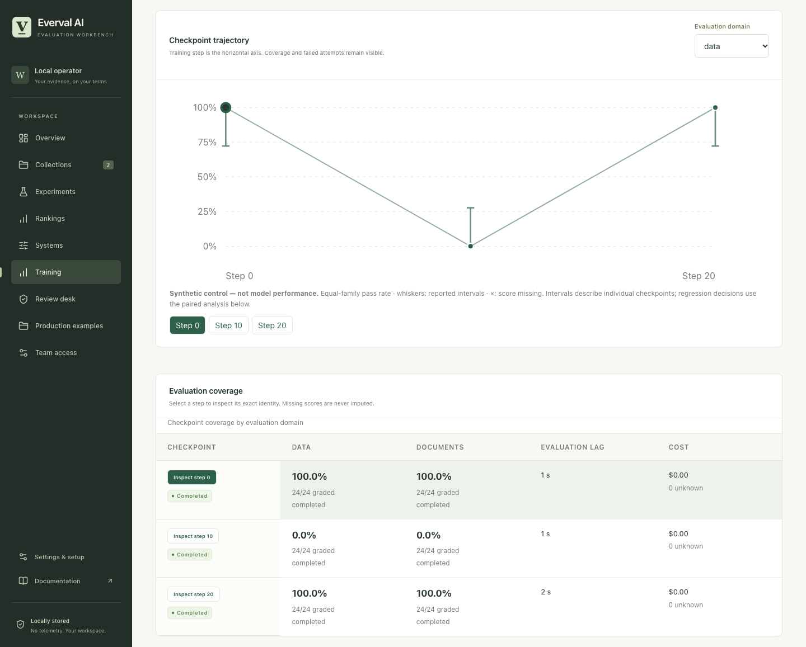

# Follow model quality through post-training

Everval connects a declared training run to checkpoint identities, frozen evaluations,
bounded worker jobs, and retained regression decisions. Researchers can inspect the
same evidence in the terminal, browser, CLI, and API.

This workflow is available in the current source checkout. The published npm
`everval-ai@0.3.1` package predates it. Follow the [source quickstart](quickstart.md)
until a newer packaged release is published.

## Try the complete workflow without a model

From the source checkout:

```sh
uv sync --frozen
uv run everval training demo
```

The command creates a separate workspace and prints its location. It runs three
**synthetic checkpoints** across two original fixture collections: a passing
reference, an empty submission, and a restored reference. It also retains a
fixed-output regrade, an investigation, a qualification with visible gaps, and
an evaluation-mix control that deliberately misses a withheld regression.

No model is trained or called. No human calibration study is represented.
The mix observations and costs are invented controls, not provider spending or
research results. A restored reference can remain **inconclusive**: observing
no difference is not enough evidence to establish equivalence.

To inspect the generated workspace, substitute its printed path:

```sh
EVERVAL_DATA_DIR=/path/from/demo uv run everval tui
EVERVAL_DATA_DIR=/path/from/demo uv run everval serve --no-worker
```

Press **Ctrl+T** for Training in the terminal, or choose **Training** in the
browser. Select a run and checkpoint to inspect the timeline, exact source
experiments, completion coverage, evaluation lag, known costs, decisions,
qualification gaps, and investigation notes. Empty cells stay empty rather than
becoming zero scores. Stale decisions and stale investigations are marked.



The [verification record](evidence/2026-10-22/post-training.md) documents the
engineering checks and their limits.

## Connect a real training run

The training process and inference service remain under your control. Everval
does not load weights, run optimization, or change a training job. Its role is
to evaluate an explicitly configured checkpoint deployment.

1. Create reviewed development collections using the [scenario format](scenarios.md).
   Assign related scenarios to the same task family: repeated templates,
   repositories, or source documents must not become fictitious independent samples.
2. Configure an [agent adapter](agent-adapters.md) or compatible
   [inference system](providers.md). Use an immutable model/deployment revision per
   checkpoint. The adapter must serve the requested revision and enforce its limits.
3. Declare the baseline step, candidate steps, evaluation domains, thresholds,
   repetitions, and budget before collecting the comparison outcomes.
4. Export finalized checkpoint manifests and admit their evaluation jobs.
5. Let the existing worker execute the jobs. Ready planned comparisons are
   finalized automatically; explicit analysis is also available.

The exact request schemas are available without creating a workspace:

```sh
uv run everval training schema run
uv run everval training schema checkpoint
uv run everval training schema qualification-evidence
```

A run request contains:

| Field | Meaning |
| --- | --- |
| `training_run_id` | Your stable training-run identity; reusing it with different content is rejected. |
| `provenance_kind` | `declared_training` for a real externally operated run; `synthetic_control` for installation exercises. |
| `training_config_sha256` | Digest of your reviewed training configuration. |
| `provenance` | Origin, model/data revisions, permissions, and relevant limits of the declaration. |
| `protocol.domains` | Names, collection IDs, complete scenario-to-family mappings, and practical regression thresholds. |
| `protocol.baseline_step`, `comparison_steps` | Fixed comparison grid. Out-of-order arrival is supported; unplanned steps are rejected. |
| `protocol.alpha`, `max_looks`, `min_clusters` | Error budget, maximum planned comparisons, and minimum independent-family count. |
| `protocol.inference_scope` | Defaults to `exploratory`. `predeclared` requires an `independence_statement`. |
| `protocol.repetitions` | Repeated attempts within each scenario; these do not create new independent families. |
| `protocol.budget_per_domain_usd`, `lifetime_budget_usd` | Per-experiment ceilings and the run's cumulative allocation ceiling. |

Create the run from your reviewed JSON:

```sh
uv run everval training create --file training-run.json
uv run everval training list --limit 100 --offset 0
uv run everval training system-hash YOUR_SYSTEM_ID
```

The run snapshots its collections. Subsequent collection or system edits do not
rewrite admitted evidence. Monitoring rejects protected holdout collections;
continuous reuse would compromise their role as a final untouched assessment.

### Export from a trainer

Call the Python helper after your trainer has completely written a checkpoint
and you have configured the matching inference system. Create a dedicated manifest
directory outside the checkpoint artifact first. Replace the example identifiers with your actual values:

```python
from pathlib import Path
from cvals.training_ingestion import export_checkpoint

export_checkpoint(
    Path("/srv/everval-manifests/step-100.json"),
    weights=Path("/srv/training/checkpoint-100"),
    step=100,
    system_id="checkpoint-100-system",
    expected_system_hash="REPLACE_WITH_TRAINING_SYSTEM_HASH",
    revision="checkpoint-100",
    provenance="Run identifier, training/data revisions, and deployment details.",
)
```

The helper reads bytes without deserializing a model. A single file uses its
SHA-256. A directory uses SHA-256 of a canonical, sorted manifest of relative
paths, file sizes, and file SHA-256 values, with format
`everval-checkpoint-tree-v1`. Symlinks and special files are rejected; the
directory limit is 4,096 files. Export only finalized, immutable artifacts.

Manifest writes are private and atomic. Identical retries are safe; conflicting
content is rejected. The helper does not send weights to Everval or a remote service.

Import once, then optionally follow the directory:

```sh
uv run everval training ingest RUN_ID /srv/everval-manifests
uv run everval training ingest RUN_ID /srv/everval-manifests --queue --follow
```

Without `--queue`, ingestion only registers metadata. With `--queue`, it
admits each checkpoint once through the existing worker and budget controls.
The watcher processes up to 1,000 bounded JSON manifests and stops on invalid
input instead of silently skipping it. Ctrl+C stops watching; already admitted
work remains in the durable queue.

For explicit single-checkpoint control:

```sh
uv run everval training checkpoint RUN_ID --file checkpoint.json
uv run everval training queue RUN_ID CHECKPOINT_ID
uv run everval training analyze RUN_ID CHECKPOINT_ID
uv run everval training show RUN_ID
```

For a single-turn system, `revision` must equal its saved model identifier. For an
external adapter it must equal `adapter_revision`. Reusing a weight digest at a
different step is rejected.

A checkpoint digest and deployment revision are declarations. Byte hashing verifies
the artifact you supplied; it does not independently attest that a remote endpoint
is serving those weights. Single-turn APIs generally provide weaker deployment
attestation than a revision-enforcing adapter.

## Read a regression decision

Comparisons pair the same frozen scenario/repetition identities. They average
repetitions within scenarios, scenarios within families, and families equally.
Related observations do not narrow the interval by being counted as independent
tasks. Complete grades and compatible execution conditions are required.

The interval uses a conservative bounded-data method with the run's error budget
allocated across planned comparisons and domains. A regression requires evidence
that the change exceeds the declared practical threshold. An inconclusive result
does not establish safety, equivalence, or improvement.

The chart's descriptive intervals and a comparison's multiplicity-adjusted
interval answer different questions. Inspect the comparison before interpreting
an alert. Numerical intervals depend on independence and frozen measurement
assumptions; repeated-look correction does not fix adaptive training on the same
benchmark. Exploratory monitoring is the default. Declaring a predeclared scope
does not prove its assumptions, and a new run does not erase earlier exploration.

Missing grades, cancellations, infrastructure errors, changed inference settings,
and unavailable cost data remain visible. Full experiment ceilings stay allocated;
unused or uncertain allocation is not recycled automatically. Unknown accounting or
charges above a frozen allocation block new live work, including previously queued
HTTP trials. Known partial charges remain part of the conservative commitment.
Provider accounting
does not include external training, hosting, or development-service bills.

Read the [measurement methods](posttraining-methods.md) for the estimand,
assumptions, decision boundaries, and limitations.

## Qualify evaluations and investigate changes

Qualification records describe what an evaluation claims to measure, who owns it,
its intended population and rubric, versioned controls, repeated grades, blinded
human-reference judgments, adjudication, and floor/ceiling saturation.

```sh
uv run everval training schema qualification
uv run everval training schema qualification-evidence
uv run everval training qualify RUN_ID --file qualification.json
```

The qualification's `task_version` must match the frozen collection version, and
`grader_version` must match the frozen grader revision (currently `deterministic/1`).

Use actual controls and judgments. Structural mutations alone do not establish
semantic validity. The result is a list of gaps or readiness for researcher review,
never automatic trust. Supplied judgments and claims of blinding are not
independently attested. Later qualification records do not silently rewrite the
qualification snapshot attached to an earlier decision.

Investigations attach observations, competing explanations, next checks, and a
recommendation to an exact comparison. Existing repeated regrades can be linked
only when they belong to the comparison's experiments:

```sh
uv run everval research repeat EXPERIMENT_ID TRIAL_ID --repetitions 3
uv run everval training schema investigation
uv run everval training investigate RUN_ID --file investigation.json
```

To isolate a scorer revision from changed model outputs, supply old/new grades
for the same item IDs and output digests:

```sh
uv run everval training schema grader-drift
uv run everval training grader-drift --file grader-drift.json
```

This reports pass-to-fail and fail-to-pass flips even if the aggregate score stays
unchanged. It does not execute either grader or establish which one is correct.
Retain the report with your investigation and cite its evidence digest.

## Study the evaluation mix

The mix workflow selects an inexpensive suite using development measurements.
It also freezes random and domain-stratified baselines under the same cost ceiling.
Protected domains retain coverage. The full suite is a reference measurement,
not unquestionable ground truth.

```sh
uv run everval training schema mix
uv run everval training schema mix-observation
uv run everval training schema mix-config
uv run everval training mix RUN_ID --file development-study.json
uv run everval training validate-mix RUN_ID SELECTION_ID --file validation.json
```

The selection request includes a validation manifest containing checkpoint, family,
evaluation, and domain identities, without validation outcomes. It is frozen
before validation. Validation must cover that grid exactly, with disjoint
development/validation checkpoints and task families. Null outcomes or costs
remain unknown; rows cannot be dropped to improve the reported result. A selection
has one immutable validation result, with identical retries permitted. Within one
run, reserved validation checkpoint and family IDs cannot become development data
in a later selection; previously observed development identities cannot become a
new withheld set. These guards cannot detect reuse outside the recorded run.

Reports retain detection recall, false alerts, magnitude error, missed/unknown
cases, and cost completeness for every strategy. These are descriptive threshold
crossings, not statistically powered superiority claims. Selection is a transparent
greedy heuristic, not a global optimum. Random baselines are single seeded draws.
A retrospective export cannot prove that its author had not seen validation data.

Use the [study protocol](../examples/post-training/STUDY.md) to plan actual checkpoint
research with independent runs and a fixed analysis plan.

## Deployment and access

The existing single-host workspace, SQLite worker, service account, backup,
authentication, and provider-origin controls apply. Training routes require
`workspace.read` or `workspace.write` permissions, currently operator/admin.
Terminal access remains a trusted administrative surface.

Run creation/listing uses `/api/training/runs`. Other paths start at
`/api/training/runs/{run_id}`: the run itself,
`/checkpoints`, `/checkpoints/{checkpoint_id}/queue`,
`/checkpoints/{checkpoint_id}/analyze`, `/qualifications`, `/investigations`,
`/mix`, and `/mix/{selection_id}/validate`. Use the CLI schemas to inspect
request bodies. No route automatically publishes results or changes training.

Run requests support up to 20 domains, 100 candidate steps, 1–10 repetitions,
and 1,000 scenario-to-family entries per domain. Frozen protocol snapshots are
limited to 16 MiB, CLI JSON requests to 5 MiB, and mix requests to 20,000 rows per
partition. The mix selector supports at most 64 evaluations and 256 development
checkpoints. Run lists default to 100 entries and support offset pagination.

This implements checkpoint evaluation operations on the supported local worker.
The [completed local research study](benchmarks/checkpoint-study-2026-10-22/results.md)
runs three real QLoRA training seeds and evaluates twelve saved checkpoints
through this workflow. It retains 3,072 model responses privately and publishes
aggregate results, lineage hashes, plots, and [reproduction instructions](../scripts/posttraining/SETUP.md).
Its inspected local artifacts do not establish remote weight attestation,
distributed-fleet scale, customer-workload generalization, or autonomous training intervention.

The study's [post-analysis review](benchmarks/checkpoint-study-2026-10-22/post-analysis-review.json)
retains twelve qualification records and three investigations, including
180 repeated grades of 60 saved model outputs. The deterministic controls agree,
but no human calibration was collected and floor/ceiling saturation remains
visible. These later records do not retroactively change the frozen comparisons.


*The real study workspace, viewed through a read-only database copy after
evaluation and review. The no-key walkthrough above remains a separate synthetic control.*
