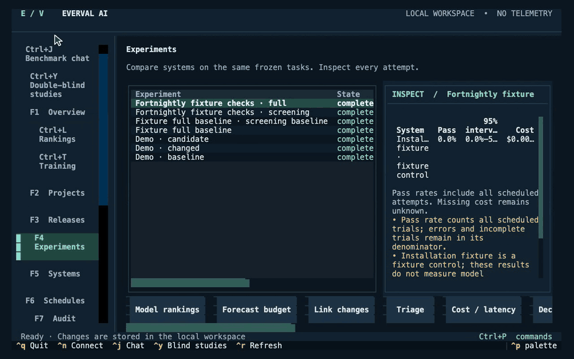
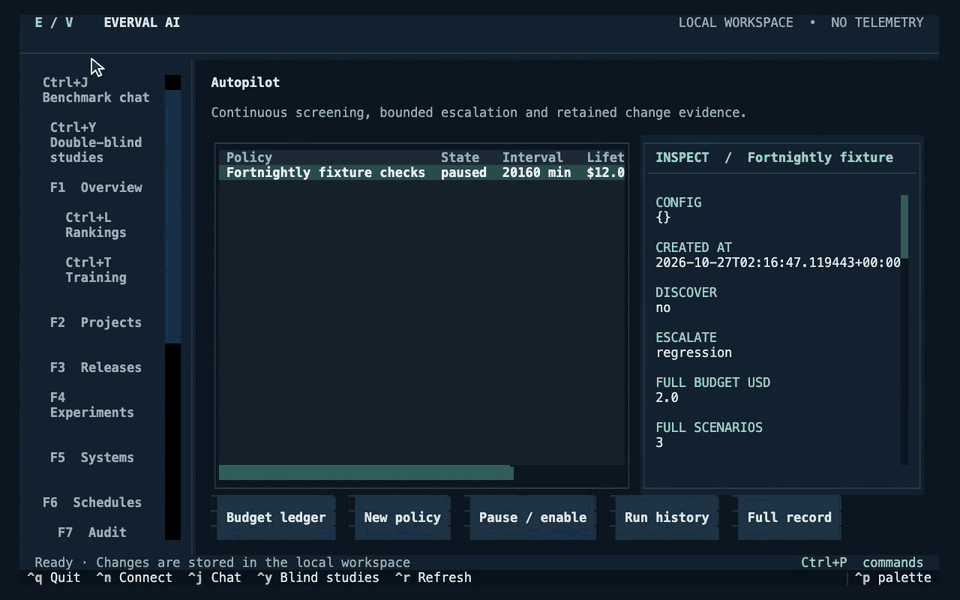
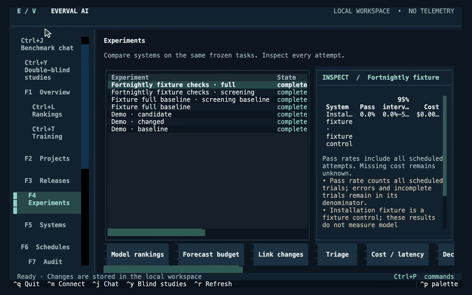

# A tour of Everval

[Documentation](index.md) · [Quickstart](quickstart.md) · [Roadmap](../ROADMAP.md)

Everval helps a team answer a specific question: did a change make an agent better at the work that matters, within the available budget?

Watch the [animated gallery](demos.md) or browse the [still-image version](demo-stills.md).

For concrete owners and decisions, see [practical use cases](use-cases.md).

The terminal workbench is the main interface. Use the CLI for scripts, the shared API for integrations, and the optional browser for authenticated reviews. All four use the same local records.

## 1. Turn work into a testable contract

Connect a GitHub or local repository. Review candidate changes, describe the desired behavior independently, prepare an isolated runtime, and validate the reference repair. The original state must fail, the repair must pass, and selected baseline behavior must remain intact.

Document, data, and workflow tasks start with explicit instructions and independently reviewed expected behavior. They are curated separately from repository history. Portable packs preserve licenses, provenance, and runtime requirements.

**Try it:** [Repository walkthrough](guided-run.md) · [Three runnable examples](../examples/community/README.md) · [Author a task](scenarios.md)

## 2. Compare changes on the same workload

Freeze a benchmark and select systems, repetitions, and a spending ceiling. Each attempt keeps its outcome, errors, timing, accounting, and revisions. Failed and incomplete attempts stay in the denominator. Missing usage stays unknown.

Open **Rankings** (**Ctrl+L** in the terminal) for a visual model-by-benchmark matrix. Switch quality, cost per success and P95 latency, then select a cell to inspect its exact run. [Read the matrix →](rankings.md)

Compare success rate, cost per passing attempt, provider time, and total attempt duration. Inspect the supported uncertainty estimate and task coverage before deciding that a difference matters.

**Try it:** [Cost and latency](cost-latency.md) · [Decision policies](policies.md) · [Existing agent adapters](agent-adapters.md)

## 3. Keep checking within a budget

Autopilot can watch configured changes or intervals, reserve a cumulative budget, run a smaller screening workload, and escalate to a full development run when its policy calls for it. Duplicate triggers are retained without starting duplicate work.

The budget ledger separates observed spend, outstanding reservations, and projections. Unknown charges retain reservations and halt the affected automation. Estimates describe their pricing and workload assumptions.

**Try it:** [Autopilot](autopilot.md) · [Budget projections](budget-planning.md) · [Change-linked runs](change-evaluation.md)

## 4. Investigate and improve deliberately

Inspect failed attempts, reproduce supported pure-grader outcomes, and reduce stored outputs while preserving an observed failure. These investigations reuse saved evidence without another provider call.

Compare saved model, prompt, or tool-budget candidates on development tasks. Reserve an unused holdout for a final check of the selected candidate. The result is a reviewable proposal; a study does not deploy a configuration.

**Try it:** [Research lab](research-loop.md) · [Failure investigation](diagnostics.md) · [Quality policies](policies.md)

## 5. Make a decision others can inspect

Assign blinded browser reviews with a frozen rubric and personal reviewer identities. Retain judgments alongside automated results. The terminal remains a trusted operator surface; browser roles restrict access for administrators, operators, reviewers, and viewers.

Export a local decision brief or a deliberately limited evidence summary. Inspect it before sharing. Full experiment exports and grading bundles can contain private work.

**Try it:** [Team review](team-review.md) · [Results](results.md) · [Share a summary](demo.md#share-a-deliberate-summary)

## Pick a starting point

| You are evaluating | Start here |
| --- | --- |
| A coding agent on historical engineering work | [Guided repository run](guided-run.md) |
| A document or RAG assistant | [Document example](../examples/community/documents/README.md) |
| A data analysis agent | [Data example](../examples/community/data/README.md) |
| A workflow agent's proposed state changes | [Scenario contracts](scenarios.md) |
| An agent you already operate | [Live adapter protocol](agent-adapters.md) |
| Checkpoints from a post-training run | [Checkpoint monitoring](post-training.md) and [measurement methods](posttraining-methods.md) |
| A model or prompt change over time | [Autopilot](autopilot.md) and [research lab](research-loop.md) |

Screenshots show original installation fixtures. They demonstrate working interfaces, not model quality or customer outcomes. The [acceptance record](evidence/2026-10-15/README.md) separates live-provider trials, local controls, and deployment limits.
