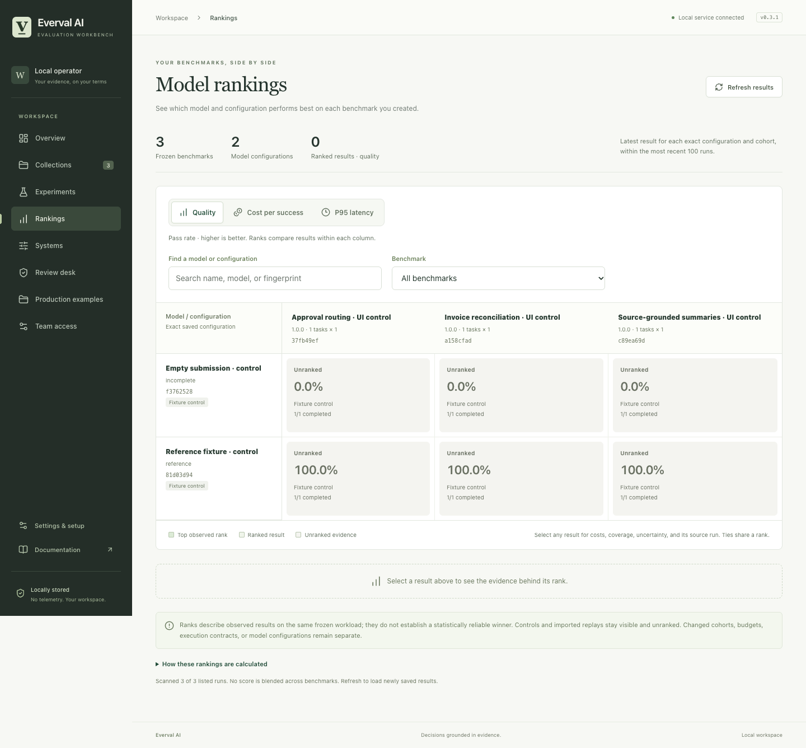

# Model rankings across your benchmarks

Open **Rankings** in the terminal with **Ctrl+L**, choose **Rankings** in the browser, or run:

```sh
everval rankings
everval rankings --metric cost
everval rankings --metric latency
everval rankings --limit 500 --json
```

This is a read-only view of saved experiments. Opening it makes no model calls, starts no jobs, and sends no results outside the workspace.



*The working browser view with declared installation controls, which remain unranked. Eligible model runs display numerical ranks in the same cells.*

## Read the matrix

Each row is one frozen model or agent configuration. Each column is one frozen benchmark and execution contract. A cell shows the observed metric, its rank within that column, and how many scheduled attempts received a completed grade. Color helps scanning; numbers and labels carry the same information.

| View | Cell value | Ranking |
| --- | --- | --- |
| Quality | Passed attempts / all scheduled attempts | Higher pass rate first |
| Cost | Complete recorded cost / passing attempts | Lower cost per success first |
| Latency | P95 recorded attempt duration | Lower P95 first |

Equal observed values share ranks: **1, 1, 3**. A dash means no matching saved run. **Unranked** means evidence exists but does not meet that metric's eligibility requirements. Controls and imported submissions remain visible and clearly labeled.

In the terminal, use the arrow keys to choose a cell, **1/2/3** to change metrics, **Enter** to inspect its evidence, and **O** to open the source run. The table scrolls horizontally for many benchmarks. In the browser, filter models or benchmarks and select a cell for details and the source experiment.

## Keep comparisons meaningful

Everval separates changed collection contents, execution contracts, requested or observed verifier images, repetition counts, campaign budgets, and the number of systems sharing the campaign. The column's fingerprint identifies the exact cohort. A prompt, model, harness, pricing or other saved configuration change creates a separate row; names alone never merge evidence.

For each row/column pair, the view selects the **latest run by creation time**, using its identifier to break timestamp ties. It never picks the best result or replaces an incomplete latest run with an older success. If a newer attempt lacks complete execution or verifier-image evidence, earlier results for that configuration and requested contract also lose their ranks; the evidence identifies the newer run. Fully observed, completed image variants remain separate comparisons.

Quality ranks require a finalized HTTP-system run and a completed grade for every scheduled attempt. Infrastructure errors, cancellations and unfinished work remain visible but unranked. Cost additionally requires complete accounting and at least one success. Latency additionally requires complete timing. A cheap failed run cannot win a cost-per-success ranking.

Partial cost remains a known lower bound, never a free run. External adapters' durations measure the adapter request; their internal stages are self-reported. Pass-rate intervals and coverage are available in the evidence details. Repeated tasks are not independent samples, and neither ranks nor intervals establish representative superiority.

## Scope and access

The default view scans the latest **100 saved experiments**, bounded to **500** through the CLI/API. The window and any truncation are reported. Older runs may be absent; this is not an unlimited historical archive. Unreadable recent evidence causes ranks to be withheld rather than silently selecting favorable older evidence.

Rankings summarize experiments created in the product workspace. Standalone research exports, including the separately published public-repository pilot, are not automatically imported into the experiment store.

There is no combined rank across unrelated benchmarks. Use the matrix to find tradeoffs, then inspect compatible experiments with [comparison and decision policies](policies.md) and [cost analysis](cost-latency.md).

The API endpoint is `GET /api/rankings?limit=100`. Team mode requires `workspace.read`: administrators and operators may access it; blinded reviewers and summary-only viewers may not. The metadata response excludes task inputs, instructions, hidden checks, reference solutions and complete provider configurations. Model names, cohort metadata and experiment identifiers are still workspace information.

[Terminal guide](terminal.md) · [Results](results.md) · [On-premises deployment](on-premises.md)
